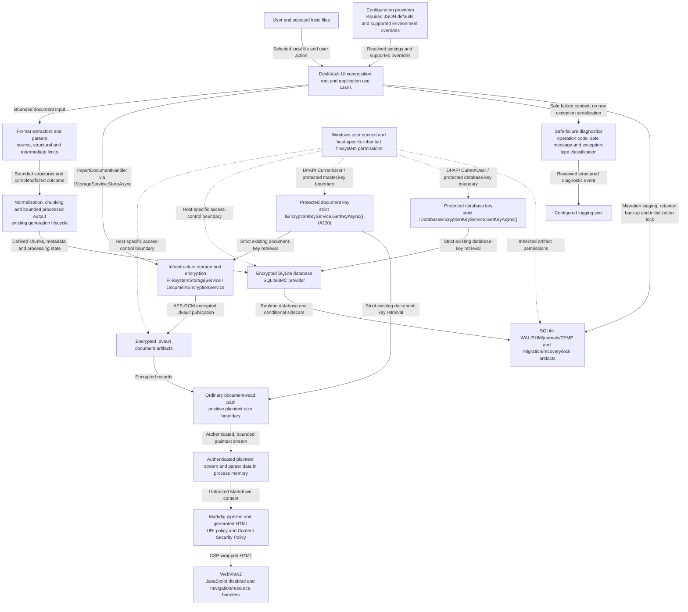

# DeskVault MVP2 Security Threat Model

## 1. Document Control

| Property | Value |
|---|---|
| Document | MVP2 Security Threat Model and Integrated Control Evidence |
| Status | Integrated assessment completed and merged; control-specific evidence limitations and open follow-ups remain explicit in Sections 10, 11, 14 and E-27/E-28. |
| Baseline Technical Task | #230 — Establish MVP2 threat model and security control baseline |
| Integrated verification task | #235 — Validate MVP2 security controls against the threat model |
| Parent PBI | #221 — Strengthen DeskVault Security Against Common Threats |
| Historical source baseline | `49d3e3f29cab423383d2feb0b07b8c58b44f6e10` |
| Historical integrated assessment revision | `7e7f6eb41ed368915b598f3e19d9fafd5b105a19` (31 October local assessment baseline recorded in E-27) |
| Integrated implementation commit | `5abd9e70a50f880246fc8bd67550f74ffa635749` |
| Post-merge `main` revision | `01471b5839bc4c140ee23065ad988a98e77e5bc5` (PR #341 squash merge) |
| Post-merge verification date | 2026-11-02 |
| Baseline date | 2026-10-26 |
| Integrated assessment date | 2026-10-31 |
| Primary implementation platform | Windows desktop, .NET |
| Integrated validation environment | Windows; .NET 10.0.14 x64; WebView2 Runtime 156.0.4314.50 for the executed browser tests |
| Architecture goal | Offline-first document and knowledge platform |
| Completed implementation PRs | #325, #326, #327, #328, #329 and #330 are merged; their Build and Test workflows succeeded. |
| Integrated verification PR | #341 is merged; its five reported PR checks passed (E-28). |
| Integrated verification owner | #235 |
| Intended audience | Product engineering, architecture, security review, and portfolio reviewers |

This document is the authoritative MVP2 threat model and cross-cutting security control baseline for DeskVault. E-01 through E-19 retain historical source observations; E-20 through E-26 retain task-level implementation evidence; E-27 records the distinct integrated assessment for #235.

It documents the supported security model, sensitive assets, trust boundaries, attacker assumptions, threat scenarios, risk-prioritization decisions, implementation ownership, executed validation evidence, unresolved gaps, and residual-risk disposition.

It is an engineering threat model and evidence assessment, not a penetration-test report, certification, or claim that the application has passed a comprehensive security assessment. A passing test, merged pull request, or successful CI run proves only the behavior and revision it actually exercised.

**Assessment boundary:** E-27 is the historical 31 October local working-tree assessment and retains the exact revision, environment, test executions, and limitations recorded at that time. E-28 records the subsequent PR #341 checks, squash merge, and post-merge repository verification on 2026-11-02. The completed PR/CI gate establishes integrated evidence completeness; it does not convert any scenario recorded as unexecuted or insufficiently evidenced in E-27 into a passed control.

## 2. Executive Security Assessment

DeskVault is a local-first knowledge platform for storing, processing, searching, and viewing sensitive documents. The MVP2 security baseline now has completed implementation changes for configuration composition and secret handling, sensitive-data-safe diagnostics, parser resource boundaries, ordinary document reads and reconciliation, filesystem/SQLite auxiliary-artifact protection, and untrusted Markdown rendering. Their implementation pull requests #325 through #330 are merged.

The integrated local verification for #235 succeeded: the full solution build completed, and the full solution test suite passed **1,552 tests, 0 failed, 0 skipped**. Each of the five test projects also passed its complete suite; the exact counts, focused security selections, runtime observations, and merged-PR CI evidence are preserved in E-27. These results are not added to or substituted for the historical task-level counts in E-20 through E-26.

The integrated assessment does not declare every control fully verified. The control register in Section 11 is authoritative for each control's separate implementation, verification, and residual-risk status. In particular:

1. The configuration inventory and secret-pattern review are bounded and heuristic; they do not prove that every possible deployment artifact is free of secrets.
2. Parser and reconciliation controls impose operation-specific limits, not a strict process-wide memory/CPU ceiling or global reconciliation time, cumulative-byte, finding-count, or consistent-snapshot guarantee.
3. WebView2 runtime behavior is now exercised by five focused tests. The initial-document test configures `AllowRawHtml=true` and supplies script markup; it verifies that JavaScript remains disabled and the script marker does not execute, but it does not assert that a script element remains in the generated DOM. The runtime suite does not exercise every URI variant or an actual click on a rendered Markdown anchor.
4. Filesystem ACL evidence is host- and artifact-specific. It is not a complete Windows effective-access calculation for every identity, group, host, or location.
5. Some SQLite auxiliary-artifact variants and abrupt-crash, power-loss, or concurrent-state scenarios remain unmaterialized or unexecuted.
6. Copied-vault behavior has not been tested under the original profile, a different Windows profile, or another device. DPAPI `CurrentUser` is not represented as universal device binding.
7. PR #341 for #235 was squash-merged into `main` on 2026-11-02. All five reported PR checks passed: `CodeQL/Analyze (actions)`, `CodeQL/Analyze (csharp)`, `CodeQL`, `Build/build (pull_request)`, and `Test/test (pull_request)`. This completes the integrated evidence and PR/CI gate for DV-SEC-015; it does not resolve the separate control-specific limitations or unexecuted scenarios recorded in the control register.

These are evidence limitations and explicit residual gaps, not findings that the completed implementation tasks are defective. No risk is recorded as accepted without an authorized decision. The assessment preserves the existing product, encryption, viewing, recovery, processing, and artifact-lifecycle owners.

### 2.1 Product-level security objectives

The MVP2 security work should preserve five product outcomes:

- **Confidentiality:** Sensitive document contents, derived knowledge, protected keys, and diagnostic data should not be exposed through avoidable storage or application behavior.
- **Integrity:** Encrypted documents, persisted knowledge, key identity, and artifact ownership must retain their established correctness guarantees.
- **Availability:** Malformed or oversized documents and unexpectedly large artifact inventories must not cause uncontrolled resource consumption within supported application workflows.
- **Correctness:** An incomplete or indeterminate operation must not be reported as successful, complete, matched, or healthy.
- **Trustworthiness:** Every material security claim must be traceable to implementation evidence and an executed validation result or explicitly remain unverified.

The implementation preserves DeskVault's existing local-first architecture. Security hardening does not replace the established encryption, key lifecycle, document viewing, recovery, processing, or persistence designs.

## 3. Scope and Methodology

### 3.1 In scope

This threat model covers the MVP2 application and data-processing boundaries relevant to PBI #221:

- Configuration loading, supported overrides, and secret-handling policy.
- Logging, exception handling, and sensitive-data-safe diagnostics.
- Document input, extraction, parsing, intermediate materialization, and processing output.
- Ordinary document reads and plaintext materialization.
- Untrusted Markdown rendering, navigation, and resource loading.
- Document artifact enumeration and reconciliation resource boundaries.
- Filesystem artifact protection and SQLite auxiliary artifacts.
- Database migration/recovery artifacts and interactions with existing key protection.
- Fail-closed behavior and integrated security verification.
- Copied-vault protection assumptions and explicitly unsupported attacker capabilities.

### 3.2 Out of scope

The following remain under their existing product or Technical Task ownership:

| Item | Existing owner |
|---|---|
| Application access and active-session locking | #185 |
| Document-viewing authorization and temporary plaintext lifecycle | #193 |
| Vault backup and restore | #202 |
| Vault-health detection and health-result semantics | #208 |
| Active-vault concurrency | #214 |
| Cryptographic key lifecycle and existing encryption architecture | #220 |
| Document-import reliability and compensation | #100 |
| Processing lifecycle, generations, cancellation, and recovery semantics | #101 |
| Artifact lifecycle consistency and reconciliation semantics | #102 |
| User-understandable processing outcomes | #223 |

Future AI-specific prompt injection, retrieval authorization, embedding protection, model-selection security, and AI credential policy are outside MVP2 scope. They require threat modeling when the relevant AI capabilities and trust boundaries are introduced.

### 3.3 Method

The assessment uses the following sequence:

1. **Decompose:** Identify assets, components, data flows, entry points, and trust boundaries.
2. **Identify:** Develop concrete attack scenarios using STRIDE as a review aid, supplemented by misuse and resource-exhaustion scenarios.
3. **Prioritize:** Assign provisional likelihood and impact ratings based on the current source review and explicit attacker assumptions.
4. **Respond:** Define a required response, the responsible Technical Task, and verifiable control expectations for each in-scope threat.
5. **Validate:** Confirm the model against the implementation, execute the required tests, and record evidence and unresolved risks.

External methodological references:

- [OWASP Threat Modeling Cheat Sheet](https://cheatsheetseries.owasp.org/cheatsheets/Threat_Modeling_Cheat_Sheet.html)
- [Microsoft Security Development Lifecycle — Threat Modeling](https://www.microsoft.com/en-us/securityengineering/sdl/threatmodeling)

This is an iterative baseline. Threat IDs and control IDs are stable references; implementation status and evidence must be updated as the code changes.

---

## 4. System Context and Data Flow

### 4.1 Logical architecture

The following diagram is a security-oriented view of the assessed MVP2 implementation. Flow labels identify the transferred data and the relevant enforcement boundary; the diagram is not a substitute for the complete application architecture.

### 4.2 Component and data-flow descriptions

| Component | Security relevance |
|---|---|
| Configuration providers | `HostConfigurator` establishes the content root and required shipped JSON configuration; tested environment-variable overrides take precedence for the covered settings. Unsupported provider channels are not part of the verified contract. |
| Application use cases | Orchestrate document import, processing, reading, search, removal, reconciliation, and other workflows while preserving their existing lifecycle owners. |
| Parsers and extractors | Consume untrusted document structures. Source-input, format-specific structural/intermediate, and processed-output limits are enforced for the reviewed CSV, JSON, XML, YAML, INI, text, and Markdown paths as applicable. |
| Processed knowledge | Derived text, chunks, metadata, and provenance remain potentially sensitive. A parser/resource failure must not publish incomplete output as successful complete processing or replace a previous successful generation. |
| Encrypted artifact storage | Stores document contents outside the SQLite metadata boundary under the existing document/key lifecycle. |
| Encrypted SQLite persistence | Stores document metadata, lifecycle information, processing state, and derived knowledge. SQLite3MC provider initialization is centralized and retained for the process lifetime. |
| Key services | Provide protected key creation and retrieval under #220. Retrieval failure must not silently provision replacement authoritative key material. |
| Ordinary read path | `OpenDocumentHandler` supplies the finite configured `MaxDecryptedDocumentBytes` boundary to the encrypted reader; the limit bounds accepted plaintext length, not exact peak memory allocation. |
| Reconciliation | Uses incremental artifact enumeration, keyset-paged metadata (maximum page size 256), and hash-only per-artifact content validation. It does not establish global scan-time/cumulative-byte/finding-count budgets or an atomic inventory snapshot. |
| Renderers and WebView2 | Present untrusted Markdown through Markdig and a restrictive generated CSP, with separate navigation/resource policies and WebView2 event restrictions. Runtime verification is recorded in E-27 with unexecuted variants explicit. |
| Logs and diagnostics | Shared safe-failure handling retains safe messages, operation codes, severity, and exception-type classification without forwarding raw exception objects; representative actual file-sink output is tested. |
| Auxiliary artifacts | WAL, persistent rollback journal, TEMP-related storage, migration staging/backup, initialization lock and document/key paths are classified by actual contents and lifecycle. Not every conditional SQLite variant was materialized. |
| Windows security context | Governs filesystem access and DPAPI-protected key material. Host ACE inspection is not a universal effective-access calculation or an isolation boundary against same-user code. |

### 4.3 Trust boundaries

| ID | Boundary | Security requirement and assessed enforcement |
|---|---|---|
| TB-01 | Configuration provider → application | `HostConfigurator` fixes content-root/default loading and tested provider precedence; do not assume untested sources or command-line overrides. |
| TB-02 | External document → parser | Treat document bytes and structures as untrusted; enforce source-input and format-specific structural/intermediate limits. |
| TB-03 | Parser → canonical processed representation | Preserve complete/partial semantics and do not publish malformed, cancelled, or resource-limited output as successful complete knowledge. |
| TB-04 | Application → persistent storage | Preserve encryption, key authority, canonical artifact ownership, SQLite provider lifetime, and host-specific artifact access protection. |
| TB-05 | Stored document → process memory | Apply the positive ordinary-read size boundary and minimize unnecessary plaintext materialization and lifetime. |
| TB-06 | Markdown-derived HTML → WebView2 | Enforce raw-HTML configuration, JavaScript restrictions, URI policy, one-time initial document navigation, event handling, and generated CSP. |
| TB-07 | Runtime failure → logs and user-visible diagnostics | Retain safe operational context without exposing protected content, key material, credentials, paths, filenames, or raw exception details. |
| TB-08 | SQLite and filesystem lifecycle → auxiliary files | Classify actual artifacts and protect them without destroying required recovery state; retain unmaterialized-variant limitations. |
| TB-09 | Initialization and recovery across processes | Preserve authoritative key/database state during concurrency, cancellation, interruption, and recovery; do not claim untested crash/concurrent-state guarantees. |

## 5. Assets and Security Goals

### 5.1 Asset register

| ID | Asset | Security impact if compromised |
|---|---|---|
| A-01 | Original document contents | Disclosure or alteration of sensitive source material. |
| A-02 | Decrypted document content and parser intermediates | Exposure of plaintext or excessive memory/resource consumption. |
| A-03 | Encrypted `.dvault` artifacts | Unauthorized file access, tampering, deletion, or incorrect artifact ownership. |
| A-04 | SQLite database | Exposure or alteration of document metadata, processing state, and derived knowledge. |
| A-05 | Master key, database key, and protected key payloads | Loss of confidentiality or access to encrypted data; loss of access to existing data if authoritative key state is mishandled. |
| A-06 | Processed text, chunks, and provenance | Disclosure of source-derived content or incorrect canonical knowledge. |
| A-07 | Configuration and runtime options | Weakened security settings, unsafe resource limits, or unintended storage/logging behavior. |
| A-08 | Logs and diagnostic output | Disclosure of document contents, credentials, paths, filenames, queries, or exception-carried sensitive values. |
| A-09 | SQLite sidecars, migration backups, recovery files, and temporaries | Exposure of database contents or unsafe loss of recovery state. |
| A-10 | Filesystem paths, filenames, metadata, and hashes | Disclosure of document identity or user activity; path confusion and access-control errors. |
| A-11 | Temporary plaintext viewing artifacts | Exposure outside the intended viewing lifecycle. |
| A-12 | Artifact inventory and validation results | False claims of artifact consistency, integrity, completeness, or health. |

### 5.2 Security goals

| Goal | Required property |
|---|---|
| SG-01 — Confidentiality | Stored document contents and database content receive the protection established by the existing encryption architecture. |
| SG-02 — Key authority | Failed key retrieval must not silently create or replace authoritative key material. |
| SG-03 — Bounded processing | Source input, relevant intermediate materialization, structural complexity, processing output, ordinary reads, and reconciliation work have explicit limits appropriate to their operations. |
| SG-04 — Safe presentation | Untrusted Markdown cannot bypass the intended markup, navigation, or resource policy. |
| SG-05 — Diagnostic safety | Protected values are not disclosed through logs or security-sensitive user-facing diagnostics. |
| SG-06 — Correctness | Resource-limit failures, incomplete reads, and indeterminate artifact validation cannot be reported as complete success. |
| SG-07 — Lifecycle integrity | Existing import, processing, viewing, concurrency, removal, and recovery invariants remain intact. |
| SG-08 — Traceability | Each threat maps to controls, implementation ownership, and expected verification evidence. |
| SG-09 — Evidence-based claims | Control completion and risk disposition are based on reviewed source and actual validation results, not assumptions. |

---

## 6. Attacker Model and Assumptions

### 6.1 Attacker profiles

| ID | Actor or condition | Capability considered |
|---|---|---|
| AT-01 | Malicious document author | Supplies malformed or adversarial content in a supported document format. |
| AT-02 | Local user opening an untrusted file | Imports or views a document that attempts to exhaust resources or use unsafe rendering features. |
| AT-03 | Unauthorized local process | Attempts to access application files without the necessary effective permissions or usable keys. |
| AT-04 | Fault or interruption | Causes cancellation, I/O errors, partial writes, process interruption, or interrupted migration/recovery. |
| AT-05 | Configuration maintainer or environment | Supplies unexpected overrides or accidentally introduces a secret or unsafe setting. |
| AT-06 | Local diagnostic reader | Can read accessible logs and uses any disclosed sensitive information. |
| AT-07 | Copied-vault recipient | Obtains vault files in a different profile or device context and attempts to open them. |

These are modeling assumptions. The document does not claim that an attacker can cross every boundary merely because the boundary is in scope.

### 6.2 Out-of-scope capabilities and limitations

The current MVP2 security model does not establish protection against:

- arbitrary code execution with the same Windows user's effective privileges;
- compromise of the operating system or administrator-level compromise;
- malware that can inspect DeskVault's plaintext process memory or use resources already authorized to the same user;
- physical destruction of storage or denial of service caused by a compromised host environment;
- universal device binding based solely on DPAPI `CurrentUser`;
- future AI-specific threats that have not yet been designed into MVP2.

Encryption at rest, a restricted renderer, file permissions, and application-level checks must not be described as protections against these capabilities without additional architecture and evidence.

---

## 7. Risk Assessment Method

### 7.1 Likelihood and impact

Use a provisional 1–5 scale for both likelihood and impact.

**Likelihood**

| Score | Definition |
|---|---|
| 1 | Rare under supported use and the stated attacker model. |
| 2 | Unlikely and dependent on additional conditions. |
| 3 | Plausible under realistic user, input, or failure conditions. |
| 4 | Likely or readily reproducible when the required preconditions exist. |
| 5 | Easily and repeatedly triggered during ordinary supported use. |

**Impact**

| Score | Definition |
|---|---|
| 1 | Negligible consequence. |
| 2 | Limited and readily recoverable consequence. |
| 3 | Material effect on an individual workflow or limited sensitive information. |
| 4 | Severe confidentiality, integrity, or availability effect on valuable data or core operations. |
| 5 | Very severe exposure, broad loss of confidentiality or integrity, or substantial loss of access to valuable vault contents. |

Calculate the initial triage score as:

`Risk score = Likelihood × Impact`

| Score | Triage band |
|---|---|
| 1–4 | Low |
| 5–9 | Moderate |
| 10–16 | High |
| 17–25 | Critical |

### 7.2 Scoring rules

- Scores in this document are provisional engineering assessments, not measured exploitability or formal business-risk calculations.
- Where exploitability depends on unverified runtime behavior, the uncertainty must be recorded; the score must not imply that the condition has been reproduced.
- A control that exists in source can reduce concern only to the extent that its effective behavior and relevant failure cases are demonstrated.
- The risk score does not automatically determine business acceptance. Any residual-risk acceptance requires an explicit decision by the authorized product/security decision-maker.
- Threats outside the supported attacker model are recorded as limitations rather than scored as mitigated.

---

## 8. Source-Evidence Register

Historical source-observation entries E-01 through E-19 retain references pinned to the reviewed baseline commit:

`49d3e3f29cab423383d2feb0b07b8c58b44f6e10`

The follow-up evidence entries E-20 and E-21 record #231 implementation, test, inventory, and scan findings from the task working tree on 2026-10-26. E-22 records #232 implementation and verification evidence from the task working tree on 2026-10-27. E-23 records #233 implementation and regression evidence from the task working tree on 2026-10-28. E-24 records #272 implementation and executed regression-test evidence from the task working tree on 2026-10-29. E-25 records #234 implementation and verification evidence from the task working tree on 2026-10-29. E-26 records #319 implementation and executed rendering-policy, project-suite, and full-solution validation evidence from the task working tree on 2026-10-30. These follow-up entries are not observations from the historical baseline commit.

### E-01 — Host configuration

[`HostConfigurator.cs`](https://github.com/anirbanB94/DeskVault/blob/49d3e3f29cab423383d2feb0b07b8c58b44f6e10/src/DeskVault.UI/Hosting/HostConfigurator.cs)

Historical source observation: `HostConfigurator` creates a `HostApplicationBuilder`, sets the base path, then explicitly adds `appsettings.json` before binding application options. Because that provider is added after builder creation, its effective precedence relative to the builder defaults is material and must be verified against the intended override contract; do not assume conventional environment-variable or command-line precedence without a test.

This is a historical observation about the reviewed baseline. E-20 records the follow-up implementation and runtime test evidence.

### E-02 — Shipped configuration

[`appsettings.json`](https://github.com/anirbanB94/DeskVault/blob/49d3e3f29cab423383d2feb0b07b8c58b44f6e10/src/DeskVault.UI/appsettings.json)

Historical source observation: the reviewed file contains application, endpoint, database, storage, processing, CSV parsing, search, rendering, and logging settings. No literal credential was identified in this file during the source review. This does not establish that all deployment artifacts and runtime overrides are secret-free.

E-21 records the follow-up inventory and bounded scan of configuration candidates.

### E-03 — Markdown policy construction

[`MarkdownDocumentContentRenderer.cs`](https://github.com/anirbanB94/DeskVault/blob/49d3e3f29cab423383d2feb0b07b8c58b44f6e10/src/DeskVault.UI/Rendering/MarkdownDocumentRendering/MarkdownDocumentContentRenderer.cs)

Source observation: raw HTML can be disabled when `AllowRawHtml` is false. The renderer explicitly disables WebView2 JavaScript and handles resource requests and navigation, including HTTP/HTTPS filtering when the corresponding options are false.

### E-04 — CSV extraction and parsing

[`CsvDocumentTextExtractor.cs`](https://github.com/anirbanB94/DeskVault/blob/49d3e3f29cab423383d2feb0b07b8c58b44f6e10/src/DeskVault.Application/Documents/Extraction/CSVDocument/CsvDocumentTextExtractor.cs) and [`CsvDocumentParser.cs`](https://github.com/anirbanB94/DeskVault/blob/49d3e3f29cab423383d2feb0b07b8c58b44f6e10/src/DeskVault.Application/Documents/Parsing/Csv/CsvDocumentParser.cs)

Source observation: the extractor constructs a parser with `MaxRows = null` and materializes a parsed document before creating its bounded output. The CSV row limit configured for other parsing paths must not be assumed to bound this extractor.

### E-05 — JSON and XML extraction

[`JsonDocumentTextExtractor.cs`](https://github.com/anirbanB94/DeskVault/blob/49d3e3f29cab423383d2feb0b07b8c58b44f6e10/src/DeskVault.Application/Documents/Extraction/JsonDocument/JsonDocumentTextExtractor.cs) and [`XmlDocumentTextExtractor.cs`](https://github.com/anirbanB94/DeskVault/blob/49d3e3f29cab423383d2feb0b07b8c58b44f6e10/src/DeskVault.Application/Documents/Extraction/XmlDocument/XmlDocumentTextExtractor.cs)

Source observation: JSON and XML extraction create structured in-memory representations before output construction. The output limit alone does not establish a bound on every intermediate allocation or structural traversal.

### E-06 — YAML and INI extraction

[`YamlDocumentTextExtractor.cs`](https://github.com/anirbanB94/DeskVault/blob/49d3e3f29cab423383d2feb0b07b8c58b44f6e10/src/DeskVault.Application/Documents/Extraction/YamlDocument/YamlDocumentTextExtractor.cs) and [`IniDocumentTextExtractor.cs`](https://github.com/anirbanB94/DeskVault/blob/49d3e3f29cab423383d2feb0b07b8c58b44f6e10/src/DeskVault.Application/Documents/Extraction/IniDocument/IniDocumentTextExtractor.cs)

Source observation: these formats also have intermediate parsing/materialization behavior that must be included in the resource-boundary review.

### E-07 — Encrypted document reader

[`EncryptedDocumentReader.cs`](https://github.com/anirbanB94/DeskVault/blob/49d3e3f29cab423383d2feb0b07b8c58b44f6e10/src/DeskVault.Infrastructure/Services/EncryptedDocumentReader.cs)

Source observation: the reader exposes an optional `maximumPlaintextBytes` parameter. E-17 records that both `OpenDocumentHandler` and `ReconcileDocumentArtifactsHandler` call `OpenReadAsync` without supplying that optional argument; those caller paths therefore do not request the explicit reader limit.

### E-08 — Artifact enumeration

[`DocumentArtifactEnumerator.cs`](https://github.com/anirbanB94/DeskVault/blob/49d3e3f29cab423383d2feb0b07b8c58b44f6e10/src/DeskVault.Infrastructure/Services/DocumentArtifactEnumerator.cs)

Source observation: the top-level artifact inventory uses `Directory.GetFiles`, which materializes the matching paths. This alone does not prove exploitability but requires the inventory and aggregate validation work to have explicit limits.

### E-09 — Migration and recovery artifacts

[`DatabaseInitializer.cs`](https://github.com/anirbanB94/DeskVault/blob/49d3e3f29cab423383d2feb0b07b8c58b44f6e10/src/DeskVault.Infrastructure/Persistence/DatabaseInitializer.cs)

Source observation: migration and backup files are created and managed during plaintext database migration and promotion. Their sensitivity depends on actual contents and migration state; recovery behavior must be preserved.

### E-10 — Application-managed storage paths

[`DeskVaultDataPaths.cs`](https://github.com/anirbanB94/DeskVault/blob/49d3e3f29cab423383d2feb0b07b8c58b44f6e10/src/DeskVault.Infrastructure/Services/DeskVaultDataPaths.cs)

Source observation: application-managed data, document, and security paths are defined here. Path definitions alone do not prove effective Windows filesystem access protection.

### E-11 — Document encryption and key authority

[ADR-0004 — Document Encryption at Rest](https://github.com/anirbanB94/DeskVault/blob/49d3e3f29cab423383d2feb0b07b8c58b44f6e10/docs/adr/0004-document-encryption-at-rest.md)

Architecture evidence: authenticated document encryption, DPAPI `CurrentUser` protection, atomic key publication, and strict existing-key retrieval are established parts of the documented design.

### E-12 — Persistence and database encryption

[ADR-0005 — Document Metadata Persistence](https://github.com/anirbanB94/DeskVault/blob/49d3e3f29cab423383d2feb0b07b8c58b44f6e10/docs/adr/0005-document-metadata-persistence.md) and [ADR-0009 — Encrypted SQLite Database Provider](https://github.com/anirbanB94/DeskVault/blob/49d3e3f29cab423383d2feb0b07b8c58b44f6e10/docs/adr/0009-encrypted-sqlite-database-provider.md)

Architecture evidence: database metadata and derived knowledge have a distinct encrypted persistence boundary and separate database-key handling.

### E-13 — Import, processing, and removal lifecycle

[ADR-0003 — Document Import Workflow](https://github.com/anirbanB94/DeskVault/blob/49d3e3f29cab423383d2feb0b07b8c58b44f6e10/docs/adr/0003-document-import-workflow.md), [ADR-0010 — Reliable Document Processing Lifecycle](https://github.com/anirbanB94/DeskVault/blob/49d3e3f29cab423383d2feb0b07b8c58b44f6e10/docs/adr/0010-reliable-document-processing-lifecycle.md), and [ADR-0013 — Reliable Document Removal Lifecycle](https://github.com/anirbanB94/DeskVault/blob/49d3e3f29cab423383d2feb0b07b8c58b44f6e10/docs/adr/0013-reliable-document-removal-lifecycle.md)

Architecture evidence: import, processing, and removal are distinct lifecycle boundaries with established failure and consistency responsibilities.

### E-14 — Rendering semantics and derived knowledge

[ADR-0008 — Document Semantic Preservation](https://github.com/anirbanB94/DeskVault/blob/49d3e3f29cab423383d2feb0b07b8c58b44f6e10/docs/adr/0008-document-semantic-preservation-through-rendering-pipeline.md), [ADR-0011 — Stable Chunk Identity and Provenance](https://github.com/anirbanB94/DeskVault/blob/49d3e3f29cab423383d2feb0b07b8c58b44f6e10/docs/adr/0011-stable-document-chunk-identity-and-provenance.md), and [ADR-0012 — Search Result and Relevance Boundary](https://github.com/anirbanB94/DeskVault/blob/49d3e3f29cab423383d2feb0b07b8c58b44f6e10/docs/adr/0012-search-result-and-relevance-boundary.md)

Architecture evidence: canonical processed representations, provenance, search results, and rendering semantics are separate concerns. Security hardening must preserve these contracts.

### E-15 - Project vision and offline-first goal

[ADR-0001 - Project Vision](https://github.com/anirbanB94/DeskVault/blob/49d3e3f29cab423383d2feb0b07b8c58b44f6e10/docs/adr/0001-project-vision.md)

Architecture evidence: DeskVault's accepted product vision establishes an offline-first enterprise knowledge platform, local data storage, privacy-sensitive deployment goals, and local AI as a future capability rather than implemented MVP2 functionality.

### E-16 - Vertical-slice architecture and dependency boundaries

[ADR-0002 - Vertical Slice Architecture](https://github.com/anirbanB94/DeskVault/blob/49d3e3f29cab423383d2feb0b07b8c58b44f6e10/docs/adr/0002-vertical-slice-architecture.md)

Architecture evidence: the project preserves Domain, Application, Infrastructure, UI, and composition-root responsibilities. Cross-cutting hardening must respect those boundaries and the assigned technical-task ownership.

### E-17 - Ordinary document-read and reconciliation caller paths

[OpenDocumentHandler.cs](https://github.com/anirbanB94/DeskVault/blob/49d3e3f29cab423383d2feb0b07b8c58b44f6e10/src/DeskVault.Application/Documents/Queries/OpenDocument/OpenDocumentHandler.cs) and [ReconcileDocumentArtifactsHandler.cs](https://github.com/anirbanB94/DeskVault/blob/49d3e3f29cab423383d2feb0b07b8c58b44f6e10/src/DeskVault.Application/Documents/Queries/ReconcileDocumentArtifacts/ReconcileDocumentArtifactsHandler.cs)

Source observation: both callers invoke `OpenReadAsync` with document identity/hash and a cancellation token but omit the optional `maximumPlaintextBytes` argument. The reader's default for that optional parameter is `null`, so these call sites do not request the explicit plaintext-size limit. This is a source-observed caller-boundary gap, not a reproduced exploit.

### E-18 - Relevant existing test files

The following test files exist at the reviewed baseline and are relevant starting points for regression coverage. Their presence does not establish that they were executed for #230 or that all associated security properties pass.

- CSV extractor behavior: [`tests/DeskVault.Application.Tests/CsvDocumentTextExtractorTests.cs`](https://github.com/anirbanB94/DeskVault/blob/49d3e3f29cab423383d2feb0b07b8c58b44f6e10/tests/DeskVault.Application.Tests/CsvDocumentTextExtractorTests.cs)
- CSV structured-content behavior: [`tests/DeskVault.Application.Tests/CsvDocumentTextExtractorStructuredContentTests.cs`](https://github.com/anirbanB94/DeskVault/blob/49d3e3f29cab423383d2feb0b07b8c58b44f6e10/tests/DeskVault.Application.Tests/CsvDocumentTextExtractorStructuredContentTests.cs)
- CSV parser limits: [`tests/DeskVault.Application.Tests/CsvParserLimitsTests.cs`](https://github.com/anirbanB94/DeskVault/blob/49d3e3f29cab423383d2feb0b07b8c58b44f6e10/tests/DeskVault.Application.Tests/CsvParserLimitsTests.cs)
- Processing output buffer: [`tests/DeskVault.Application.Tests/DocumentProcessingTextBufferTests.cs`](https://github.com/anirbanB94/DeskVault/blob/49d3e3f29cab423383d2feb0b07b8c58b44f6e10/tests/DeskVault.Application.Tests/DocumentProcessingTextBufferTests.cs)
- JSON extractor behavior: [`tests/DeskVault.Application.Tests/JsonDocumentTextExtractorTests.cs`](https://github.com/anirbanB94/DeskVault/blob/49d3e3f29cab423383d2feb0b07b8c58b44f6e10/tests/DeskVault.Application.Tests/JsonDocumentTextExtractorTests.cs)
- XML extractor behavior: [`tests/DeskVault.Application.Tests/XmlDocumentTextExtractorTests.cs`](https://github.com/anirbanB94/DeskVault/blob/49d3e3f29cab423383d2feb0b07b8c58b44f6e10/tests/DeskVault.Application.Tests/XmlDocumentTextExtractorTests.cs)
- YAML extractor behavior: [`tests/DeskVault.Application.Tests/YamlDocumentTextExtractorTests.cs`](https://github.com/anirbanB94/DeskVault/blob/49d3e3f29cab423383d2feb0b07b8c58b44f6e10/tests/DeskVault.Application.Tests/YamlDocumentTextExtractorTests.cs)
- INI extractor behavior: [`tests/DeskVault.Application.Tests/IniDocumentTextExtractorTests.cs`](https://github.com/anirbanB94/DeskVault/blob/49d3e3f29cab423383d2feb0b07b8c58b44f6e10/tests/DeskVault.Application.Tests/IniDocumentTextExtractorTests.cs)
- Encrypted reader behavior: [`tests/DeskVault.Infrastructure.Tests/EncryptedDocumentReaderTests.cs`](https://github.com/anirbanB94/DeskVault/blob/49d3e3f29cab423383d2feb0b07b8c58b44f6e10/tests/DeskVault.Infrastructure.Tests/EncryptedDocumentReaderTests.cs)
- Artifact enumeration behavior: [`tests/DeskVault.Infrastructure.Tests/DocumentArtifactEnumeratorTests.cs`](https://github.com/anirbanB94/DeskVault/blob/49d3e3f29cab423383d2feb0b07b8c58b44f6e10/tests/DeskVault.Infrastructure.Tests/DocumentArtifactEnumeratorTests.cs)
- Reconciliation handler behavior: [`tests/DeskVault.Application.Tests/ReconcileDocumentArtifactsHandlerTests.cs`](https://github.com/anirbanB94/DeskVault/blob/49d3e3f29cab423383d2feb0b07b8c58b44f6e10/tests/DeskVault.Application.Tests/ReconcileDocumentArtifactsHandlerTests.cs)
- Plaintext database migration/recovery integration: [`tests/DeskVault.Infrastructure.Tests/PlaintextDatabaseMigrationIntegrationTests.cs`](https://github.com/anirbanB94/DeskVault/blob/49d3e3f29cab423383d2feb0b07b8c58b44f6e10/tests/DeskVault.Infrastructure.Tests/PlaintextDatabaseMigrationIntegrationTests.cs)
- Renderer resolver selection (not a scheme-policy test): [`tests/DeskVault.UI.Tests/DocumentContentRendererResolverTests.cs`](https://github.com/anirbanB94/DeskVault/blob/49d3e3f29cab423383d2feb0b07b8c58b44f6e10/tests/DeskVault.UI.Tests/DocumentContentRendererResolverTests.cs)

The renderer-resolver test establishes renderer selection coverage, not the complete Markdown security policy. The initial review did not establish a dedicated suite covering all raw-HTML, URI-scheme, local-file, navigation, and external-resource cases; #319 must provide focused security tests for its assigned policy.

### E-19 - Baseline diagnostic and exception-bearing output paths (pre-#232)

- [`ImportDocumentHandler.cs`](https://github.com/anirbanB94/DeskVault/blob/49d3e3f29cab423383d2feb0b07b8c58b44f6e10/src/DeskVault.Application/Documents/Commands/ImportDocument/ImportDocumentHandler.cs#L129-L149)
- [`RemoveDocumentHandler.cs`](https://github.com/anirbanB94/DeskVault/blob/49d3e3f29cab423383d2feb0b07b8c58b44f6e10/src/DeskVault.Application/Documents/Commands/RemoveDocument/RemoveDocumentHandler.cs#L53-L71)
- [`MainFormPresenter.cs`](https://github.com/anirbanB94/DeskVault/blob/49d3e3f29cab423383d2feb0b07b8c58b44f6e10/src/DeskVault.UI/Presenters/MainFormPresenter.cs#L1157-L1166)
- [`MainFormPresenterTests.cs`](https://github.com/anirbanB94/DeskVault/blob/49d3e3f29cab423383d2feb0b07b8c58b44f6e10/tests/DeskVault.UI.Tests/MainFormPresenterTests.cs#L303-L372)
- [`EncryptedDocumentReaderTests.cs`](https://github.com/anirbanB94/DeskVault/blob/49d3e3f29cab423383d2feb0b07b8c58b44f6e10/tests/DeskVault.Infrastructure.Tests/EncryptedDocumentReaderTests.cs#L484-L555)

Historical source/test observation: import and removal handlers logged caught exception objects and returned `ex.Message` for I/O and authorization failures. The search-failure path in `MainFormPresenter` placed `ex.Message` in status text and passed `ex.ToString()` to the user-facing error view; related workspace-operation paths also used exception detail in the error UI. `MainFormPresenterTests.SearchRequested_SearchStoreFails_ShowsErrorAndFailureStatus` explicitly asserted that the exception message reached the status and error dialog. `EncryptedDocumentReaderTests.OpenReadAsync_WhenContentIntegrityFails_DoesNotLogPlaintextHashOrCryptographicMaterial` was a narrow reader-specific non-disclosure test and did not establish cross-cutting diagnostic safety.

These are observations from the historical source/test baseline, not proof that any particular secret has already leaked or a claim that the same paths remain unchanged in the current working tree. E-22 records follow-up implementation and test evidence for #232.

**Evidence note:** This register is a reference index, not an execution report. The final task evidence must identify actual tests or inspections executed and record their results.

### E-20 — Current configuration composition and precedence (#231)

Current implementation evidence: `src/DeskVault.UI/Hosting/HostConfigurator.cs` explicitly establishes the content root, requires `appsettings.json` to exist, and constructs the host through `Host.CreateApplicationBuilder` using `HostApplicationBuilderSettings`. The previous explicit, late `AddJsonFile` registration has been removed. Configuration defaults therefore use the host's standard provider composition rather than a duplicate JSON provider appended after the other default providers.

The focused UI configuration-policy tests exercise the current composition path and establish the following results:

- `CreateBuilder_LoadsConfigurationFromSpecifiedContentRoot`: passed.
- `CreateBuilder_EnvironmentVariablesOverrideJsonSettings`: passed. The environment-variable value overrides the JSON default for `MarkdownRendering:AllowRawHtml`.
- `CreateBuilder_EnvironmentVariablesOverrideJsonResourceLimits`: passed. The environment-variable value overrides the JSON default for `DocumentProcessing:MaxChunkSize`, and the test verifies the bound options value.
- `CreateBuilder_ThrowsWhenAppsettingsFileIsMissing`: passed.
- `ShippedAppsettings_DoesNotContainRecognizedSecretPatterns`: passed.

Execution evidence from the task working tree on 2026-10-26:

- Focused command: `dotnet test .\tests\DeskVault.UI.Tests\DeskVault.UI.Tests.csproj --no-restore --filter "FullyQualifiedName~HostConfigurationPolicyTests"` — **5 passed, 0 failed, 0 skipped**.
- UI regression command: `dotnet test .\tests\DeskVault.UI.Tests\DeskVault.UI.Tests.csproj --no-restore` — **200 passed, 0 failed, 0 skipped**.

These results establish the tested content-root, required-file, JSON-default, and environment-variable override behavior. They do not establish configuration precedence for every conceivable provider or prove that all possible secrets are absent from every deployment artifact. Full-solution validation and final repository-diff validation remain part of the task's final validation step.

### E-21 — Configuration inventory and secret-pattern review (#231)

The local configuration inventory included the shipped `src/DeskVault.UI/appsettings.json`, repository workflow/configuration YAML files, and issue-template configuration. The reviewed `appsettings.json` contains application metadata, local Ollama endpoint/model/timeout declarations, database-provider and storage-path declarations, processing settings, CSV parsing limits, search settings, Markdown-rendering policy, and Serilog settings.

Configuration declarations were traced to their bindings and consumers where identified. The following distinction is important: a declaration that is bound to an options type is not necessarily an actively consumed runtime control.

| Configuration | Classification and observed use |
|---|---|
| `Application:Name`, `Application:Version` | Non-secret application metadata; consumed by `ApplicationInfoService`. |
| `Application:Environment` | Non-secret declaration; no active consumer was identified in the reviewed implementation. It must not be treated as the host's effective environment setting. |
| `Ollama:BaseUrl`, `Ollama:DefaultModel`, `Ollama:TimeoutSeconds` | Non-secret endpoint/model/runtime declarations bound to options. No active consumer was identified in the reviewed MVP2 implementation. Endpoint details may be operational metadata; future AI credential policy remains outside MVP2. |
| `Database:Provider` | Non-secret provider declaration bound to options. No active consumer was identified. It does not replace the established encrypted SQLite provider and key architecture. |
| `Storage:DataDirectory`, `Storage:LogDirectory`, `Storage:TempDirectory` | Declared path settings for which no effective binding-to-use path was identified. They must not be represented as authoritative runtime storage overrides. Actual application-managed data paths are derived by `DeskVaultDataPaths`; logging uses its Serilog configuration. |
| `DocumentProcessing:*` | Non-secret processing settings, including resource limits; consumed by the applicable processing paths. |
| `CsvParsing:MaxRows` | Non-secret parser configuration consumed by the applicable CSV parsing paths. The existence of this setting does not establish that every CSV extraction path uses it. |
| `Search:PageSize` | Non-secret search configuration consumed by search options. |
| `MarkdownRendering:AllowRawHtml`, `AllowExternalResources`, `AllowExternalNavigation` | Non-secret policy settings consumed by the Markdown rendering configuration. Effective policy behavior remains subject to the existing renderer controls and their separate security tests. |
| `Serilog:*` | Operational logging configuration consumed by Serilog. Log destinations and retention settings are operational metadata, not credentials. Diagnostic sanitization remains owned by #232. |

The review distinguishes ordinary non-secret settings from potentially sensitive operational metadata such as local paths, endpoint locations, and log destinations. No actual secret was identified in the reviewed shipped JSON.

The bounded scan of tracked and generated configuration candidates reported `publicKeyToken` property-name matches in generated Roslyn `BuildHost-net472` `.exe.config` files. These are assembly-binding metadata, not credential material. The scan did not report a recognizable credential-value pattern in those reviewed candidates.

The scan is heuristic. Its result is evidence about the reviewed files and patterns, not a guarantee that no arbitrary, encoded, novel, or otherwise unrecognized secret can exist in any source, build, or deployment artifact.

### E-22 — Cross-cutting safe-failure diagnostics (#232)

**Evidence type:** Follow-up implementation and validation evidence from the local task working tree on 2026-10-27. This entry supplements the historical source-observation entries; it does not rewrite the reviewed baseline commit or claim that the baseline contained the new implementation.

- **Stable control:** DV-SEC-003 — Sensitive-data-safe diagnostics.
- **Working-tree baseline:** `484c9173c775314c224e4b9c5e723004394ffc58` was the reported `HEAD` when the initial #232 audit was captured. The implementation and new tests were local changes beyond that commit.
- **Shared implementation:** `src/DeskVault.Shared/Extensions/SafeFailureLoggingExtensions.cs` defines the `LogSafeFailure` logging boundary; `src/DeskVault.Shared/Resources/DiagnosticOperationCodes.cs` provides stable operation identifiers. The helper logs a source-controlled safe message, operation code, severity, and exception type classification. It does not forward the caught exception object to the logging provider.
- **Reviewed change areas:** Application import, processing, removal and reconciliation handlers; Infrastructure database initialization, SQLite processing/search stores, document encryption/reading, filesystem storage, hashing, and key services; UI forms, presenters, workspace presentation failure paths, and bootstrap logging.
- **ADR impact review (main baselines):** Reviewed ADR-0004 at `0b4802e7564cf12a5097255a266ca5f739deadba`; it already prohibits diagnostic disclosure of plaintext key bytes, protected key blobs, decrypted document content, authentication material and credentials. #232 does not change encryption or key lifecycle responsibilities, so no change was required. Reviewed ADR-0009 at `247439283b795536e9ffc35ec283a2e96f5b613a`; its prior startup-failure wording permitted technical exception details in application logging and conflicted with the verified safe-logging behavior, so ADR-0009 was updated. Reviewed ADR-0010 at `831de2564c42230a5d6c2386b3dd71b9c74a7b1e`; it already requires avoiding sensitive document/security logging, and #232 does not change processing lifecycle, generations, cancellation, persistence, or failure-recovery semantics, so no update was required.
- **Source-to-sink review:** A targeted logging-call inventory over 292 production C# files recognized 185 logging invocation candidates; 30 had dynamic-value candidates and were reviewed in context. No direct exception-object logger argument matched, no direct exception `Message`/`StackTrace`/`ToString()` reference matched, no direct exception-derived user-facing sink matched, and no logging-scope/enrichment candidates matched. The 30 dynamic candidates resolve to safe-failure helper/bootstrap fields (source-controlled safe message, operation code, exception type/category), file-extension-only diagnostics, fixed source-controlled result descriptions, a missing-document count, and opaque `Guid` workspace/document identifiers retained as operational correlation context. No query text, full path/filename, document content, key bytes, credentials, tokens, or raw exception details were identified in these reviewed arguments. Inspected workspace, import, removal and processing result producers use fixed result messages; unsupported-file diagnostics use `Path.GetExtension(fileName)`. A targeted scan of 408 production/test C# files confirmed that SQLite migration failure handling reaches the startup safe-logging boundary. These pattern-based checks document reviewed call sites, not proof that every possible runtime dataflow is safe.
- **Sensitive-value classification:** Treat document content/excerpts, key bytes and protected key material, credentials/secrets, paths/filenames, query values, parser details, and document-derived metadata as potentially sensitive by default. Stable operation codes and reviewed, non-sensitive messages preserve context without requiring raw exception details. User-facing failures must not surface unreviewed exception strings or stack details.
- **Shared regression tests:** `DeskVault.Shared.Tests` — **25 passed, 0 failed, 0 skipped**. The helper tests cover severity, safe message and operation code, and the absence of synthetic sensitive values in captured log messages/properties.
- **Application regression tests:** `DeskVault.Application.Tests` — **672 passed, 0 failed, 0 skipped**. The reviewed test changes include sentinel-based safe-diagnostic assertions for document-handler failure paths.
- **Infrastructure regression tests:** `DeskVault.Infrastructure.Tests` — **348 passed, 0 failed, 0 skipped**, including the four `KeyServiceSafeLoggingTests`. The four-test targeted key-service rerun also passed.
- **UI regression tests:** `DeskVault.UI.Tests` — **211 passed, 0 failed, 0 skipped**. The targeted `SafeFailureLoggingSerilogSinkTests.LogSafeFailure_WritesSafeContext_WithoutSensitiveExceptionData` test also passed.
- **Actual logging sink evidence:** The Serilog test emits a failure through the configured file sink, reads the rendered file, and asserts that severity, safe message, operation code, and exception-type classification remain present. It asserts that synthetic document, path, key, query, and nested-exception sentinels are absent, including the nested exception type.
- **Test-count accounting:** Shared (25), Application (672), Infrastructure (348), and UI (211) total **1,256 passed, 0 failed, 0 skipped**. Integration tests separately passed **83/83**. The final full-solution run passed **1,339 tests, 0 failed, 0 skipped**. Focused key-service, UI filename, and Serilog sink reruns are included within their respective project counts and are not added again.
- **Evidence boundary:** `dotnet build .\DeskVault.slnx --no-restore --verbosity minimal` succeeded. All five test projects and the full solution passed; the final full-solution run reported 1,339 passed, 0 failed, 0 skipped. `git diff --check` passed with Git line-ending normalization warnings only, and the staged index was empty at the final validation gate. The seven temporary audit reports were removed. The targeted source-to-sink inventory and producer-to-consumer checks support the acceptance review for the inspected paths; they remain heuristic and do not prove every possible runtime dataflow safe. The AC review is recorded against this working-tree evidence; rerun status/diff verification after this documentation reconciliation.

### E-23 — Parser resource-boundary hardening and regression evidence (#233)

**Evidence type:** Implementation and executed regression-test evidence from the #233 task working tree on 2026-10-28. This entry supplements historical source observations E-04 through E-06. It does not rewrite the reviewed historical baseline or claim that the baseline already contained the current controls.

- **Stable controls:** DV-SEC-004 — Source-input and structural resource boundaries; DV-SEC-005 — Parser intermediate-materialization bounds; DV-SEC-006 — Processed-output limits and completeness.
- **ADR impact review (current `main` baselines):** ADR-0008 (`27ef2de63acbb92a5b7c8f1db48d5924275e8ef8`) is updated to keep deliberate CSV preview completeness distinct from complete-processing failure and to note the additional shared-parser safety caps used by the preview path. ADR-0010 (`831de2564c42230a5d6c2386b3dd71b9c74a7b1e`) is updated to document format-specific structure boundaries, failure-state preservation, and the unit semantics of field/line-length limits. ADR-0007 (`834d05429998e252dc691fad4e8643c710110d62`) was reviewed and needs no update: its preview contract (`CsvParsing:MaxRows` plus `HasMoreRows`) is unchanged, and the shared parser safety guardrails are documented in ADR-0008. ADR-0003 (`e11df7fd690c1fb8c478002f1dc95120c7d8d2a3`) was reviewed and needs no update because import validation, storage, and compensation are unchanged; document processing remains a separate workflow.
- **Implementation configuration:** `src/DeskVault.Application/Configurations/DocumentProcessingOptions.cs` defines the format-specific limits, and `src/DeskVault.UI/appsettings.json` supplies the corresponding `DocumentProcessing` settings. The configured values include parser nesting depth 64, 100,000 structured nodes, 100,000 CSV rows, 1,024 CSV columns, 1,048,576 decoded .NET string characters per CSV field, 500,000 CSV cells, 100,000 INI entries, and 1,048,576 decoded .NET string characters per INI line. The CSV field and INI line limits count UTF-16 code units (`string.Length`), not source bytes; source byte size is governed separately by `MaxDecryptedDocumentBytes`. The INI structural preflight counts section declarations and entries against `MaxStructuredNodeCount`, while `MaxIniEntries` separately limits entries. The existing decrypted-source and processed-output byte boundaries remain in effect. These settings do not establish a strict process-memory or CPU-time budget.
- **CSV implementation:** `src/DeskVault.Application/Documents/Parsing/Csv/CsvResourceLimitTextReader.cs`, `CsvDocumentParser.cs`, and `src/DeskVault.Application/Documents/Extraction/CSVDocument/CsvDocumentTextExtractor.cs` enforce the reviewed field, column, cell, and row dimensions. A row-limit breach fails extraction instead of being published as successful complete output. A regression test verifies that the field-length counter resets at each record boundary.
- **JSON implementation:** `src/DeskVault.Application/Documents/Extraction/JsonDocument/JsonDocumentTextExtractor.cs` bounds source input, performs a structural preflight before constructing the JSON document representation, enforces nesting and structured-node limits, and applies the configured depth to the final parse. The structural preflight excludes an optional UTF-8 BOM from its byte slice. The final ParseAsync receives the original bounded stream, which System.Text.Json accepts with a UTF-8 BOM, preserving BOM-prefixed JSON compatibility. Input-buffer and pooled read-buffer cleanup remains in the extractor's `finally` path.
- **XML implementation:** `src/DeskVault.Application/Documents/Extraction/XmlDocument/XmlDocumentTextExtractor.cs` bounds source input and checks structure before loading the XML representation. DTD processing is prohibited, the resolver is disabled, and nesting and node-count limits are enforced.
- **YAML implementation:** `src/DeskVault.Application/Documents/Extraction/YamlDocument/YamlDocumentTextExtractor.cs` bounds source input, preflights parser events, limits nesting and nodes, rejects recursive alias expansion, and rejects non-recursive alias fan-out when the expanded rendered-node budget is exceeded. Existing valid alias behavior remains covered by regression tests.
- **INI implementation:** `src/DeskVault.Application/Documents/Extraction/IniDocument/IniDocumentTextExtractor.cs` bounds source input and enforces line-length and entry-count limits alongside processed-output limits. The structural preflight counts both section declarations and entries against `MaxStructuredNodeCount`, preventing section-only fan-out from bypassing the structure limit.
- **Other extraction paths:** The existing text and Markdown extraction paths retain their bounded-output behavior, and supported processing uses the applicable shared source-read boundary. This review does not establish a universal parser CPU-time quota or an exact bound on every third-party parser allocation.
- **Application suite:** `dotnet test .\tests\DeskVault.Application.Tests\DeskVault.Application.Tests.csproj --no-restore --verbosity minimal` — final full Application run after the INI non-positive structured-node-count validation guard and regression cases: **741 passed, 0 failed, 0 skipped** on 2026-10-28.
- **Integration suite:** `dotnet test .\tests\DeskVault.Integration.Tests\DeskVault.Integration.Tests.csproj --no-restore --verbosity minimal` — **84 passed, 0 failed, 0 skipped** on 2026-10-28.
- **Focused test evidence:** The CSV boundary and parser regressions passed 48 tests; JSON resource-boundary and extractor tests passed 26; XML resource-boundary, extractor and configuration-extractor tests passed 54; YAML resource-boundary and extractor tests passed 33; INI resource-boundary, extractor and configuration-extractor tests passed 53; and processing-options configuration tests passed 10. These focused runs overlap the Application suite total and must not be added again.
- **Lifecycle regression:** `ProcessDocument_WhenParserResourceLimitIsExceededAfterPreviousSuccess_PreservesPreviousChunksAndGeneration` passed in the Integration project. It processes an unchanged JSON artifact successfully, retries with a stricter structured-node limit, and verifies that the subsequent generation fails while the previous successful generation and persisted chunks remain intact.
- **Compatibility regression:** The focused JSON BOM and lifecycle selection passed **11 tests, 0 failed**. The full Integration suite subsequently passed with 84 tests.
- **Final correction regression selections:** An earlier `IniResourceBoundaryTests` selection passed **9/9**; after adding constructor validation for non-positive structured-node limits and its regression cases, the final `IniResourceBoundaryTests` run passed **11/11**. The combined JSON extractor/resource-boundary/generated-parser selection passed **42/42**, and the YAML extractor/resource-boundary/generated-parser selection passed **50/50**. These focused selections overlap the full Application suite and are not added to its total. The final full Application suite passed **741/741**, the final full Integration suite passed **84/84**, and `git diff --check` passed.
- **Validation boundary:** `git diff --check` passed at the reported implementation-test gates. The Application and Integration project suites passed against the updated working tree. A full-solution test run after the #233 changes has not yet been established by this entry; integrated verification remains owned by #235. These results support the tested parser boundaries and failure behavior but do not prove a universal memory or CPU-time guarantee.

### E-24 — Ordinary document-read and artifact-reconciliation resource bounds (#272)

**Evidence type:** Implementation and executed regression-test evidence from the #272 task working tree on 2026-10-29. This entry supplements historical source observations E-07, E-08 and E-17. It does not rewrite the reviewed historical baseline or claim that the baseline already contained the current controls.

- **Stable controls:** DV-SEC-010 — Ordinary document-read boundary; DV-SEC-011 — Bounded reconciliation and validation certainty.
- **Working-tree baseline:** `bc6d0a2` (`fix(security): harden untrusted-input and parser resource boundaries (#327)`). The #272 implementation and test changes are task-local changes beyond that baseline.
- **ADR impact review (current `main` baselines):** ADR-0004 (`0b4802e7564cf12a5097255a266ca5f739deadba`) is updated to clarify the finite ordinary-open limit and incremental hash-only reconciliation contract. ADR-0006 (`4a52a549f340542e774d6aeea3d2d6f59b7cf8f9`) was reviewed and needs no update: document-viewing authorization and the temporary-plaintext lifecycle remain under #193. ADR-0010 (`5805df242bfb2a65b0ce088457af3aae4c4f150a`) was reviewed and needs no update because #272 does not change the established processing lifecycle, generations, cancellation or failure-recovery contract owned by #101. Reconciliation lifecycle semantics remain under #102.
- **Ordinary opening:** `src/DeskVault.Application/Documents/Queries/OpenDocument/OpenDocumentHandler.cs` receives `DocumentProcessingOptions` and supplies the finite configured `MaxDecryptedDocumentBytes` value to `IDocumentReader.OpenReadAsync`. The reader returns its private staging stream only after record authentication, completeness checks and persisted SHA-256 validation succeed. Over-limit, integrity, I/O and cancellation failures must not return partial or unverified plaintext.
- **Incremental content validation:** `src/DeskVault.Application/Interfaces/IDocumentReader.cs` exposes `ValidateContentHashAsync`. `src/DeskVault.Infrastructure/Services/EncryptedDocumentReader.cs` decrypts into `HashingWriteStream`, which incrementally computes SHA-256 without retaining the complete plaintext. Validation applies an explicit finite plaintext-size limit and compares the completed digest with the persisted expected hash.
- **Repository paging:** `IDocumentRepository.GetPageAsync` uses `DocumentPageCursor` keyset paging, with a maximum page size of 256 and deterministic `ImportedAt` / document-identity ordering. This avoids offset-based paging but does not establish a transactionally consistent snapshot across concurrent changes.
- **Artifact inventory and recovery:** `DocumentArtifactEnumerator.EnumerateIncrementallyAsync` avoids materializing the full artifact-path inventory into an array. Canonical artifact existence is checked per document, and enumeration/access failures are not silently treated as absence. `RecoverDocumentArtifactsHandler` re-reads current metadata for each orphan immediately before canonical ownership validation and deletion. This reduces reliance on a stale snapshot but does not create an atomic filesystem/database snapshot.
- **Focused Application tests:** The selection covering `OpenDocumentHandlerTests`, `ReconcileDocumentArtifactsHandlerTests`, `RecoverDocumentArtifactsHandlerTests` and `ProcessDocumentHandlerTests` passed **50 tests, 0 failed, 0 skipped**.
- **Focused Infrastructure tests:** The selection covering `EncryptedDocumentReaderTests`, `DocumentArtifactEnumeratorTests`, `InMemoryDocumentRepositoryTests` and `SqliteDocumentRepositoryTests` passed **76 tests, 0 failed, 0 skipped**.
- **Focused Integration tests:** The selection covering `DocumentImportIntegrationTests`, `DocumentRemovalIntegrationTests` and `DocumentArtifactReconciliationIntegrationTests` passed **41 tests, 0 failed, 0 skipped**.
- **Full-solution validation:** `dotnet build .\DeskVault.slnx --no-restore --verbosity minimal` succeeded. `dotnet test .\DeskVault.slnx --no-build --no-restore --verbosity minimal` passed **1,446 tests, 0 failed, 0 skipped** across all five test projects. `git diff --check` passed; Git emitted an LF-to-CRLF normalization warning for the already-updated ADR-0004 file. The focused selections overlap the full-solution run and must not be added again.
- **Resource and consistency limitations:** The configured ordinary-open limit bounds accepted plaintext length, not exact peak memory allocation; stream-capacity growth and transient decryption buffers add overhead. Hash-only validation avoids retaining the complete plaintext but performs I/O and hashing work proportional to content size. Incremental enumeration and keyset paging reduce intermediate inventory materialization but do not impose a global scan-time, cumulative-byte or finding-count budget; findings are still accumulated for the caller. Concurrent repository/filesystem changes are not observed through a transactionally consistent snapshot.
- **Evidence boundary:** These results establish task-local implementation and regression evidence; they do not constitute final integrated MVP2 security acceptance. #235 remains responsible for the integrated control-to-evidence matrix, residual-risk disposition and verification of cross-control behavior.

---

### E-25 — Filesystem and SQLite auxiliary-artifact protection (#234)

**Evidence type:** Implementation, focused-regression and full-solution verification evidence from the #234 task working tree on 2026-10-29. This entry supplements historical source observations E-09, E-10 and E-12 without rewriting the historical baseline.

- **Stable controls:** DV-SEC-012 — Filesystem artifact boundary; DV-SEC-013 — SQLite and migration/recovery auxiliary-artifact protection. The evidence also supports task-local review of DV-SEC-014.
- **Working-tree baseline:** `b4db2dd331eca4a60e51a03a2a65c674a2bafd63` was the recorded #234 branch baseline. The implementation and tests described here are task-local changes beyond that baseline.
- **Reviewed implementation:** `src/DeskVault.Infrastructure/Services/DeskVaultDataPaths.cs` establishes application-managed data, Documents and Security paths; `DatabaseInitializer.cs` creates and promotes migration artifacts; `SqliteDatabaseEncryptionMigrator.cs` rekeys the migration copy; `EncryptedDeskVaultDbContextFactory.cs` supplies the canonical encrypted SQLite connection path; `Persistence/SqliteProviderBootstrap.cs` provides one-time initialization of the existing SQLite provider; and `VaultInitializationCoordinator.cs` owns initialization coordination. Existing storage and key lifecycle ownership is unchanged.
- **Artifact inventory:** The table distinguishes observed locations, exercised scenarios and conditional SQLite artifacts. A candidate or conditional artifact is not represented as having been materialized by these tests.

| Artifact | Producer and effective location | Sensitivity and lifecycle owner | Evidence and protection assessment |
|---|---|---|---|
| Canonical `DeskVault.db` | `DeskVaultDataPaths.DatabasePath`, under the application data root. | Encrypted database contents; existing database and key lifecycle owners. | Present during host inspection. Its file inherited the inspected data-root permission boundary. Canonical database encryption alone does not establish protection of every auxiliary artifact. |
| SQLite WAL (`DeskVault.db-wal`) | SQLite provider/runtime, adjacent to the database when WAL mode is used. | May contain database pages; treated as potentially sensitive SQLite state. | Actual-provider test retains a WAL after connection handles close, checks its ACL and scans the isolated runtime tree for a unique plaintext marker. |
| SQLite WAL shared-memory/index file (`DeskVault.db-shm`) | The SQLite provider/runtime creates the WAL index/shared-memory artifact while the tested Windows SQLite3MC connection is in WAL mode, adjacent to the database. | Transient WAL index/shared-memory state; protect the containing directory. | The actual-provider WAL regression asserts that SHM exists while the connection is open and checks its ACL. The marker assertion targets the retained WAL after connection closure; this does not assert that SHM remains after closure or that SHM was independently marker-scanned. Other VFS/runtime variants remain conditional. |
| SQLite rollback journal (`DeskVault.db-journal`) | SQLite provider/runtime, adjacent to the database in rollback-journal mode. | May contain database pages needed for rollback; SQLite/provider owns transaction recovery. | Actual-provider PERSIST test requires a retained journal, checks its ACL and scans for the unique plaintext marker after connection handles close. |
| SQLite super-journal | Conditional artifact for qualifying transactions spanning multiple attached database files. | Transaction-coordination metadata; SQLite/provider owns recovery. | No qualifying multi-database transaction was materialized by these tests. This remains a conditional inventory entry, not a passed artifact test. |
| SQLite TEMP database | Connection-scoped temporary objects; the effective store depends on provider/build configuration and runtime settings. | TEMP rows may contain document-derived values; SQLite/provider owns lifecycle. | Actual-provider test creates and queries a TEMP table, verifies marker round-trip and scans files under the isolated database root after disposal. It does not force disk-backed TEMP storage or scan the operating-system temporary directory. |
| SQLite TEMP rollback journal | Conditional journal associated with a temporary database and its transactions. | Potentially sensitive transient database state; SQLite/provider owns lifecycle. | Not independently materialized and inspected. The TEMP-table test is not proof of coverage for every journal state. |
| SQLite statement journal | Conditional temporary artifact for statement-level rollback. | May contain data needed to undo a partially executed statement; SQLite/provider owns lifecycle. | Not separately materialized. Its creation and location depend on executed statement behavior and SQLite configuration. |
| SQLite transient indices and materializations | Conditional structures for sorts, grouping, distinctness, compound queries and materialized subqueries. | May contain query-derived values; SQLite/provider owns lifecycle. | The TEMP regression exercises an unindexed `ORDER BY`; it does not force a disk spill or cover every query plan. |
| SQLite `VACUUM` transient database | Conditional temporary database during `VACUUM`, managed by SQLite/provider. | May contain database content while rebuilding. | Not directly exercised by #234 tests. |
| Other provider-specific SQLite temporary artifacts | Conditional runtime/provider files; effective location may differ from the canonical database directory. | Treated as potentially sensitive pending artifact-specific verification; provider/runtime owns lifecycle. | Not comprehensively inventoried through file materialization or OS temporary-directory inspection. Provider configuration assertions are not proof that every temporary-artifact variant is protected. |
| `.migration` | `DatabaseInitializer`, at `<DatabasePath>.migration` in the database directory. | Plaintext SQLite staging copy; existing migration/recovery lifecycle owners. | Managed cancellation after staging creation left the plaintext staging artifact present. The test checked contents and ACL; a successful retry preserved the document and cleaned staging. |
| `.migration-backup` | `DatabaseInitializer` promotion path, at `<DatabasePath>.migration-backup`. | Retained plaintext copy of the prior database for recovery; existing initialization/recovery owner. | Injected post-promotion failure left the plaintext backup available while the canonical database was encrypted. ACL and retained document were checked; a successful retry preserved the document and cleaned recovery artifacts. |
| `.initialization.lock` | `VaultInitializationCoordinator`, at `<DatabasePath>.initialization.lock` under the data root. | Coordination metadata; initialization coordinator owns lifecycle. | Present during host inspection with the inspected inherited access boundary. The synthetic ACL test includes a representative lock path. File existence alone does not establish an active lock. |
| `Documents` and encrypted `.dvault` artifacts | `DeskVaultDataPaths.DocumentsDirectory` and `FileSystemStorageService`, under the application data root. | Encrypted documents; existing storage and viewing ownership, including #193, remains unchanged. | Documents ACL was inspected; the synthetic ACL test covers a representative encrypted-document path. #234 does not change document lifecycle behavior. |
| `Security\master.key` and `Security\database.key` | Existing key services under `DeskVaultDataPaths.SecurityDirectory`. | Protected key material or protected payloads; key lifecycle remains with #220. | Security directory and key files were inspected on the host. The observed permission boundary did not demonstrate a need to change key semantics under #234. |

- **Point-in-time runtime inventory:** The inspected `%LOCALAPPDATA%\DeskVault` root contained no `.migration`, `.migration-backup`, WAL, SHM or journal artifact at that inspection time. This records the observed state only; it does not establish that such artifacts are never created or retained during interruption.
- **Windows access protection:** On the inspected host, the data root had a protected DACL with explicit FullControl for SYSTEM, Administrators and the current user. Inspected Documents, Security, database, lock and key paths inherited the observed permission boundary. This is host-specific ACL evidence, not a universal guarantee of effective access for every group, user, privilege, machine or location.
- **ACL regression coverage:** `AuxiliaryArtifactAclAssertions` rejects sensitive `Allow` ACEs for Everyone, Authenticated Users, BUILTIN Users, Interactive and Guests. It requires ReadData, WriteData and Delete allow rights for the tested current-user, SYSTEM and Administrators SIDs, and rejects a direct `Deny` ACE for a required right on those exact trusted SIDs. Synthetic-path coverage includes representative roots, database, migration, backup, lock, SQLite-sidecar, document and key paths. Generated WAL, rollback-journal, backup and staging tests check ACLs on exercised artifacts. Negative controls cover broad-principal allow, missing trusted-principal rights and direct trusted-principal deny. This is ACE-level evidence, not a complete Windows effective-access calculation.
- **SQLite marker regressions:** `EncryptedDatabase_WhenRuntimeArtifactsExist_DoNotExposePlaintextContent` remains a separate regression. `EncryptedDatabase_WhenWalArtifactRemainsAfterConnectionClose_DoesNotExposePersistedPlaintextMarker` checks a retained WAL; `EncryptedDatabase_WhenPersistentRollbackJournalRemainsAfterCommit_DoesNotExposePersistedPlaintextMarker` checks a retained PERSIST journal. These exercise the tested artifacts and configurations, not every SQLite auxiliary-file variant.
- **Provider/runtime configuration evidence:** `EncryptedDatabase_WhenInitialized_ReportsProviderAndTemporaryStoreConfiguration` checks SQLite version prefix `3.54.0`, SQLite3MC version containing `2.6.1`, WAL journal mode, `temp_store`, and compile options requiring exactly one `TEMP_STORE=2` or `TEMP_STORE=3` option. `EncryptedDatabase_WhenTemporaryTableAndSortUseConfiguredTempStore_DoNotPersistPlaintextMarker` exercises a TEMP table and unindexed sort, verifies marker round-trip and scans the isolated database root after disposal. These tests do not force file-backed TEMP storage or exhaustively scan the OS temporary directory.
- **Provider initialization lifetime regression:** Repeated direct `SQLitePCL.Batteries_V2.Init()` calls in production dependency injection and Infrastructure tests were replaced with `SqliteProviderBootstrap.EnsureInitialized()`, backed by `Lazy<bool>` with `LazyThreadSafetyMode.ExecutionAndPublication`. The single direct initialization call remains inside the bootstrap. An earlier Infrastructure-suite execution terminated in SQLite3MC during `sqlite3_step` when a scalar-function callback delegate had been garbage-collected. `EnsureInitialized_WhenCalledRepeatedly_PreservesScalarFunctionCallbacksForOpenConnections` passed **1 test, 0 failed, 0 skipped** after repeated bootstrap calls and forced garbage collection with the DeskVault scalar function registered on an open connection. The corrected working tree subsequently passed the full Infrastructure suite and full solution.
- **Focused Infrastructure test results:** The original runtime-artifact marker regression passed **1 test, 0 failed, 0 skipped**; the provider/runtime configuration test separately passed **1 test, 0 failed, 0 skipped**. The combined ACL/artifact selection passed **8 tests, 0 failed, 0 skipped**. The TEMP-table/sort regression passed **1 test, 0 failed, 0 skipped**, and the provider-bootstrap lifetime regression passed **1 test, 0 failed, 0 skipped**. Focused runs overlap later project and full-solution runs and are not summed into the suite total.
- **Test-count accounting:** Shared (25), Application (747), Infrastructure (391), UI (211) and Integration (85) total **1,459 passed, 0 failed, 0 skipped**. Individual project runs overlap the full-solution run and are not added again.
- **Full-solution validation:** `dotnet build .\DeskVault.slnx --no-restore --verbosity minimal` succeeded. `dotnet test .\DeskVault.slnx --no-build --no-restore --verbosity minimal` passed **1,459 tests, 0 failed, 0 skipped**. `git diff --check` passed with Git's LF-to-CRLF normalization warning for the threat-model Markdown file only. #235 integrated security acceptance remains a separate gate.
- **Recovery behavior:** Injected post-promotion failure verified the plaintext backup remained available; managed cancellation verified the source and plaintext staging copy remained available. Successful retries preserved the document, left an encrypted canonical database and cleaned migration artifacts through the existing lifecycle. These tests do not simulate every process crash, power loss or filesystem failure.
- **Protection mechanism decision:** The inspected root DACL and generated-artifact checks support reliance on inherited permissions for the host and scenarios tested. No demonstrated gap requiring a second application-specific ACL-enforcement or artifact-cleanup lifecycle was identified.
- **ADR impact review:** Reviewed ADR-0004 and ADR-0009 as directly governing decisions, plus ADR-0002, ADR-0005, ADR-0006 and ADR-0013 for adjacent architecture, persistence, viewing and artifact-lifecycle boundaries. **ADR-0009 was updated** to document the process-wide SQLite3MC provider-initialization lifetime invariant: Infrastructure initializes the already-selected provider through `SqliteProviderBootstrap.EnsureInitialized()` once per process, using thread-safe lazy initialization. Reinitializing provider-global state after connections have registered scalar-function callbacks can disrupt callback lifetime. ADR-0004 and the adjacent ADRs required no changes. The bootstrap does not change provider selection, encryption, key lifecycle, migration/promotion, delayed cleanup, initialization-lock ownership, document viewing (#193) or document artifact lifecycle.
- **Residual limitations:** The ACL assertions do not resolve every group membership or calculate complete Windows effective access across all trustees, privileges, hosts and locations. WAL and journal tests use unique `%LOCALAPPDATA%` test roots rather than the production data root. Not every SHM, statement journal, TEMP database, transient index/materialization, super-journal, VACUUM or provider-specific temporary-artifact variant was materialized. The TEMP test does not force file-backed storage or scan the OS temporary directory. Managed cancellation and injected failure do not cover every crash, power-loss, filesystem-error or concurrent-initialization state.
- **Evidence boundary:** The focused artifact/recovery regressions, provider-bootstrap regression, full-solution build, all five project suites and `git diff --check` passed as recorded above. These results support the exercised paths and configurations; they do not establish universal filesystem protection, complete SQLite artifact coverage or every crash/recovery state. #235 remains responsible for integrated control-to-evidence review and residual-risk disposition.

### E-26 — Untrusted Markdown rendering, navigation and resource policy (#319)

**Evidence type:** Implementation and executed regression-test evidence from the #319 task working tree on 2026-10-30. This entry supplements historical source observation E-03. It does not rewrite the reviewed historical baseline or imply that the historical baseline contained the new policy.

- **Stable controls:** DV-SEC-007 — Markdown markup and script policy; DV-SEC-008 — Markdown navigation scheme policy; DV-SEC-009 — Markdown resource scheme policy.
- **Working-tree baseline:** `bf9d6583f37fb25a6f895c6b8146c54bb7631153` was the recorded `HEAD` when the #319 task branch was created. The implementation and tests described here are task-local changes beyond that baseline.
- **Implementation files:** `src/DeskVault.UI/Rendering/MarkdownDocumentRendering/MarkdownRenderingSecurityPolicy.cs` introduces the focused policy boundary; `MarkdownDocumentContentRenderer.cs` integrates that policy with Markdig and WebView2; `tests/DeskVault.UI.Tests/MarkdownRenderingSecurityPolicyTests.cs` supplies the task-specific regression tests.
- **Markdig markup policy:** `MarkdownRenderingSecurityPolicy.CreatePipeline` retains the advanced Markdown extensions and calls `DisableHtml()` when `AllowRawHtml` is false. The application configuration retains `AllowRawHtml`, `AllowExternalResources`, and `AllowExternalNavigation` as false. When raw HTML is explicitly enabled, Markdig preserves configured HTML; this is not treated as permission to execute scripts.
- **URI parsing and validation:** The policy requires an absolute, well-formed URI. It rejects null/blank values, padded whitespace, control characters, backslashes, relative references, malformed values and URI forms that do not satisfy the explicit policy. External HTTP/HTTPS URIs must have a non-empty host and must not contain embedded user information.
- **Navigation policy:** `about:blank` and its fragment form are permitted as the renderer's internal document navigation target. The renderer-owned initial `NavigateToString` operation is reported by WebView2 as a `data:text/html` navigation; exactly one non-user-initiated, non-redirected initial HTML navigation is permitted while the renderer's host-side one-time token is pending. The token is consumed by the first top-level navigation event, including a rejected event. This exception does not permit later Markdown-originated `data:` navigation. External navigation is restricted to HTTP/HTTPS and requires `AllowExternalNavigation` plus a user-initiated initial navigation. Redirects are accepted only when they belong to a previously authorized navigation identified by the same WebView2 navigation ID. Unsupported schemes, local-file paths, custom schemes, malformed references and unapproved navigation are rejected by the policy.
- **Resource policy:** `about:blank` is navigation-only and is not accepted as a resource URI. External resources are restricted to HTTP/HTTPS and require the independent `AllowExternalResources` setting. Local-file paths, data/blob/FTP/mail/custom schemes, relative references, malformed URIs and other unsupported forms are not accepted by this policy.
- **WebView2 enforcement integration:** The renderer keeps JavaScript disabled. It registers a document-source resource-request filter and responds with HTTP 403 to resource requests rejected by the URI policy. The `NavigationStarting` handler consumes the one-time initial HTML navigation token and otherwise applies the explicit scheme, user-initiation and redirect-authorization rules. Frame navigation is cancelled when a frame is created; new-window requests are handled without opening a new window; and external URI-scheme launching is cancelled.
- **Generated HTML Content Security Policy:** The renderer inserts a `Content-Security-Policy` meta element in the generated HTML head before the untrusted Markdown-derived HTML. The policy sets `default-src 'none'`; denies scripts, objects, frames, child documents, workers, connections, base-URI changes and form submission; and limits image, font and media sources to HTTP/HTTPS only when external resources are enabled. The renderer's inline styles remain permitted through `style-src 'unsafe-inline'`; HTTP/HTTPS style sources are added only when external resources are enabled. The resource option does not enable script, object, frame, worker or connection sources.
- **Defense-in-depth boundary:** WebResourceRequested interception is not treated as a universal interception mechanism for every possible URI scheme. The explicit policy, generated HTML CSP, JavaScript setting, navigation handling, frame handling, new-window handling and external-scheme cancellation are separate restrictions. The CSP tests establish the generated directive values and their placement in the HTML string; they do not by themselves prove enforcement by a running WebView2 runtime.
- **Focused regression tests:** `MarkdownRenderingSecurityPolicyTests` covers explicit navigation and resource scheme cases, independent options, user-initiated navigation and redirect authorization, raw HTML disabled/enabled behavior, CSP generation, generated adversarial URI variants, and the final HTML wrapper. The focused command `dotnet test .\tests\DeskVault.UI.Tests\DeskVault.UI.Tests.csproj --no-restore --filter "FullyQualifiedName~MarkdownRenderingSecurityPolicyTests" --verbosity minimal` passed **81 tests, 0 failed, 0 skipped**.
- **Shared regression tests:** `DeskVault.Shared.Tests` — **25 passed, 0 failed, 0 skipped**.
- **Application regression tests:** `DeskVault.Application.Tests` — **747 passed, 0 failed, 0 skipped**.
- **Infrastructure regression tests:** `DeskVault.Infrastructure.Tests` — **391 passed, 0 failed, 0 skipped**.
- **Integration regression tests:** `DeskVault.Integration.Tests` — **85 passed, 0 failed, 0 skipped**.
- **UI regression tests:** `dotnet test .\tests\DeskVault.UI.Tests\DeskVault.UI.Tests.csproj --no-restore --verbosity minimal` passed **292 tests, 0 failed, 0 skipped**. The focused 81-test selection is included in this full UI total and must not be added again.
- **Full-solution test suite:** `dotnet test .\DeskVault.slnx --no-restore --verbosity minimal` — **1,540 passed, 0 failed, 0 skipped**. The five project totals sum to 1,540 and agree with the full-solution result; project counts are not added again.
- **Test-count accounting:** The focused 81-test Markdown selection is included in the UI suite and full-solution total. It is not added again to either result.
- **Build and whitespace evidence:** `dotnet build .\DeskVault.slnx --no-restore --verbosity minimal` succeeded. `git diff --check` passed. The new policy and test files also passed their `git diff --no-index --check -- /dev/null <file>` checks.
- **Runtime-verification limitation:** The 81 focused tests exercise the policy methods, Markdig pipeline, generated HTML wrapper and one-time initial-document navigation decision. An application smoke check after the initial `NavigateToString` navigation exception visibly rendered multiple Markdown documents and demonstrated ordinary text, headings, emphasis, lists, fenced code, tables and links. The sample remote image remained blocked with external resources disabled. These checks do not directly exercise the WebView2 runtime's resource interception, browser CSP enforcement, adversarial navigation, redirects, frame events, new-window events or external URI-scheme event. Those broader runtime behaviors remain to be verified by the integrated #235 review; this task-local evidence must not be described as a completed browser-runtime security assessment.
- **ADR impact review (current `main` baselines):** ADR-0007 (`834d05429998e252dc691fad4e8643c710110d62`) has been updated in the current #319 change set to document the explicit navigation and resource URI policies, the internal `about:blank` navigation exception, user-initiated external navigation and same-navigation-ID redirect authorization, WebView2 frame/new-window/external-scheme restrictions, JavaScript restrictions, and generated HTML Content Security Policy. The existing DeskVault-controlled presentation-shell decision, including typography, spacing, code blocks, tables, links and future theme support, remains documented under `### Markdown Rendering Strategy`. ADR-0008 (`a055ed8883787d16f9f4500ffce3e7fde9c54e84`) was reviewed and requires no update because #319 does not change extraction, structured document semantics, source preservation, normalization, chunking or the persisted derived representation. ADR-0002 was reviewed and requires no update because the implementation remains within the existing UI renderer boundary and does not change layer responsibilities or dependency direction. Document-viewing authorization and temporary plaintext lifecycle remain under #193.
- **Validation boundary:** The full-solution build and test suite passed against the #319 implementation and test change set. All five project suites passed, with the aggregate result of 1,540 passed, 0 failed, and 0 skipped. The focused Markdown selection is included in the UI and full-solution totals. Tracked and new-file whitespace checks passed. The subsequent reconciliation of this evidence entry changes documentation only. Actual WebView2 runtime enforcement and integrated cross-control security verification remain owned by #235. These results support the tested policy and generated-HTML behavior but do not prove every WebView2 runtime path or constitute final integrated MVP2 security acceptance.

### E-27 — Integrated MVP2 security verification (#235)

**Evidence type:** Integrated local working-tree verification and live merged-PR/CI review performed on 2026-10-31. This entry is separate from the historical implementation-task evidence E-20 through E-26; those entries retain the counts and conditions of their original task runs.

- **Assessed repository revision:** `7e7f6eb41ed368915b598f3e19d9fafd5b105a19`; the #235 branch `feat/235-validate-mvp2-security-controls-against-threat-model` had this `HEAD`, matching the reviewed `origin/main` and merge base. The working tree under test contained the #235 renderer testability change in `src/DeskVault.UI/Rendering/MarkdownDocumentRendering/MarkdownDocumentContentRenderer.cs` and the untracked `tests/DeskVault.UI.Tests/MarkdownWebView2RuntimeSecurityTests.cs`. The tested changes were local working-tree changes beyond the assessed commit; no committed branch delta was claimed.
- **Environment:** Windows desktop; .NET `10.0.14`, x64; WebView2 Runtime `156.0.4314.50`; the five runtime tests ran on an STA WinForms thread using the real WebView2 runtime. The Windows OS build was not captured in the evidence and is not inferred here.
- **Full-solution build:** `dotnet build .\DeskVault.slnx --no-restore --verbosity minimal` — succeeded (reported duration 1.8 seconds).
- **Full-solution test:** `dotnet test .\DeskVault.slnx --no-restore --verbosity minimal` — **1,552 passed, 0 failed, 0 skipped** (reported duration 13.5 seconds).
- **Complete project-suite reruns:** Shared **25/25**, Application **750/750**, Infrastructure **395/395**, Integration **85/85**, and UI **297/297**; all reported 0 failed and 0 skipped. The project counts sum to 1,552 and reconcile with the full-solution result. Project reruns are not added again to the solution count.
- **Complete project-suite rerun commands** (each used `--no-build --no-restore --verbosity minimal`):
  - `dotnet test .\tests\DeskVault.Shared.Tests\DeskVault.Shared.Tests.csproj --no-build --no-restore --verbosity minimal` — **25 passed, 0 failed, 0 skipped**.
  - `dotnet test .\tests\DeskVault.Application.Tests\DeskVault.Application.Tests.csproj --no-build --no-restore --verbosity minimal` — **750 passed, 0 failed, 0 skipped**.
  - `dotnet test .\tests\DeskVault.Infrastructure.Tests\DeskVault.Infrastructure.Tests.csproj --no-build --no-restore --verbosity minimal` — **395 passed, 0 failed, 0 skipped**.
  - `dotnet test .\tests\DeskVault.Integration.Tests\DeskVault.Integration.Tests.csproj --no-build --no-restore --verbosity minimal` — **85 passed, 0 failed, 0 skipped**.
  - `dotnet test .\tests\DeskVault.UI.Tests\DeskVault.UI.Tests.csproj --no-build --no-restore --verbosity minimal` — **297 passed, 0 failed, 0 skipped**.
- **Focused configuration and diagnostic selections:** `HostConfigurationPolicyTests` — 5/5; `SafeFailureLoggingExtensionsTests` — 25/25; selected Application safe-diagnostic failure-path tests — 55/55; `KeyServiceSafeLoggingTests` — 4/4; `SafeFailureLoggingSerilogSinkTests` — 1/1. The sink test checks actual emitted file output for retained safe context and absent synthetic sensitive markers.
- **Focused parser/processing selections:** the selected Application parser/resource-boundary tests — 72/72; Integration parser-limit/preservation test — 1/1. The task-level per-format counts and exact historical runs remain in E-23. These focused selections overlap the complete project suites and are not summed into 1,552.
- **Focused ordinary-read/reconciliation selections:** selected Application tests — 50/50; Infrastructure tests — 76/76; Integration reconciliation/recovery tests — 11/11. These are additional selections within the same test projects, not additional unique tests for the full-suite total.
- **Focused filesystem/SQLite selections:** `AuxiliaryArtifactProtectionIntegrationTests` — 6/6; `EncryptedDatabasePipelineIntegrationTests` — 9/9; `PlaintextDatabaseMigrationIntegrationTests` — 8/8; and selected Infrastructure migrator/context/initialization-coordinator/provider-bootstrap tests — 13/13. These selections overlap project-suite totals.
- **Key-service regression rerun:** an initial broad selected run reported 62 passed and 1 failed due to a transient file-sharing violation while reading `Security\database.key` in `ConcurrentKeyProvisioning_InitializesEncryptedDatabaseUsingAuthoritativeKey`. The affected test passed on isolated rerun (1/1), and the subsequent broad selection passed 63/63. No production change was made in response to that transient failure. The final full Infrastructure and full-solution suites also passed.
- **Markdown policy tests:** `MarkdownRenderingSecurityPolicyTests` — **81/81**. These cover raw-HTML pipeline behavior, navigation/resource URI policies, adversarial/malformed/local/custom URI variants, independent settings, initial-document policy, redirect authorization, CSP generation, and HTML wrapper placement. Policy-method coverage is not by itself browser-runtime evidence.
- **Actual WebView2 runtime tests:** `MarkdownWebView2RuntimeSecurityTests` — **5/5**:
  1. `RenderAsync_UsesWebView2RuntimeAndEnforcesInitialDocumentPolicy` verified a real initial HTML document, JavaScript disabled, script/CSP restrictions, rendered Markdown, and blocked an attempted external navigation. The renderer was configured with `AllowRawHtml=true` and received script markup; the script marker did not execute, but the test does not assert that the generated DOM retains a script element.
  2. `ConfigureSecurityAndNavigate_AllowsHttpNavigationAndAuthorizesSameNavigationRedirect` verified an HTTP navigation and redirect associated with the same authorized navigation ID.
  3. `ConfigureSecurityAndNavigate_BlocksResourceRequestsAndFrameNavigation` observed a blocked resource request (HTTP 403 through the production handler) and cancelled frame navigation.
  4. `GeneratedContentSecurityPolicy_BlocksExternalImageRequestsAtRuntime` observed `img-src 'none'` prevent the attempted remote image request during the probe window.
  5. `ConfigureSecurityAndNavigate_HandlesNewWindowsAndExternalUriSchemes` verified popup handling and cancellation of external `ms-settings:privacy` scheme launching.
- **Runtime limitations:** The initial-document runtime test did configure `AllowRawHtml=true` and supplied script markup. It verified that JavaScript remained disabled and the script marker did not execute, but it did not assert that the raw `<script>` element remained in the generated DOM; it therefore does not directly establish raw-element retention under that option. The HTTP and external-navigation scenarios were initiated through `CoreWebView2.Navigate`; the runtime reported the initial API navigation as `IsUserInitiated=true`, but the suite did not simulate a user click on a rendered Markdown anchor. `about:blank` fragment policy is unit-tested, but a separate interactive in-document fragment navigation was not exercised in the browser. Individual file/UNC, malformed/encoded, `data:`, `blob:`, and other unsupported/custom URI variants are covered by policy tests but were not each exercised as distinct browser-runtime cases. The runtime resource probes cover the attempted request and CSP image case, not every resource class or every external-resource-enabled path. Those unexecuted runtime variants remain explicitly insufficiently evidenced; the five actual runtime tests must not be generalized into proof of every browser path.
- **Copied-vault limitation:** No copied-vault attempt was executed under the original Windows profile, a different Windows profile, or another device. The host profile inventory found zero additional non-special local profiles; this inventory is not a copied-vault test. Existing DPAPI/key-service tests are not copied-vault evidence.
- **Repository-quality checks:** Before the threat-model reconciliation, `git diff --check` passed for the tracked renderer change, and `git diff --no-index --check -- /dev/null tests/DeskVault.UI.Tests/MarkdownWebView2RuntimeSecurityTests.cs` passed for the new test file. The V4 guarded threat-model write and the subsequent AC-reconciliation correction each completed with a passing post-write `git diff --check`. No files are staged or committed.
- **Merged implementation PR/CI provenance:** Each implementation PR is closed/merged, and its GitHub Build and Test workflows completed successfully at the PR head:

  | Implementation | Merged PR commit | Build/Test workflow run |
  |---|---|---|
  | #231 configuration | #325 — `484c9173c775314c224e4b9c5e723004394ffc58` | Run 329 — both succeeded |
  | #232 diagnostics | #326 — `1c4e0a848540f12dffc7c59cd522a58d6df2fb44` | Run 331 — both succeeded |
  | #233 parser boundaries | #327 — `bc6d0a283cfd661e505025edcd132a4bf61e359f` | Run 333 — both succeeded |
  | #272 read/reconciliation bounds | #328 — `b4db2dd331eca4a60e51a03a2a65c674a2bafd63` | Run 335 — both succeeded |
  | #234 auxiliary artifacts | #329 — `bf9d6583f37fb25a6f895c6b8146c54bb7631153` | Run 339 — both succeeded |
  | #319 Markdown policy | #330 — `9b5def578e8c369f114518405d9efed1cc82bdcb` | Run 341 — both succeeded |

- **#235 PR/CI status:** No #235 pull request had been created at the time of this assessment. Its own PR checks are therefore unexecuted/pending and are not represented as passed. The six merged PR workflows establish provenance for the implementation baseline only.
- **Overall interpretation:** The local full-solution build and tests passed. No final blanket security pass is claimed. The control-specific limitations and follow-up owners are recorded in Sections 10, 11, 14 and 16. No residual risk is recorded as accepted without an authorized decision.

### E-28 — Post-merge verification of integrated MVP2 security assessment (#235)

**Evidence type:** Post-merge GitHub PR/CI and repository-state verification performed on 2026-11-02. This entry supplements E-27 without rewriting its historical local execution record.

- **Pull request:** #341 — `test(security): validate MVP2 security controls against the threat model`.
- **PR state:** Closed and merged; merge time `2026-11-02T05:55:36Z`; base branch `main`.
- **Implementation head:** `5abd9e70a50f880246fc8bd67550f74ffa635749`.
- **Squash merge commit:** `01471b5839bc4c140ee23065ad988a98e77e5bc5`.
- **Changed files:** `docs/security/mvp2-threat-model.md`; `src/DeskVault.UI/Rendering/MarkdownDocumentRendering/MarkdownDocumentContentRenderer.cs`; `tests/DeskVault.UI.Tests/MarkdownWebView2RuntimeSecurityTests.cs`.
- **PR acceptance criteria:** The PR body retained all 37 acceptance criteria from Technical Task #235, with 37 checked after the final CI evidence update.
- **PR check rollup:** `gh pr checks 341 --repo anirbanB94/DeskVault` reported **5 successful, 0 failed, 0 cancelled, 0 skipped, and 0 pending**:
  - `CodeQL/Analyze (actions)` — success.
  - `CodeQL/Analyze (csharp)` — success.
  - `CodeQL` — success.
  - `Build/build (pull_request)` — success.
  - `Test/test (pull_request)` — success.
- **Build/Test workflow evidence:** GitHub Actions run #369. Build run ID `41395970548`, job `build`, completed successfully with every reported step successful. Test run ID `41395970537`, job `test`, completed successfully with every reported step successful, including test execution, coverage report generation, summary publication, and artifact upload.
- **Merge verification:** GitHub reports PR #341 as `closed`, `merged: true`, with merge commit `01471b5839bc4c140ee23065ad988a98e77e5bc5`. The merge commit contains the three expected task files. Comparing `main` with the merge commit returned `identical`, zero commits ahead, and zero behind.
- **Remote cleanup:** The remote task branch `feat/235-validate-mvp2-security-controls-against-threat-model` was deleted. A subsequent repository branch search returned no matching branch.
- **Local synchronization and cleanup:** Local `main` was fast-forwarded to `01471b5`, `git fetch origin --prune` confirmed remote branch deletion, and the working tree was clean. The local task branch was deleted after the safe delete correctly rejected the squash-merged history; force deletion occurred only after the PR merge and remote deletion had been verified.
- **Control interpretation:** PR/CI completion satisfies the integrated evidence and repository-check gate for DV-SEC-015. It does not establish copied-vault behavior, universal Windows effective-access protection, exhaustive SQLite artifact coverage, a process-wide CPU/memory ceiling, or every WebView2 URI/resource/runtime variant. Those limitations and their existing follow-up owners remain unchanged. No residual risk is marked as accepted.

## 9. Threat Register

The scenarios, initial ratings, and implementation ownership below remain the threat baseline. The **Verification** field in each threat describes the evidence criteria for that threat; actual control-execution results and their authoritative status are recorded in Sections 10 and 11 and E-27; post-merge PR/CI and repository-state evidence is recorded in E-28. The three status fields in Section 11 are authoritative; historical task counts in E-20 through E-26 are not current integrated counts.

### DV-T-001 — Configuration overrides weaken security-sensitive behavior

- **STRIDE:** Tampering, Elevation of Privilege where applicable.
- **Affected assets:** A-07, A-08, A-09.
- **Trust boundary:** TB-01.
- **Attack scenario:** A supported or unexpected configuration source changes a security-sensitive option, resource limit, storage destination, endpoint, or logging setting. The effective value differs from the intended policy, or a future credential is accidentally shipped in configuration.
- **Preconditions:** The relevant configuration source or override is available, or the shipped configuration changes.
- **Entry point:** `HostConfigurator` configuration composition, options binding, the shipped `appsettings.json`, and supported configuration override sources.
- **Plausible attack path:** A provider is applied in an unexpected order or an invalid override is accepted; the runtime then uses a security-sensitive endpoint, storage/logging option, renderer setting, or resource limit different from the intended policy. A future secret may also be accidentally included in shipped configuration.
- **Potential impact:** Weakened restrictions, unintended data destinations or external behavior, resource exhaustion, or credential disclosure if a real secret is introduced.
- **Current protection:** E-20 and E-21 record the current configuration composition, tested JSON/environment-variable precedence, setting-to-consumer classification, and bounded secret-pattern review. E-27 records the integrated build/test result and the live merged #325 Build/Test workflow provenance.

- **Gap:** The tested provider paths are established, but the secret scan is heuristic and does not prove comprehensive coverage of every possible deployment artifact or unrecognized secret encoding. No command-line override channel is supported (`Args=[]`); do not extend the verified provider contract beyond the exercised sources.

- **Initial rating:** Likelihood 3 × Impact 4 = **12, High**.
- **Treatment:** Mitigate.
- **Owner:** #231.
- **Verification:** E-20 records five configuration-policy tests; E-27 reran HostConfigurationPolicyTests 5/5 and the full project/solution suites. The secret inventory remains heuristic; Args=[] and unsupported provider channels remain outside the verified contract.

- **Residual-risk rule:** Do not claim that secrets are comprehensively absent or that every conceivable provider combination has been verified.

### DV-T-002 — Logs or diagnostics disclose sensitive information

- **STRIDE:** Information Disclosure.
- **Affected assets:** A-01, A-04 through A-10.
- **Trust boundary:** TB-07.
- **Attack scenario:** A failure emits raw exception details or contextual values that contain document text, keys, secrets, paths, filenames, queries, or metadata. Someone who can access logs or diagnostic output recovers information that should remain protected.
- **Preconditions:** A relevant failure or logging path receives sensitive values.
- **Entry point:** Failure catches and logger calls in Application document handlers, Infrastructure storage/encryption/database services, and UI forms/presenters. E-19 records the historical paths; E-22 records the current implementation and test evidence reviewed for #232.
- **Plausible attack path:** A malformed input, path, storage condition, or backend failure causes an exception carrying sensitive details; code logs the exception or forwards its message/`ToString()` into user-visible diagnostics.
- **Potential impact:** Disclosure of sensitive paths, filenames, document-derived values, query data, or other exception-carried information to log readers or users who should not receive it.
- **Current protection:** E-22 records the shared safe-failure helper, operation codes, reviewed failure paths, sentinel tests, and actual Serilog file-sink output. E-27 adds the integrated project/solution results and the repeated safe-diagnostic regression selections.

- **Residual limitation:** The inspected paths and representative emitted output passed. Pattern-based source-to-sink inventories remain heuristic and cannot prove every possible runtime dataflow safe; new structured properties, scopes/enrichers, and user-facing diagnostics still require review.

- **Initial rating:** Likelihood 3 × Impact 4 = **12, High**.
- **Treatment:** Mitigate.
- **Owner:** #232.
- **Verification:** E-22 records source-to-sink review and actual Serilog file-sink evidence. E-27 reran Shared safe-failure tests 25/25, selected Application diagnostics 55/55, Infrastructure key-service diagnostics 4/4 and the UI Serilog sink test 1/1. The inspected output excluded synthetic markers; the inventory remains heuristic.

- **Residual-risk rule:** A test of one handler does not establish that all cross-cutting diagnostic paths are safe.

### DV-T-003 — Untrusted document input causes excessive parser resource use

- **STRIDE:** Denial of Service.
- **Affected assets:** A-01, A-02, A-06; application availability.
- **Trust boundary:** TB-02 and TB-03.
- **Attack scenario:** A document uses excessive size, nesting, row/field counts, nodes, aliases, or structural expansion. Parsing or constructing intermediate structures consumes excessive memory or CPU before the processed-output boundary is reached.
- **Preconditions:** The file reaches an extractor or parser without an effective limit for the relevant resource dimension.
- **Entry point:** Supported document-processing entry points and format-specific extractors/parsers for CSV, JSON, XML, YAML, and INI content.
- **Plausible attack path:** A crafted or unusually large document reaches a parser that constructs a full intermediate representation before output limits apply; high row/field/node counts, nesting, aliases, or fan-out cause excessive allocation or traversal.
- **Potential impact:** Excessive memory/CPU consumption, application unresponsiveness or failure, and possible incomplete processed knowledge if resource-limit outcomes are mishandled.
- **Current protection:** E-23 records source-input, structural, intermediate, and output enforcement across the reviewed CSV, JSON, XML, YAML, and INI paths, plus preservation of the previous successful generation after a later parser-limit failure. E-27 records the integrated Application/Integration/solution results.

- **Gap:** Format-specific limits do not establish a strict process-wide memory ceiling, universal parser-allocation bound, or global CPU-time quota. Library allocation overhead and total wall-clock work are not measured directly.

- **Initial rating:** Likelihood 4 × Impact 4 = **16, High**.
- **Treatment:** Mitigate.
- **Owner:** #233. Preserve processing lifecycle semantics owned by #101.
- **Verification:** E-23 records per-format parser regressions. E-27 selected Application parser/resource tests 72/72 and the Integration prior-generation preservation test 1/1; complete Application 750/750 and Integration 85/85 passed. No process-wide memory or CPU-time guarantee is established.

- **Residual-risk rule:** A bounded final text buffer must not be cited as proof that parser memory is bounded.

### DV-T-004 — Ordinary document opening materializes excessive plaintext

- **STRIDE:** Denial of Service; Information Disclosure where excess plaintext handling increases exposure.
- **Affected assets:** A-01, A-02, A-05.
- **Trust boundary:** TB-05.
- **Attack scenario:** Opening a sufficiently large document causes the application to materialize excessive decrypted content or to hold unnecessary plaintext copies.
- **Preconditions:** A large stored document reaches the ordinary open path.
- **Entry point:** The ordinary open use case (`OpenDocumentHandler`) calling `IDocumentReader.OpenReadAsync`, with plaintext staged by `EncryptedDocumentReader`.
- **Plausible attack path:** A large stored artifact reaches the ordinary-open path and requires substantial plaintext staging. If the caller does not supply an effective bound, the operation can consume excessive resources. E-17 preserves this as a historical source observation; E-24 records the current caller-supplied limit.
- **Potential impact:** Uncontrolled memory consumption, degraded availability, or a larger/longer-lived plaintext representation than intended. The precise exploitability remains unverified.
- **Current protection:** E-24 records the positive configured `MaxDecryptedDocumentBytes` value supplied by `OpenDocumentHandler` and the encrypted reader checks for authenticated record completeness and persisted-hash validity. E-27 records the integrated read/reconciliation selections and complete suite.

- **Gap:** The plaintext-length boundary is not an exact peak-memory-allocation bound; transient buffers and stream growth add overhead. Viewing authorization and temporary-plaintext lifecycle remain owned by #193.

- **Initial rating:** Likelihood 3 × Impact 4 = **12, High**.
- **Treatment:** Mitigate.
- **Owner:** #272. Temporary plaintext viewing lifecycle remains under #193.
- **Verification:** E-24 records the caller-supplied positive plaintext-size limit and reader validation. E-27 selected Application ordinary-read tests 50/50 and Infrastructure read tests 76/76; complete project suites passed. The length bound is not an exact peak-memory bound; #193 retains viewing lifecycle ownership.

### DV-T-005 — Untrusted Markdown bypasses the intended rendering policy

- **STRIDE:** Elevation of Privilege, Information Disclosure, and Spoofing where applicable.
- **Affected assets:** A-01, A-02, A-10.
- **Trust boundary:** TB-06.
- **Attack scenario:** Markdown content causes unsafe markup processing, unsupported-scheme navigation, local-file access, or unapproved resource loading outside the intended preview policy.
- **Preconditions:** An attacker-supplied Markdown file is previewed.
- **Entry point:** Markdown preview in `MarkdownDocumentContentRenderer`, including the Markdig pipeline, generated HTML shell, WebView2 navigation and web-resource-request handlers.
- **Plausible attack path:** Crafted Markdown produces raw markup, links or embedded resources that reach the presentation boundary. If that boundary relies only on HTTP/HTTPS request filtering, unsupported schemes or browser behaviors that do not raise the expected resource-request event may not be rejected by a complete explicit policy.
- **Potential impact:** Unintended navigation or resource access, disclosure of locally accessible information, script or frame activity where restrictions are bypassed, or misleading/spoofed presentation. No specific exploit is claimed reproduced.
- **Current protection:** E-26 records Markdig, renderer, WebView2 event, and generated CSP controls. E-27 adds five actual WebView2 runtime tests covering initial load, permitted HTTP/redirect navigation, resource/frame blocking, CSP image blocking, and popup/external-scheme handling.

- **Gap:** The initial-document runtime test sets `AllowRawHtml=true` and supplies script markup; it observes JavaScript disabled and the script marker not executing, but does not assert that the raw element remains in the generated DOM. The runtime navigation tests use `CoreWebView2.Navigate` rather than an actual click on a rendered Markdown anchor; interactive in-document fragment navigation was not exercised. Individual file/UNC, malformed/encoded, data/blob, and unsupported/custom URI variants are policy-tested but not each runtime-tested. Runtime resource probes do not cover every resource class or configuration.

- **Initial rating:** Likelihood 3 × Impact 4 = **12, High**.
- **Treatment:** Mitigate.
- **Owner:** #319 for the renderer policy and task-local regression coverage; #235 for integrated runtime verification and evidence completeness.
- **Verification:** E-26 records policy tests; E-27 `MarkdownRenderingSecurityPolicyTests` passed 81/81 and actual WebView2 runtime tests passed 5/5. The first runtime test used `AllowRawHtml=true` with script markup and verified disabled JavaScript/non-execution, but did not assert script-element retention in the DOM. The navigation tests used `CoreWebView2.Navigate`; they did not simulate a user click on a rendered Markdown anchor. The runtime tests also covered the initial document, allowed HTTP and same-ID redirect, resource/frame rejection, selected CSP enforcement, popup and external-scheme handling. Other URI/resource variants and interactive fragment navigation remain insufficiently evidenced.

- **Residual-risk rule:** Do not describe policy-method tests or generated CSP string assertions as proof that every WebView2 runtime navigation/resource path has been blocked. Do not describe the renderer as sanitizing raw HTML when `AllowRawHtml` is explicitly enabled.

### DV-T-006 — Artifact inventory or validation consumes excessive resources

- **STRIDE:** Denial of Service.
- **Affected assets:** A-03, A-04, A-12.
- **Trust boundary:** TB-08.
- **Attack scenario:** A very large artifact directory, oversized files, or a changing filesystem state causes unbounded inventory allocation or excessive validation work.
- **Preconditions:** The vault contains enough artifacts or data to stress current enumeration and validation behavior.
- **Entry point:** `DocumentArtifactEnumerator.EnumerateIncrementallyAsync`, canonical artifact-existence checks, keyset-paged `IDocumentRepository.GetPageAsync` queries, and the reconciliation inventory/content-validation loop in `ReconcileDocumentArtifactsHandler`.
- **Plausible attack path:** A very large or changing vault requires work proportional to the inventory and content processed. Incremental enumeration, deterministic paging and per-artifact limits reduce intermediate materialization, but do not place a global bound on total scan time, cumulative bytes read or the number of findings retained.
- **Potential impact:** Excessive memory/CPU/IO use and degraded availability during reconciliation; an interrupted pass may also leave validation incomplete.
- **Current protection:** E-24 records incremental artifact enumeration, canonical path ownership, keyset-paged metadata with a maximum page size of 256, and finite per-artifact hash-only validation through `HashingWriteStream`. E-27 records the selected reconciliation/recovery regressions and full-suite results.

- **Gap:** There is no global scan-time, cumulative-byte, or finding-count budget, and the cursor does not establish a transactionally consistent snapshot across concurrent repository/filesystem changes.

- **Initial rating:** Likelihood 4 × Impact 3 = **12, High**.
- **Treatment:** Mitigate.
- **Owner:** #272. Reconciliation semantics remain under #102.
- **Verification:** E-24 records bounded paging, incremental enumeration and hash-only validation. E-27 selected Application reconciliation 50/50, Infrastructure 76/76 and Integration reconciliation/recovery 11/11. Global scan-time, cumulative-byte, finding-count and transactionally consistent snapshot guarantees are not established.

### DV-T-007 — Incomplete artifact validation is reported as successful

- **STRIDE:** Tampering, Repudiation, and Information Disclosure where downstream consumers rely on an incorrect trust result.
- **Affected assets:** A-03, A-04, A-12.
- **Trust boundaries:** TB-04 and TB-08.
- **Attack scenario:** An I/O failure, cancellation, resource limit, or incomplete hash/content check is handled in a way that produces a successful `Matched` result or hides relevant findings.
- **Preconditions:** Artifact validation is incomplete or indeterminate.
- **Entry point:** Reconciliation content-read and result-classification logic that decides whether an artifact is `Matched`, unreadable, mismatched, or otherwise indeterminate.
- **Plausible attack path:** A read, hash, I/O, cancellation, or resource-limit failure prevents all required checks from completing, but a failure path or coarse result mapping still reports success or suppresses other safe-to-collect findings.
- **Potential impact:** False assurance of artifact integrity/consistency, missed findings, or incorrect decisions by users and downstream health/recovery workflows.
- **Current protection:** E-24 records distinct missing/orphaned/unreadable/path/content mismatch outcomes and requires complete hash validation before `Matched`; cancellation and validation failures remain non-success outcomes. E-27 records the selected reconciliation and integration regressions.

- **Gap:** Safe continuation preserves unrelated findings in exercised cases, but final findings remain accumulated in memory and inventory validation is not transactionally snapshot-consistent during concurrent changes.

- **Initial rating:** Likelihood 3 × Impact 4 = **12, High**.
- **Treatment:** Mitigate.
- **Owner:** #272 for resource bounds and validation certainty; #102 for artifact lifecycle semantics.
- **Verification:** E-24 records distinct incomplete-validation outcomes and the Matched certainty boundary. E-27 selected Application reconciliation 50/50, Infrastructure 76/76 and Integration 11/11. Unrelated findings were preserved in exercised cases; global aggregate and concurrent-snapshot guarantees remain unestablished.

### DV-T-008 — Sensitive filesystem artifacts lack effective access protection

- **STRIDE:** Information Disclosure, Tampering.
- **Affected assets:** A-03, A-04, A-05, A-09, A-10.
- **Trust boundary:** TB-04 and TB-08.
- **Attack scenario:** A sensitive artifact is created outside its intended storage boundary, inherits ineffective permissions, or remains accessible through an unexpected auxiliary path.
- **Preconditions:** An actor can access a location whose effective permissions permit access to the artifact.
- **Entry point:** Creation and access of files under application-managed data, Documents, Security, database, logging, and temporary paths, including files created by dependent runtime libraries.
- **Plausible attack path:** A sensitive file is created in an unexpected location or inherits effective Windows access permissions broader than intended; a local actor who has access to that path reads or alters it.
- **Potential impact:** Disclosure or tampering with encrypted artifacts, database/key-related files, logs, or sensitive auxiliary data, depending on the actual contents and permissions.
- **Current protection:** E-10 records application-managed paths; E-25 records the inspected host DACL, generated-artifact ACL checks for WAL, persistent rollback journal, migration staging and backup, plus three ACL negative controls. E-27 confirms the integrated Infrastructure/Integration suites passed.

- **Gap:** The evidence is host- and artifact-specific and ACE-level. It does not calculate complete Windows effective access for every identity, group, privilege, host, or location.

- **Initial rating:** Likelihood 3 × Impact 5 = **15, High**.
- **Treatment:** Mitigate.
- **Owner:** #234 for auxiliary-artifact protection; #220 remains authoritative for key and encryption lifecycle.
- **Verification:** E-25 records inspected host DACLs, synthetic/generated-artifact ACL checks and three negative controls. E-27 complete Infrastructure 395/395 and Integration 85/85 suites passed. This is host-specific ACE-level evidence, not a universal effective-access calculation.

### DV-T-009 — Interrupted database migration leaves exposed plaintext recovery material

- **STRIDE:** Information Disclosure, Tampering, Denial of Service.
- **Affected assets:** A-04, A-05, A-09.
- **Trust boundary:** TB-08 and TB-09.
- **Attack scenario:** Plaintext database migration or promotion is interrupted and a migration/recovery artifact containing sensitive database contents remains accessible.
- **Preconditions:** The migration/recovery path is exercised and the resulting files are accessible to an actor.
- **Entry point:** `DatabaseInitializer` plaintext-to-encrypted migration staging, promotion, backup retention, and recovery/cleanup paths.
- **Plausible attack path:** Migration creates a plaintext recovery backup or staging artifact, then interruption or cleanup failure leaves the artifact behind; an actor with effective filesystem access can read it or it can interfere with later recovery.
- **Potential impact:** Disclosure of database contents, integrity loss, failed startup, or loss of recoverability if cleanup or promotion destroys the authoritative state.
- **Current protection:** E-25 records plaintext migration staging and retained-backup contents, ACL checks, cancellation/failure recovery, successful retry/cleanup, SQLite marker checks, and provider bootstrap lifetime coverage. E-27 records the latest integrated Infrastructure/Integration results.

- **Gap:** Not every SQLite sidecar, journal, TEMP, VACUUM, file-backed temporary, or provider-specific artifact was materialized. Tests do not simulate every process crash, power loss, filesystem failure, or concurrent state.

- **Initial rating:** Likelihood 3 × Impact 5 = **15, High**.
- **Treatment:** Mitigate.
- **Owner:** #234 for artifact protection. Preserve the existing migration/recovery lifecycle.
- **Verification:** E-25 records WAL and persistent-journal marker checks, TEMP behavior, provider callback lifetime, migration staging/backup protection and retry recovery. E-27 selected artifact integrations passed 6/6, 9/9 and 8/8, with related Infrastructure selections 13/13. Unmaterialized variants and abrupt/concurrent states remain insufficiently evidenced.

### DV-T-010 — Copied-vault protection is assumed to exceed the actual guarantee

- **STRIDE:** Information Disclosure, Elevation of Privilege where applicable.
- **Affected assets:** A-01, A-03, A-04, A-05.
- **Trust boundary:** TB-04 and TB-09.
- **Attack scenario:** A user assumes a copied encrypted vault is universally device-bound or permanently inaccessible, or assumes copied files are safe without considering whether usable protected key material and the original user context remain available.
- **Preconditions:** Vault files or protected key material are copied to another profile/device or remain accessible under the original user context.
- **Entry point:** Copying the encrypted document artifacts, encrypted database, and any protected key artifacts across profiles/devices, or reusing a copy in the original user context.
- **Plausible attack path:** A user or attacker copies some or all vault files and assumes DPAPI `CurrentUser` guarantees universal device binding, or fails to account for whether the target context can access usable protected key material.
- **Potential impact:** Incorrect security assumptions or unintended access to copied vault content under contexts where the required key material remains usable. Actual cross-profile/device behavior remains unverified.
- **Current protection:** E-11 records DPAPI `CurrentUser` key protection and the existing #220 key lifecycle. E-27 confirms that no copied-vault scenario was executed and that existing DPAPI/key-service tests are not copy-vault tests.

- **Gap:** Copy behavior remains unverified under the original profile, another Windows profile, and another device. DPAPI `CurrentUser` alone does not establish universal device binding.

- **Initial rating:** Likelihood 2 × Impact 5 = **10, High**.
- **Treatment:** Mitigate by documenting and verifying the existing boundary; do not invent a stronger guarantee.
- **Owner:** #220 for key/encryption semantics; #235 records integrated evidence.
- **Verification:** No copied-vault attempt was executed under the original profile, a different Windows profile or another device. Existing DPAPI/key-service tests are not copy-vault tests. DPAPI CurrentUser alone does not establish universal device binding.

### DV-T-011 — Interrupted or concurrent initialization establishes incorrect authoritative state

- **STRIDE:** Tampering, Denial of Service.
- **Affected assets:** A-03, A-04, A-05, A-09.
- **Trust boundary:** TB-04 and TB-09.
- **Attack scenario:** Competing initialization attempts or a failure during publication/recovery leaves inconsistent authoritative key/database state, or a failure path replaces protected state instead of reporting failure.
- **Preconditions:** Concurrent startup or interruption during a security-sensitive initialization/migration operation.
- **Entry point:** Cross-process vault initialization, key/database provisioning, schema migration, migration staging/promotion, and recovery coordination.
- **Plausible attack path:** Concurrent instances or interruption during initialization cause overlapping state inspection/publication/cleanup, potentially leaving competing temporary candidates or ambiguous database/key state.
- **Potential impact:** Data becoming unreadable, inconsistent authoritative state, interrupted recovery, or startup failure. The existing mechanisms are not declared defective; required behavior must be verified.
- **Current protection:** E-11 and E-12 preserve the key/database lifecycle evidence; E-25 records provider bootstrap callback-lifetime validation and managed migration backup/staging recovery tests. E-27 records the integrated key/Infrastructure/Integration suite results.

- **Gap:** The tests do not establish every competing-initialization, abrupt-crash, power-loss, filesystem-failure, or concurrent recovery state. Existing key authority, initialization coordination, and recovery ownership remain with #220, #214, and #234 as applicable.

- **Initial rating:** Likelihood 2 × Impact 4 = **8, Moderate**.
- **Treatment:** Verify and mitigate any demonstrated gap.
- **Owner:** #220 for key lifecycle; #214 for active-vault concurrency; #234 for auxiliary-artifact protection as applicable.
- **Verification:** E-25 records the provider callback-lifetime regression and managed migration staging/backup recovery. E-27 complete Infrastructure 395/395 and Integration 85/85 passed, along with selected key/provider/recovery regressions. Every competing-initialization, abrupt-crash, power-loss and concurrent recovery state was not exercised.

### DV-T-012 — Arbitrary same-user code execution exceeds the supported model

- **STRIDE:** Elevation of Privilege and Information Disclosure.
- **Affected assets:** Potentially all assets available to the compromised user's effective security context.
- **Trust boundaries:** Windows user context, key protection, and process memory.
- **Attack scenario:** Code already executing with the same user's effective privileges inspects plaintext memory, accesses files available to that user, or invokes authorized application operations.
- **Preconditions:** The Windows user context or host is compromised sufficiently for the code to act with those privileges.
- **Entry point:** The Windows user security context, process memory containing plaintext, and filesystem/API operations already authorized to the compromised user.
- **Plausible attack path:** Arbitrary code executes with the same user’s effective privileges and reads accessible vault files, inspects authorized process memory, or invokes operations available to that user.
- **Potential impact:** Potential confidentiality/integrity/availability loss for assets accessible to that user. This capability is explicitly outside MVP2’s supported attacker model, not claimed as mitigated.
- **Current protection:** The existing encryption and DPAPI mechanisms provide only their documented at-rest and key-protection boundaries. E-27 does not claim isolation from arbitrary code executing with the same-user effective privileges.

- **Gap:** This capability remains explicitly outside the supported MVP2 attacker model. A stronger same-user isolation requirement needs separately scoped product/security architecture and an explicit ADR decision.

- **Initial rating:** Not scored; out of the supported attacker model.
- **Treatment:** Document the limitation and avoid unsupported claims.
- **Owner:** Product/security architecture. Any broader protection requirement needs separate scope and an explicit architectural review.
- **Verification:** Security claims were reviewed against the existing DPAPI and same-user threat boundary. Arbitrary code with the same-user effective privileges remains outside the supported MVP2 attacker model; no same-user isolation claim is made.

## 10. Threat-to-Control Traceability Matrix

This is the integrated control-to-evidence matrix for all 16 stable controls. The detailed and authoritative implementation, verification, and residual-risk statuses are recorded once per control in Section 11. Historical evidence E-20 through E-26 remains task-specific; E-27 is the integrated #235 run.

| Control | Threat(s) / security objective | Responsible task and preserved owner | Implementation and enforcement paths | Test identity and actual evidence | Merged PR / CI evidence | Remaining gap and follow-up owner |
|---|---|---|---|---|---|---|
| DV-SEC-001 — Configuration classification and secret handling | DV-T-001; classify declarations, consumers, metadata, and genuine secrets. | #231; #220 retains key lifecycle. | `src/DeskVault.UI/Hosting/HostConfigurator.cs`; `src/DeskVault.UI/appsettings.json`; consumers classified in E-21. | `DeskVault.UI.Tests/HostConfigurationPolicyTests` 5/5; E-21 bounded configuration/secret-pattern inventory; E-27 full suites. | #325 merged; Build/Test run 329 succeeded. | Heuristic inventory is not exhaustive across every deployment artifact. #231 owns source/consumer policy; follow-up owner: #231 for configuration/consumer review; Product/security architecture must assign ownership before any broader deployment-artifact inventory is added to scope. |
| DV-SEC-002 — Configuration-provider precedence | DV-T-001; effective settings follow the supported provider order. | #231. | `src/DeskVault.UI/Hosting/HostConfigurator.cs`; `src/DeskVault.UI/appsettings.json`; supported environment-variable override path. | `DeskVault.UI.Tests/HostConfigurationPolicyTests`: `CreateBuilder_LoadsConfigurationFromSpecifiedContentRoot`, `CreateBuilder_EnvironmentVariablesOverrideJsonSettings`, `CreateBuilder_EnvironmentVariablesOverrideJsonResourceLimits`, `CreateBuilder_ThrowsWhenAppsettingsFileIsMissing`; E-20 5/5; E-27 1,552/1,552 solution tests. | #325 merged; Build/Test run 329 succeeded. | Other provider channels and command-line overrides are not supported or claimed; `Args=[]`. Unsupported channels are out of scope, not failed tests. |
| DV-SEC-003 — Sensitive-data-safe diagnostics | DV-T-002; protect content, metadata, paths, credentials, keys, and exception-carried data. | #232; existing feature owners retain their outcome/lifecycle contracts. | `src/DeskVault.Shared/Extensions/SafeFailureLoggingExtensions.cs`; `src/DeskVault.Shared/Extensions/DiagnosticFailureClassifier.cs`; `src/DeskVault.Shared/Resources/DiagnosticOperationCodes.cs`; reviewed Application, Infrastructure, UI callers and configured Serilog sink. | `DeskVault.Shared.Tests/SafeFailureLoggingExtensionsTests` 25/25; selected `DeskVault.Application.Tests` diagnostic paths 55/55; `DeskVault.Infrastructure.Tests/KeyServiceSafeLoggingTests` 4/4; `DeskVault.UI.Tests/SafeFailureLoggingSerilogSinkTests` 1/1; synthetic markers absent from exercised emitted output. | #326 merged; Build/Test run 331 succeeded. | Source-to-sink inventory is heuristic and not a proof of every runtime dataflow. #232 owns the shared diagnostic implementation; changed call sites require continued review. |
| DV-SEC-004 — Source-input and structural resource boundaries | DV-T-003; prevent oversized/malformed input and structures from causing uncontrolled work. | #233; #101 retains processing lifecycle ownership. | `src/DeskVault.Application/Configurations/DocumentProcessingOptions.cs`; format extractors under `src/DeskVault.Application/Documents/Extraction/`; `src/DeskVault.Application/Documents/Parsing/Csv/CsvDocumentParser.cs`; `CsvResourceLimitTextReader.cs`; `src/DeskVault.Application/Documents/Processing/DocumentStructureLimitExceededException.cs`. | `DeskVault.Application.Tests` parser-boundary tests (`CsvResourceBoundaryTests`, `GeneratedParserResourceBoundaryTests`, `JsonResourceBoundaryTests`, `XmlResourceBoundaryTests`, `YamlResourceBoundaryTests`, `IniResourceBoundaryTests`); E-27 selected Application 72/72 and Integration 1/1; full Application 750/750 and Integration 85/85. | #327 merged; Build/Test run 333 succeeded. | No strict process-wide memory or CPU-time budget. #233 owns format-specific limits; #101 retains generations/cancellation/recovery. |
| DV-SEC-005 — Parser intermediate-materialization bounds | DV-T-003; reject excessive nesting, fan-out, aliases, nodes and intermediates before unbounded construction. | #233; #101 retains lifecycle semantics. | Format-specific structural preflight/guarded parsing in CSV, JSON, XML, YAML and INI extractors; `CsvDocumentParser.cs`; `CsvResourceLimitTextReader.cs`. | The parser boundary test classes listed for DV-SEC-004; YAML alias-expansion, JSON BOM/structure, XML DTD/resolver and INI section-fan-out evidence in E-23; E-27 selected parser runs. | #327 merged; Build/Test run 333 succeeded. | Parser-library allocation overhead and a hard wall-clock CPU/work budget are not established. #233 owns the format controls. |
| DV-SEC-006 — Processed-output limits and completeness | DV-T-003; incomplete parser results must not publish as complete or replace prior success. | #233; #101 owns generations, cancellation and recovery; #100 import compensation; #223 user-facing outcomes. | `src/DeskVault.Application/Documents/Commands/ProcessDocument/ProcessDocumentHandler.cs`; format extractors under `src/DeskVault.Application/Documents/Extraction/`; `DocumentStructureLimitExceededException.cs`; existing processing publication boundary. | `DeskVault.Application.Tests/ProcessDocumentHandlerTests`; `DeskVault.Integration.Tests/ProcessDocument_WhenParserResourceLimitIsExceededAfterPreviousSuccess_PreservesPreviousChunksAndGeneration`; E-27 full Application/Integration/solution suites. | #327 merged; Build/Test run 333 succeeded. | CPU/memory-wide bounds remain limited as above; lifecycle semantics remain under #101. |
| DV-SEC-007 — Markdown markup and script policy | DV-T-005; untrusted markup cannot enable script/active content outside policy. | #319; #235 owns integrated runtime evidence; #193 retains viewing lifecycle. | `src/DeskVault.UI/Rendering/MarkdownDocumentRendering/MarkdownRenderingSecurityPolicy.cs`; `src/DeskVault.UI/Rendering/MarkdownDocumentRendering/MarkdownDocumentContentRenderer.cs`; Markdig raw-HTML option; WebView2 JavaScript setting; generated CSP. | `DeskVault.UI.Tests/MarkdownRenderingSecurityPolicyTests` 81/81; local #235 `DeskVault.UI.Tests/MarkdownWebView2RuntimeSecurityTests` 5/5; runtime initial-document/CSP/script checks. | #330 merged; Build/Test run 341 succeeded. | Runtime test uses `AllowRawHtml=true` and script markup, verifies JavaScript disabled/non-execution, but does not assert script-node retention in the generated DOM. #319 owns renderer policy; #235 records the residual runtime limit. |
| DV-SEC-008 — Markdown navigation scheme policy | DV-T-005; only valid internal and authorized external navigation is allowed. | #319; #235 owns integrated runtime evidence. | `src/DeskVault.UI/Rendering/MarkdownDocumentRendering/MarkdownRenderingSecurityPolicy.cs`; `src/DeskVault.UI/Rendering/MarkdownDocumentRendering/MarkdownDocumentContentRenderer.cs`; `ConfigureSecurityAndNavigate`; `ConfigureExternalUriSchemeProtection`. | `DeskVault.UI.Tests/MarkdownRenderingSecurityPolicyTests` 81/81; local #235 `DeskVault.UI.Tests/MarkdownWebView2RuntimeSecurityTests` 5/5, including allowed HTTP/same-navigation-ID redirect, initial document, blocked frame, popup and `ms-settings:privacy` launching. | #330 merged; Build/Test run 341 succeeded. | Runtime navigation was initiated through `CoreWebView2.Navigate` (the initial event reported `IsUserInitiated=true`); an actual click on a rendered Markdown anchor and interactive fragment navigation were not exercised. Individual file/UNC, malformed/encoded, data/blob and other unsupported/custom URI variants remain policy-only. #319 owns policy; #235 records browser limitations. |
| DV-SEC-009 — Markdown resource scheme policy | DV-T-005; resources are independent from navigation and constrained by policy/CSP. | #319; #235 owns integrated runtime evidence. | `src/DeskVault.UI/Rendering/MarkdownDocumentRendering/MarkdownRenderingSecurityPolicy.cs`; `src/DeskVault.UI/Rendering/MarkdownDocumentRendering/MarkdownDocumentContentRenderer.cs`; `WebResourceRequested` handling; generated CSP. | `DeskVault.UI.Tests/MarkdownRenderingSecurityPolicyTests` 81/81; local #235 runtime 5/5 observed production request rejection (403) and `img-src 'none'` blocking. | #330 merged; Build/Test run 341 succeeded. | Not every resource scheme/class or external-resource-enabled HTTP path was exercised in the browser. #319 owns policy; #235 records the unexecuted runtime variants. |
| DV-SEC-010 — Ordinary document-read boundary | DV-T-004; ordinary open must return bounded, complete, authenticated and hash-valid plaintext. | #272; #193 retains viewing authorization and temporary plaintext lifecycle. | `src/DeskVault.Application/Documents/Queries/OpenDocument/OpenDocumentHandler.cs`; `src/DeskVault.Application/Interfaces/IDocumentReader.cs`; `src/DeskVault.Infrastructure/Services/EncryptedDocumentReader.cs`; configured `MaxDecryptedDocumentBytes`. | E-27 selected `DeskVault.Application.Tests` ordinary-read/reconciliation tests 50/50 (including `OpenDocumentHandlerTests`); `DeskVault.Infrastructure.Tests` read/reconciliation tests 76/76 (including `EncryptedDocumentReaderTests`); full Application 750/750 and Infrastructure 395/395. | #328 merged; Build/Test run 335 succeeded. | Plaintext-length limit is not an exact peak-memory bound. #193 remains owner of viewing lifecycle. |
| DV-SEC-011 — Bounded reconciliation and validation certainty | DV-T-006, DV-T-007; no incomplete validation may return `Matched`. | #272; #102 retains artifact lifecycle/reconciliation semantics. | `src/DeskVault.Application/Documents/Queries/ReconcileDocumentArtifacts/ReconcileDocumentArtifactsHandler.cs`; `src/DeskVault.Application/Interfaces/IDocumentRepository.cs`; `src/DeskVault.Infrastructure/Repositories/SqliteDocumentRepository.cs`; `src/DeskVault.Infrastructure/Services/DocumentArtifactEnumerator.cs`; `src/DeskVault.Infrastructure/Services/HashingWriteStream.cs`. | `DeskVault.Application.Tests/ReconcileDocumentArtifactsHandlerTests`; `DeskVault.Infrastructure.Tests/DocumentArtifactEnumeratorTests` and `SqliteDocumentRepositoryTests`; `DeskVault.Integration.Tests/DocumentArtifactReconciliationIntegrationTests`; E-27 selected Application 50/50, Infrastructure 76/76, Integration 11/11. | #328 merged; Build/Test run 335 succeeded. | No global scan-time/cumulative-byte/finding-count budget or transactionally consistent inventory snapshot. #272 owns bounds; #102 retains semantics. |
| DV-SEC-012 — Filesystem artifact boundary | DV-T-008; application-managed paths and exercised generated files retain intended host permission boundary. | #234; #220 retains key lifecycle; #102 retains artifact lifecycle. | `src/DeskVault.Infrastructure/Services/DeskVaultDataPaths.cs`; `src/DeskVault.Infrastructure/Services/FileSystemStorageService.cs`; `tests/DeskVault.Infrastructure.Tests/AuxiliaryArtifactAclAssertions.cs`. | `DeskVault.Infrastructure.Tests/AuxiliaryArtifactAclAssertions`; `DeskVault.Infrastructure.Tests/AuxiliaryArtifactProtectionIntegrationTests` 6/6; generated WAL, persistent rollback-journal, staging/backup checks and three ACL negative controls in E-25. | #329 merged; Build/Test run 339 succeeded. | ACE-level and host-specific evidence is not a complete effective-access calculation for every trustee/host/location. #234 owns artifact protection; stronger Windows access claims need explicit follow-up. |
| DV-SEC-013 — SQLite and migration/recovery auxiliary-artifact protection | DV-T-008, DV-T-009, DV-T-011; protect actual sensitive sidecars/recovery state and provider lifetime. | #234; #220 key authority; #214 initialization/concurrency; existing recovery owners retain lifecycle. | `src/DeskVault.Infrastructure/Persistence/DatabaseInitializer.cs`; `src/DeskVault.Infrastructure/Services/SqliteDatabaseEncryptionMigrator.cs`; `src/DeskVault.Infrastructure/Persistence/SqliteProviderBootstrap.cs`; `src/DeskVault.Infrastructure/Persistence/EncryptedDeskVaultDbContextFactory.cs`; `src/DeskVault.Infrastructure/DependencyInjection.cs`. | `DeskVault.Infrastructure.Tests/EncryptedDatabasePipelineIntegrationTests` 9/9; `DeskVault.Infrastructure.Tests/PlaintextDatabaseMigrationIntegrationTests` 8/8; `DeskVault.Infrastructure.Tests/SqliteProviderBootstrapTests`; `DeskVault.Infrastructure.Tests/SqliteDatabaseEncryptionMigratorTests`; `DeskVault.Infrastructure.Tests/EncryptedDeskVaultDbContextFactoryTests`; E-27 selected Infrastructure 13/13 and Integration artifact selections. | #329 merged; Build/Test run 339 succeeded. | Unmaterialized SQLite variants, forced file-backed TEMP, exhaustive OS temp inspection, abrupt crash/power-loss and concurrent states remain unverified. #234 owns protection. |
| DV-SEC-014 — Fail-closed behavior for security-sensitive uncertainty | DV-T-001 through DV-T-011 where applicable; incomplete/uncertain operations do not become success. | Follow-up owners by operation: #231 configuration/secrets; #232 diagnostics; #233 parser/source/structure/output boundaries, with #101 retaining processing lifecycle, #100 import compensation and #223 outcome semantics; #272 ordinary reads/reconciliation, with #193 retaining viewing/plaintext lifecycle and #102 retaining artifact lifecycle; #220 key authority; #214 initialization/concurrency; #319 Markdown renderer policy, with #193 retaining viewing lifecycle; #234 filesystem/SQLite auxiliary-artifact protection, with #220 retaining key authority and #214 retaining initialization/recovery responsibilities; #235 for completed integrated evidence and threat-model reconciliation (E-27/E-28). Product/security architecture owns any separately approved stronger copied-vault or same-user isolation requirement. | Configuration, key retrieval, parser, ordinary-read, reconciliation, renderer, migration/recovery and diagnostic enforcement points listed above. | Representative failure-path tests include `DeskVault.UI.Tests/HostConfigurationPolicyTests`, `DeskVault.Shared.Tests/SafeFailureLoggingExtensionsTests`, `DeskVault.Integration.Tests/ProcessDocument_WhenParserResourceLimitIsExceededAfterPreviousSuccess_PreservesPreviousChunksAndGeneration`, `DeskVault.Application.Tests/OpenDocumentHandlerTests`, `DeskVault.Application.Tests/ReconcileDocumentArtifactsHandlerTests`, `DeskVault.Infrastructure.Tests/SqliteProviderBootstrapTests`, `DeskVault.Infrastructure.Tests/PlaintextDatabaseMigrationIntegrationTests`, and the local #235 `DeskVault.UI.Tests/MarkdownWebView2RuntimeSecurityTests`; all five full project suites passed. | Implementation PRs #325–#330 (Build/Test workflow runs #329, #331, #333, #335, #339 and #341); integrated verification PR #341 (Build/Test workflow run #369; all five reported PR checks passed, E-28). | Evidence remains operation-specific; no blanket proof for every possible failure state. Each newly demonstrated defect returns to the mapped existing owner or a separately scoped follow-up. |
| DV-SEC-015 — Integrated verification and evidence completeness | All 12 threats and all in-scope controls; no unverified control is reported as passed. | #235; no lower-level implementation ownership is transferred. | `docs/security/mvp2-threat-model.md`; E-27 local integrated evidence; E-28 PR/CI, merge, and repository-state evidence; 16 individually assessed control records. | Full-solution build succeeded; full solution 1,552/1,552; Shared 25, Application 750, Infrastructure 395, Integration 85, UI 297; Markdown policy 81/81; WebView2 runtime 5/5; all 37 #235 PR acceptance criteria checked; all five reported PR checks passed. | PR #341, implementation head `5abd9e7`, squash-merged as `01471b5`; Build/Test run #369 and three CodeQL check contexts succeeded (E-28). | Integrated evidence reconciliation and PR/CI gate are complete. Control-specific evidence limitations and open follow-ups remain assigned to their respective controls and owners; no unverified property is reclassified as passed and no residual risk is accepted. |
| DV-SEC-016 — Copied-vault boundary and attacker-model limitation | DV-T-010, DV-T-012; describe DPAPI `CurrentUser` and same-user capability no more strongly than evidence supports. | #220 owns key/encryption semantics; #235 records evidence; Product/security architecture owns any stronger requirement. | `src/DeskVault.Infrastructure/Services/WindowsEncryptionKeyService.cs`; `src/DeskVault.Infrastructure/Services/WindowsDatabaseEncryptionKeyService.cs`; existing DPAPI `CurrentUser` key protection. | `DeskVault.Infrastructure.Tests/WindowsEncryptionKeyServiceTests` and `WindowsDatabaseEncryptionKeyServiceTests` are key-service tests, not copied-vault tests. No copy attempt was run under the original profile, a different profile, or another device. | PR #341 and its five passing PR checks verify integrated task evidence and CI (E-28); they do not exercise copied-vault behavior. | Copied-vault scenarios remain unexecuted. Do not claim universal device binding or protection against arbitrary same-user code. Follow-up owner: #220 for observed key behavior; Product/security architecture for any stronger requirement. |

The matrix records execution evidence and residual gaps; it does not duplicate the authoritative three-field status in Section 11. No risk is treated as accepted without an explicit authorized decision.

## 11. Security Control Register

The `DV-SEC-*` IDs are stable references used by the threat register and the integrated validation. An ID denotes a required security property; it does not mean that the control has been implemented or passed.

Each control has three independent, authoritative status fields:
- **Implementation status:** `Implemented`, `Partially implemented`, `Not implemented`, or `Not applicable`.
- **Verification status:** `Passed`, `Failed`, `Unexecuted`, or `Insufficient evidence`.
- **Residual-risk disposition:** `Open follow-up`, `Accepted risk`, or `Out of scope`. `Accepted risk` requires an authorized decision-maker, decision date, rationale, and traceable decision reference; no accepted-risk decision is recorded by this assessment.

**Integrated status tally (16 control records only):** implementation — 12 `Implemented`, 4 `Partially implemented`, 0 `Not implemented`, 0 `Not applicable`; verification — 8 `Passed`, 0 `Failed`, 7 `Insufficient evidence`, 1 `Unexecuted`; residual disposition — 15 `Open follow-up`, 1 `Out of scope`, 0 `Accepted risk`. DV-SEC-015 is now implemented and passed because the 16-control evidence reconciliation and PR/CI gate are complete; the seven insufficient-evidence controls and one unexecuted control remain unchanged. The tally excludes this definition text.

A verification result applies only to the behavior exercised. Where runtime scenarios, artifact variants, identities, or failure states were not exercised, the verification status must remain `Unexecuted` or `Insufficient evidence`; it must not be inferred from source inspection, test-file existence, or a different test scenario.

### DV-SEC-001 — Configuration classification and secret handling

- **Threat:** DV-T-001.
- **Assets:** A-07, A-08, A-09.
- **Owner:** #231.
- **Current evidence:** E-02, E-20, E-21, and integrated E-27. The current configuration/consumer classification and supported provider behavior are implemented; the secret scan is bounded and heuristic.

- **Implementation status:** `Implemented`.
- **Verification status:** `Insufficient evidence`.
- **Residual-risk disposition:** `Open follow-up`.

- **Required behavior:** Classify settings according to purpose and sensitivity; distinguish ordinary configuration from potentially sensitive operational metadata and actual secret material; trace declarations to effective consumers; keep actual credentials out of shipped configuration; define the required sourcing, protection, access, lifecycle and diagnostic-exposure decisions before an in-scope capability introduces a genuine secret. Do not introduce a generic secret-management subsystem without a concrete requirement.
- **Secret-handling policy:** Environment variables and ordinary configuration providers are value sources, not inherently protected secret stores. If an in-scope feature genuinely requires a secret, its source, protection mechanism, authorized access boundary, lifecycle, rotation/replacement requirements where applicable, and diagnostic exposure must be explicitly reviewed before implementation. Existing DPAPI-backed key protection, key identity, provisioning and retrieval remain under #220. AI-specific credentials remain outside MVP2.
- **Verification:** E-27 records `HostConfigurationPolicyTests` 5/5 and the full solution 1,552/1,552. The reviewed configuration candidates produced no recognized credential-value finding, but generated/deployment artifact coverage and unrecognized secret forms are not proven. Follow-up owner: #231 for configuration policy; deployment inventory scope requires explicit assignment if broadened.

### DV-SEC-002 — Configuration-provider precedence

- **Threat:** DV-T-001.
- **Assets:** A-07.
- **Owner:** #231.
- **Current evidence:** E-20 and integrated E-27. The supported content-root, required JSON defaults, and tested environment-variable overrides are implemented and regression-tested.

- **Implementation status:** `Implemented`.
- **Verification status:** `Passed`.
- **Residual-risk disposition:** `Out of scope`.

- **Required behavior:** The UI composition root must establish the content root explicitly, require the shipped `appsettings.json`, and preserve the intended host configuration-provider precedence. Environment variables override the shipped JSON defaults for the tested settings. Do not append a duplicate JSON provider after host defaults. Configuration sources not explicitly supported and tested by the application must not be represented as part of this task's verified override contract.
- **Command-line boundary:** `HostApplicationBuilderSettings.Args` is initialized to an empty argument collection. This task does not introduce command-line configuration as an application override channel. Any future change to the supported sources must explicitly define and test its precedence.
- **Verification:** E-20 records all five named `HostConfigurationPolicyTests` as passed. E-27 reran the host configuration selection 5/5 and full solution 1,552/1,552. `Args=[]`; command-line overrides and untested provider channels are not supported and remain out of scope.

### DV-SEC-003 — Sensitive-data-safe diagnostics

- **Threat:** DV-T-002.
- **Assets:** A-01, A-04 through A-10.
- **Owner:** #232.
- **Current evidence:** E-19 is the historical pre-#232 baseline; E-22 records the shared safe-failure helper, operation codes, source-to-sink review and actual Serilog file-sink regression; E-27 records integrated reruns.

- **Implementation status:** `Implemented`.
- **Verification status:** `Passed`.
- **Residual-risk disposition:** `Open follow-up`.

- **Required behavior:** Use source-controlled safe messages and stable operation codes. Preserve the selected failure severity and a non-sensitive exception-type classification; do not forward raw exception objects, exception messages, inner-exception chains, or serialized exception details to the normal logging provider through the shared safe-failure helper. Treat document content/excerpts, key bytes and protected key material, credentials/secrets, paths/filenames, query text, parser details, and document-derived metadata as potentially sensitive by default. Do not insert runtime-sensitive values into safe messages or unreviewed structured properties. Retain useful non-sensitive operational context without changing lifecycle or user-facing outcome contracts owned by other tasks.
- **Verification:** E-27: `SafeFailureLoggingExtensionsTests` 25/25; selected Application diagnostic paths 55/55; `KeyServiceSafeLoggingTests` 4/4; `SafeFailureLoggingSerilogSinkTests` 1/1. The sink output retained safe context and excluded exercised synthetic sensitive markers. Pattern inventories remain heuristic; follow-up owner: #232 and each changed caller owner.

### DV-SEC-004 — Source-input and structural resource boundaries

- **Threat:** DV-T-003.
- **Assets:** A-01, A-02, A-06.
- **Owner:** #233.
- **Current evidence:** E-04 through E-06 are historical observations; E-23 records current parser source-input and structural limits; E-27 records integrated parser and full-suite runs.

- **Implementation status:** `Implemented`.
- **Verification status:** `Passed`.
- **Residual-risk disposition:** `Open follow-up`.

- **Required behavior:** Enforce source-input, structural-complexity and output boundaries appropriate to each supported format, while preserving cancellation and complete-result semantics.
- **Verification:** E-27 selected Application parser/resource tests 72/72 and Integration limit/preservation test 1/1; complete Application 750/750 and Integration 85/85. CSV, JSON, XML, YAML and INI boundaries are represented. There is no strict process-wide memory or CPU-time guarantee; owner: #233, with #101 retaining lifecycle semantics.

### DV-SEC-005 — Parser intermediate-materialization bounds

- **Threat:** DV-T-003.
- **Assets:** A-02 and application availability.
- **Owner:** #233.
- **Current evidence:** E-04 through E-06 are historical; E-23 records guarded parsing, structural preflight and format-specific intermediate limits; E-27 records integrated parser runs.

- **Implementation status:** `Implemented`.
- **Verification status:** `Passed`.
- **Residual-risk disposition:** `Open follow-up`.

- **Required behavior:** Bound source input and relevant intermediate structure before excessive materialization or expansion. Do not treat a final output-byte limit as proof that every parser allocation or traversal is bounded.
- **Verification:** The parser boundary selections and complete Application/Integration suites passed. YAML alias expansion, JSON structural/BOM handling, XML DTD/resolver restrictions and INI section fan-out have task-level evidence. Exact parser-library allocation overhead and wall-clock CPU/work are not bounded; owner: #233.

### DV-SEC-006 — Processed-output limits and completeness

- **Threat:** DV-T-003.
- **Assets:** A-01, A-02, A-06 and persisted processing state.
- **Owner:** #233 for extraction/resource behavior; #101 for processing lifecycle semantics.
- **Current evidence:** E-04 through E-06 are historical; E-23 records processed-output and lifecycle preservation; E-27 records the integrated build/test run.

- **Implementation status:** `Implemented`.
- **Verification status:** `Passed`.
- **Residual-risk disposition:** `Open follow-up`.

- **Required behavior:** Enforce processed-output limits without allowing malformed, partial, cancelled, or resource-limited input to be published as successful complete processing. A failed later processing attempt must preserve the previous successful derived result and its lineage.
- **Verification:** `ProcessDocument_WhenParserResourceLimitIsExceededAfterPreviousSuccess_PreservesPreviousChunksAndGeneration` passed in Integration. Full Application 750/750, Integration 85/85 and solution 1,552/1,552 passed. No partial result is promoted as complete in the exercised failure case. Follow-up owner: #233; #101 retains generations/cancellation/recovery; #223 retains user-facing outcomes.

### DV-SEC-007 — Markdown markup and script policy

- **Threat:** DV-T-005.
- **Assets:** A-01, A-02, A-10.
- **Owner:** #319.
- **Current evidence:** E-03 is historical; E-26 records Markdig raw-HTML behavior, disabled JavaScript, WebView2 settings and generated CSP; E-27 adds actual runtime evidence.

- **Implementation status:** `Implemented`.
- **Verification status:** `Insufficient evidence`.
- **Residual-risk disposition:** `Open follow-up`.

- **Required behavior:** Treat imported Markdown as untrusted. Keep raw HTML disabled by default; make any relaxation explicit. Disabling JavaScript alone must not be treated as proof of a complete markup policy. Preserve independent restrictions on scripts, objects, frames, workers, connections and other active content, including when raw HTML is explicitly enabled.
- **Verification:** `MarkdownRenderingSecurityPolicyTests` 81/81 and `MarkdownWebView2RuntimeSecurityTests` 5/5 passed. The first runtime test configures `AllowRawHtml=true`, supplies script markup, and verifies JavaScript is disabled and the script marker does not execute. It does not assert that a script element remains in the generated DOM. Follow-up owner: #319 for renderer policy and #235 for integrated evidence.

### DV-SEC-008 — Markdown navigation scheme policy

- **Threat:** DV-T-005.
- **Assets:** A-01, A-02, A-10.
- **Owner:** #319.
- **Current evidence:** E-03 is historical; E-26 records absolute-URI, scheme, internal-document, user-initiation and same-navigation-ID redirect policy; E-27 adds actual WebView2 event tests.

- **Implementation status:** `Implemented`.
- **Verification status:** `Insufficient evidence`.
- **Residual-risk disposition:** `Open follow-up`.

- **Required behavior:** Permit only the renderer's one-time initial `data:text/html` document load while its host-side token is pending. Continue to reject subsequent `data:` navigation, unsupported schemes, local-file navigation and unapproved custom navigation. An enabled external-navigation option must not enable automatic navigation or turn the viewer into an unrestricted browser. Redirect authorization must remain associated with the original approved navigation.
- **Verification:** Policy suite 81/81 and runtime suite 5/5 passed, including permitted HTTP/redirect, initial load, frame/popup and external-scheme handling. The runtime HTTP and blocked-external-navigation checks use `CoreWebView2.Navigate`; the initial API navigation event reported `IsUserInitiated=true`, but no actual click on a rendered Markdown anchor or interactive fragment navigation was simulated. Every file/UNC, malformed/encoded, data/blob and unsupported/custom URI variant was not separately exercised in the browser. Owner: #319; #235 records the browser boundary.

### DV-SEC-009 — Markdown resource scheme policy

- **Threat:** DV-T-005.
- **Assets:** A-01, A-02, A-10.
- **Owner:** #319.
- **Current evidence:** E-03 is historical; E-26 records independent resource scheme policy and CSP construction; E-27 records actual WebView2 resource/CSP observations.

- **Implementation status:** `Implemented`.
- **Verification status:** `Insufficient evidence`.
- **Residual-risk disposition:** `Open follow-up`.

- **Required behavior:** Define allowed resource schemes independently from navigation. Reject local-file and unsupported/custom/data/blob references. External-resource relaxation must not enable scripts, objects, frames, workers, connections or other resource classes that remain denied by CSP. Preserve legitimate supported Markdown presentation.
- **Verification:** Policy suite 81/81 and runtime suite 5/5 passed. Runtime evidence includes production resource rejection and a remote image blocked by `img-src 'none'`. It does not cover every resource class or all external-resource-enabled cases. Owner: #319; #235 records unexecuted variants.

### DV-SEC-010 — Ordinary document-read boundary

- **Threat:** DV-T-004.
- **Assets:** A-01, A-02, A-05.
- **Owner:** #272.
- **Current evidence:** E-07 and E-17 are historical; E-24 records the caller-supplied positive `MaxDecryptedDocumentBytes` limit and encrypted-reader checks; E-27 records integrated selected tests and full suites.

- **Implementation status:** `Implemented`.
- **Verification status:** `Passed`.
- **Residual-risk disposition:** `Open follow-up`.

- **Required behavior:** Apply an explicit finite read boundary or appropriate bounded strategy to ordinary open flows, preserving complete-document semantics.
- **Verification:** E-27 selected Application ordinary-read tests 50/50 and Infrastructure reader tests 76/76; complete Application 750/750, Infrastructure 395/395 and solution 1,552/1,552 passed. The length bound is not an exact peak-memory bound. #193 retains viewing authorization and temporary plaintext lifecycle.

### DV-SEC-011 — Bounded reconciliation and validation certainty

- **Threats:** DV-T-006, DV-T-007.
- **Assets:** A-03, A-04, A-12.
- **Owner:** #272; #102 owns lifecycle/reconciliation semantics.
- **Current evidence:** E-08 and E-17 are historical; E-24 records incremental enumeration, keyset paging, hash-only validation and incomplete-result certainty; E-27 records integration tests.

- **Implementation status:** `Implemented`.
- **Verification status:** `Passed`.
- **Residual-risk disposition:** `Open follow-up`.

- **Required behavior:** Bound inventory and artifact-content validation; do not report `Matched` unless all mandatory checks complete; preserve unrelated findings where safe continuation is possible.
- **Verification:** E-27 selected Application reconciliation 50/50, Infrastructure 76/76 and Integration 11/11 passed. The maximum page size is 256. Global scan time, cumulative bytes, finding count and a transactionally consistent snapshot remain unguaranteed. #272 owns bounds; #102 retains lifecycle/reconciliation semantics.

### DV-SEC-012 — Filesystem artifact boundary

- **Threat:** DV-T-008.
- **Assets:** A-03, A-04, A-05, A-09, A-10.
- **Owner:** #234 for auxiliary artifacts; existing artifact/key lifecycle owners remain unchanged.
- **Current evidence:** E-10 is historical path evidence; E-25 records host DACL inspection, generated-artifact ACL tests, negative controls and migration/sidecar checks; E-27 records the full Infrastructure/Integration suites.

- **Implementation status:** `Partially implemented`.
- **Verification status:** `Insufficient evidence`.
- **Residual-risk disposition:** `Open follow-up`.

- **Required behavior:** Verify intended locations and effective Windows access protections for the actual sensitive artifact classes. Preserve canonical ownership and recovery behavior.
- **Verification:** `AuxiliaryArtifactProtectionIntegrationTests` 6/6 and the relevant complete suites passed. Evidence is limited to the inspected host, locations and artifacts and ACE-level assertions; it does not compute complete effective access for every trustee, group, privilege, host or location. Follow-up owner: #234; stronger Windows-access claims require explicit scope.

### DV-SEC-013 — SQLite and migration/recovery auxiliary-artifact protection

- **Threats:** DV-T-008, DV-T-009, DV-T-011.
- **Assets:** A-04, A-05, A-09.
- **Owner:** #234 for auxiliary-artifact protection.
- **Current evidence:** E-09 and E-12 are historical; E-25 records provider bootstrap, WAL/journal/TEMP markers, migration staging/backup ACLs and recovery tests; E-27 records integrated selections.

- **Implementation status:** `Partially implemented`.
- **Verification status:** `Insufficient evidence`.
- **Residual-risk disposition:** `Open follow-up`.

- **Required behavior:** Classify and protect SQLite sidecars/journals, migration/recovery files, locks, and temporary artifacts according to their actual contents and lifecycle. Do not remove required recovery state solely to make the filesystem look clean.
- **Verification:** E-27: `EncryptedDatabasePipelineIntegrationTests` 9/9; `PlaintextDatabaseMigrationIntegrationTests` 8/8; selected Infrastructure migrator/context/coordinator/provider-bootstrap tests 13/13. Not every SQLite variant, file-backed TEMP, OS temp location, crash, power-loss or concurrent state was exercised. Follow-up owner: #234; #220/#214 retain key and initialization ownership.

### DV-SEC-014 — Fail-closed behavior for security-sensitive uncertainty

- **Threats:** DV-T-001 through DV-T-011 where applicable.
- **Assets:** Assets affected by the relevant operation.
- **Owner:** Existing operation owners retain follow-up responsibility: #231 for configuration/secret policy; #232 for diagnostics; #233 for parser/source/structure/output limits, with #101 retaining processing lifecycle, #100 import compensation and #223 outcome semantics; #272 for ordinary-read/reconciliation bounds, with #193 retaining viewing authorization/plaintext lifecycle and #102 retaining artifact lifecycle; #220 for key authority; #214 for initialization/concurrency; #319 for Markdown renderer policy, with #193 retaining viewing lifecycle; #234 for filesystem/SQLite auxiliary-artifact protection, with #220 retaining key authority and #214 retaining initialization/recovery responsibilities; #235 for integrated evidence and its PR/CI gate. Product/security architecture owns any separately approved stronger copied-vault or same-user isolation requirement.
- **Current evidence:** Existing task-level failure/lifecycle evidence E-20 through E-26 plus integrated E-27 selections across configuration, diagnostics, parsing, reads, reconciliation, keys, rendering and filesystem/SQLite protection.

- **Implementation status:** `Partially implemented`.
- **Verification status:** `Insufficient evidence`.
- **Residual-risk disposition:** `Open follow-up`.

- **Required behavior:** Invalid security-sensitive configuration, failed key retrieval, exceeded mandatory resource limits, incomplete validation, or failure to establish required protection must not silently become success, complete, `Matched`, or healthy. Preserve required recovery state and avoid unsafe fallback.
- **Verification:** The exercised failure paths and all five project suites passed. This is not a blanket proof for every possible failure, cancellation, crash, malformed state or concurrency condition. Any demonstrated gap returns to its existing operation owner; #235 integrates and records evidence.

### DV-SEC-015 — Integrated verification and evidence completeness

- **Threats:** All in-scope threats.
- **Assets:** All.
- **Owner:** #235.
- **Current evidence:** E-27 records the integrated local build, test, focused security, and runtime evidence. E-28 records the #235 PR body, all five successful PR checks, merge commit, and post-merge repository verification. Sections 10 and 11 contain the per-control matrix and status register.

- **Implementation status:** `Implemented`.
- **Verification status:** `Passed`.
- **Residual-risk disposition:** `Open follow-up`.

- **Required behavior:** Verify every in-scope control; record failures, unexecuted checks, insufficient evidence, and residual risks separately.
- **Verification:** Full build succeeded; full solution 1,552/1,552; project totals Shared 25, Application 750, Infrastructure 395, Integration 85, UI 297; Markdown policy 81/81; WebView2 runtime 5/5. PR #341 retained and checked all 37 #235 acceptance criteria. Its five reported PR checks (three CodeQL contexts, Build, and Test) passed. PR #341 was squash-merged as `01471b5839bc4c140ee23065ad988a98e77e5bc5`; local `main` synchronization and local/remote task-branch cleanup were verified in E-28. The open residual disposition refers to control-specific limitations assigned to their existing owners, not a pending #235 PR/CI gate. No unverified control is reported as passed.

### DV-SEC-016 — Copied-vault boundary and attacker-model limitation

- **Threats:** DV-T-010 and DV-T-012.
- **Assets:** Encrypted document artifacts, encrypted database and protected key material, plus any assets accessible within the same-user security context.
- **Owner:** #220 for existing key/encryption semantics; #235 for integrated evidence. Product/security architecture owns any decision to require stronger protection.
- **Current evidence:** E-11 records DPAPI `CurrentUser` key protection and existing #220 key lifecycle. E-27 records the absence of copied-vault scenario execution.

- **Implementation status:** `Partially implemented`.
- **Verification status:** `Unexecuted`.
- **Residual-risk disposition:** `Open follow-up`.

- **Required behavior:** Describe the existing guarantee no more strongly than the evidence supports. Do not imply that copying a vault always makes it inaccessible, that DPAPI `CurrentUser` alone provides universal device binding, or that MVP2 prevents arbitrary same-user code from accessing data already available to that user. Do not change key semantics within #230.
- **Verification:** No copy attempt was run under the original profile, another Windows profile, or another device. The inventory found zero additional non-special local profiles, which is not a copy test. Existing key-service tests are not copied-vault tests. Owner: #220 for existing key semantics; Product/security architecture for any stronger protection requirement.

## 12. Fail-Closed and Lifecycle Invariants

The following invariants must be preserved by applicable implementations. They complement, and do not replace, the detailed contracts owned by the existing PBIs and ADRs.

1. **Configuration:** A security-sensitive value that fails validation must not silently weaken the intended policy.
2. **Key authority:** A failed retrieval or unprotection of an existing authoritative key must not implicitly authorize a replacement key.
3. **Processing:** A parser failure, cancellation, or mandatory resource-limit breach must not publish incomplete output as a successful complete processed representation.
4. **Ordinary reads:** Exceeding the supported read boundary must result in explicit failure or a suitable bounded complete strategy. Silent truncation is unacceptable.
5. **Rendering:** Invalid or unsupported URIs must be handled by an explicit safe policy. Failure to validate a URI must not create implicit permission to navigate or load it.
6. **Reconciliation:** An artifact that could not be completely validated must not be marked `Matched`.
7. **Partial continuation:** A failure affecting one artifact must not hide unrelated findings when safe continuation remains possible.
8. **Filesystem protection:** Failure to establish required access protection must be surfaced rather than treated as proof that the artifact is protected.
9. **Migration and recovery:** Cleanup must not destroy required authoritative state or prevent recovery. A migration artifact's filename alone must not be used as proof that its contents are safe.
10. **Diagnostics:** Failure output must be useful without disclosing protected content, credentials, protected key material, or sensitive metadata.
11. **Integrated verification:** Unexecuted, failed, and insufficiently evidenced checks must not be reported as passed.
12. **Scope discipline:** Security hardening must preserve existing ownership and architecture unless a verified gap is raised for explicit architectural review.

---

## 13. Existing Feature Responsibilities and Control Ownership

### 13.1 Existing feature/lifecycle responsibilities

| Work item | Responsibility preserved by this threat model |
|---|---|
| #185 | Application access and session locking; this document does not redesign locking. |
| #193 | Document viewing and temporary plaintext lifecycle; ordinary-read limits do not transfer viewing authorization or cleanup ownership. |
| #202 | Backup and restore; auxiliary-artifact hardening must preserve required recovery behavior. |
| #208 | Vault health and diagnostic-result semantics; this document does not redefine health results. |
| #214 | Active-vault concurrency; initialization checks do not replace concurrency ownership. |
| #220 | Key lifecycle and encryption architecture; this document does not prescribe a replacement cryptographic design. |
| #100 | Import reliability and compensation; parser hardening must preserve import semantics. |
| #101 | Processing lifecycle, generations, cancellation, retry and failure recovery; #233 must preserve these invariants. |
| #102 | Artifact lifecycle consistency and reconciliation semantics; #272 adds bounds and validation certainty without replacing these semantics. |
| #223 | User-understandable processing outcomes; resource-limit failures must remain consistent with the outcome contract. |

### 13.2 Completed cross-cutting implementation ownership

The following implementation tasks are completed and their pull requests are merged. Their closure does not transfer the existing feature or lifecycle responsibilities listed in Section 13.1.

| Completed Technical Task | Merged PR | Completed implementation responsibility | Ownership retained after merge |
|---|---|---|---|
| #231 | #325 | Configuration classification, secret-handling policy, supported override behavior, and effective configuration validation. | #231 remains the implementation provenance for this control; future changes must preserve the verified provider contract. |
| #232 | #326 | Shared safe-failure logging, diagnostic operation codes, and reviewed Application/Infrastructure/UI failure paths. | Existing feature owners retain outcome contracts; changed call sites remain subject to safe-diagnostic review. |
| #233 | #327 | Source-input, parser/intermediate, structural-complexity, and processed-output resource boundaries. | #101 retains processing generations, cancellation, retry and recovery semantics; #100 and #223 retain import/outcome ownership. |
| #272 | #328 | Ordinary document-read bounds and bounded incremental artifact reconciliation/validation. | #193 retains viewing/temporary-plaintext lifecycle; #102 retains artifact lifecycle and reconciliation semantics. |
| #234 | #329 | Filesystem and SQLite auxiliary-artifact protection, provider initialization lifetime, and migration/recovery artifact evidence. | #220 retains key lifecycle; #214 retains active-vault concurrency; existing recovery/artifact owners retain lifecycle. |
| #319 | #330 | Untrusted Markdown markup, navigation, resource, WebView2 event, and generated-CSP policy. | #193 retains viewing authorization and temporary plaintext lifecycle. |

#235 completed the integrated verification and threat-model reconciliation through PR #341, merged as `01471b5839bc4c140ee23065ad988a98e77e5bc5`; post-merge evidence is recorded in E-28. Shared validation does not transfer feature ownership. The control-specific limitations and open follow-ups remain assigned to their existing owners. A demonstrated implementation defect must be returned to its existing owner or proposed as a separately scoped follow-up; this integrated assessment does not silently expand #235 into a competing implementation task.

## 14. Copied-Vault Protection Boundary

The existing encryption design provides at-rest protection with a documented key lifecycle. ADR-0004 and E-11 record DPAPI `CurrentUser` protection for key material. This mechanism does not, by itself, establish universal device binding or isolation from arbitrary code executing with the same user's effective privileges.

**Integrated test result:** No copied-vault attempt was executed during #235 under the original Windows profile, a different Windows profile, or another device. The host profile inventory found zero additional non-special local profiles. That inventory is not an attempted copy/open test. Existing DPAPI and key-service tests validate their own key-service contracts and must not be represented as copied-vault evidence.

| Scenario | #235 execution status | Required interpretation |
|---|---|---|
| Copy under the original user profile and attempt to open the copy | Unexecuted | Do not infer that a copy is inaccessible merely because it is a copy. |
| Copy vault/key artifacts to a different Windows profile | Unexecuted; the host inventory found no additional non-special local profile to exercise | Do not infer cross-profile success or failure from DPAPI unit tests. |
| Copy vault/key artifacts to another device | Unexecuted | Do not claim device binding from DPAPI `CurrentUser` alone. |
| Run arbitrary code with the same user's effective privileges | Outside the supported attacker model | Encryption at rest and file permissions do not establish isolation from code already authorized as that user. |

The exact copied files, target profile/device, attempted operation, and observed outcome must be recorded if these scenarios are executed in a separately available environment. Until then, copy behavior remains unverified.

**Owner:** #220 owns the existing key/encryption semantics. #235 records the absence of copy-test evidence. Product/security architecture owns any decision to require stronger cross-profile, cross-device, or same-user protection; that requirement needs a separately scoped architecture decision.

## 15. ADR Impact Assessment

This assessment reconciles the current threat model with the relevant ADR decisions and the merged implementation. It records the actual ADR updates already made by the implementation owners; #235 does not propose replacement architectural decisions or unrelated ADR edits.

| ADR | Relevant boundary | Current decision and merged implementation impact |
|---|---|---|
| [ADR-0001 - Project Vision](../adr/0001-project-vision.md) | Offline-first operation, local data ownership, privacy-sensitive deployment goals, and future local AI. | Reviewed. The baseline aligns with local-first operation. Future local AI is not treated as implemented MVP2 functionality. No update required. |
| [ADR-0002 - Vertical Slice Architecture](../adr/0002-vertical-slice-architecture.md) | Layer boundaries and UI composition root. | Updated by #231 / PR #325 to document the explicit content-root, required shipped JSON configuration, and tested environment-variable precedence at the existing composition root. Dependency direction and key-management ownership are unchanged. |
| [ADR-0003 - Document Import Workflow](../adr/0003-document-import-workflow.md) | Import validation, storage, compensation and separation from processing. | Reviewed. #233 hardens parser/processing boundaries while #100 remains authoritative for import reliability and compensation. No update required. |
| [ADR-0004 - Document Encryption at Rest](../adr/0004-document-encryption-at-rest.md) | Document encryption, key protection, bounded reads, atomic publication and strict retrieval. | Updated by #272 / PR #328 to document the finite ordinary-open plaintext-size boundary and incremental hash-only reconciliation contract. Encryption, key lifecycle, encrypted-record framing and copied-vault limitations remain unchanged. |
| [ADR-0005 - Document Metadata Persistence](../adr/0005-document-metadata-persistence.md) | Metadata and derived-knowledge persistence. | Reviewed. Metadata, processing state, chunks and provenance remain potentially sensitive. No persistence-contract redesign or ADR update required. |
| [ADR-0006 - In-App Document Workspace](../adr/0006-in-app-document-workspace.md) | In-app document viewing. | Reviewed. Viewing authorization and temporary plaintext lifecycle remain with #193. The ordinary-read bound does not transfer view/cleanup ownership. No update required. |
| [ADR-0007 - Document Workspace UI and Interaction Model](../adr/0007-document-workspace-ui-and-interaction-model.md) | Workspace and Markdown renderer integration. | Updated by #319 / PR #330 to specify explicit navigation/resource URI policy, internal `about:blank`, user-initiated HTTP/HTTPS navigation, same-navigation-ID redirects, WebView2 frame/new-window/external-scheme restrictions, JavaScript policy and generated CSP. #235 adds runtime test evidence without changing the ADR contract. |
| [ADR-0008 - Document Semantic Preservation](../adr/0008-document-semantic-preservation-through-rendering-pipeline.md) | Extraction, structured representation and rendering semantics. | Updated by #233 / PR #327 to preserve the distinction between deliberate CSV preview completeness and complete-processing failure, document shared parser safety caps and format-specific parser boundaries. #319 does not change semantic extraction or the persisted derived representation. |
| [ADR-0009 - Encrypted SQLite Database Provider](../adr/0009-encrypted-sqlite-database-provider.md) | Safe startup diagnostics, encrypted SQLite provider, initialization and auxiliary artifacts. | Updated by #232 / PR #326 to remove exception-bearing startup diagnostics and by #234 / PR #329 to document the process-wide `SqliteProviderBootstrap.EnsureInitialized()` lifetime/callback invariant. Provider selection, encryption and key lifecycle are unchanged. |
| [ADR-0010 - Reliable Document Processing Lifecycle](../adr/0010-reliable-document-processing-lifecycle.md) | Processing generations, cancellation, failure, retry and publication. | Updated by #233 / PR #327 to document format-specific structural limits, failure-state preservation, and unit semantics for field/line-length limits. #101 remains lifecycle owner; resource-limit failures must not publish incomplete output as success. |
| [ADR-0011 - Stable Document Chunk Identity and Provenance](../adr/0011-stable-document-chunk-identity-and-provenance.md) | Canonical chunks, identity and provenance. | Reviewed. No identity redesign proposed; derived chunk contents and provenance remain potentially sensitive. No update required. |
| [ADR-0012 - Search Result and Relevance Boundary](../adr/0012-search-result-and-relevance-boundary.md) | Document-oriented search and pagination. | Reviewed. Diagnostic query/result disclosure remains under #232; parser/read bounds do not redefine search semantics. No update required. |
| [ADR-0013 - Reliable Document Removal Lifecycle](../adr/0013-reliable-document-removal-lifecycle.md) | Retry-convergent artifact/workspace/metadata cleanup. | Reviewed. #234 protects auxiliary artifacts without taking cleanup-ordering ownership; #102 retains artifact lifecycle consistency. No update required. |

### 15.1 ADR decision rule

The reviewed ADR updates are the decisions made by the implementation-owning tasks. No new ADR change is justified by #235: the integrated work validates and documents the existing boundaries rather than replacing encryption, key management, database, viewing, recovery, processing, or removal architecture. If future evidence demonstrates a material contradiction, return it to the established owner and request an explicit architecture review; do not silently rewrite the decision.

## 16. Integrated Verification Results and Remaining Checks

The #235 integrated local validation was executed against the assessed revision and working-tree changes recorded in E-27. The results below distinguish completed executions from residual checks that were not performed or are not established by the available evidence.

### 16.1 Configuration and diagnostics

- The supported content-root, required `appsettings.json`, JSON-default, and tested environment-variable precedence behavior has focused evidence in E-20 and the integrated `HostConfigurationPolicyTests` rerun (5/5).
- Configuration declarations and consumers were classified in E-21. No recognized credential-value pattern was identified in the reviewed candidates; the scan remains heuristic and does not prove every deployment artifact is secret-free.
- Safe failure logging preserves severity, safe message, operation code and exception-type classification. The actual configured Serilog file-sink regression passed and synthetic sensitive markers were absent from the exercised output. Pattern-based inventory is not proof of every runtime dataflow.

### 16.2 Parser and processing

- The reviewed CSV, JSON, XML, YAML and INI paths enforce applicable source-input, structural/intermediate and output boundaries. E-23 contains per-format implementation and task-level regression details.
- CSV preview completeness (`CsvParsing:MaxRows` and `HasMoreRows`) remains separate from complete-processing success. XML DTD processing is prohibited and the resolver is disabled; YAML nesting/node/alias expansion is bounded; JSON structural preflight, depth and UTF-8 BOM behavior are covered; INI line/entry/section fan-out is bounded.
- Resource-limit, malformed and cancellation outcomes must not publish partial results as successful complete processing. `ProcessDocument_WhenParserResourceLimitIsExceededAfterPreviousSuccess_PreservesPreviousChunksAndGeneration` passed, preserving the prior successful generation and chunks.
- E-27 selected parser/processing runs passed: Application 72/72 and Integration 1/1. Complete Application passed 750/750 and Integration passed 85/85 as part of the five-project and full-solution runs.
- Configured parser dimensions do not establish a strict process-wide memory ceiling or universal CPU-time quota.

### 16.3 Ordinary reads and reconciliation

- `OpenDocumentHandler` supplies the finite positive `MaxDecryptedDocumentBytes` boundary to the encrypted reader. Authentication, record completeness and persisted-hash validation must succeed before a stream is returned. The length bound is not an exact peak-memory bound; #193 retains temporary viewing lifecycle ownership.
- Reconciliation uses keyset metadata paging (maximum page size 256), incremental artifact enumeration, canonical path checks and finite per-artifact hash-only validation. Incomplete validation cannot become `Matched`; unrelated findings are preserved where safe continuation is possible.
- E-27 selected read/reconciliation runs passed: Application 50/50, Infrastructure 76/76, Integration 11/11. These selections overlap the complete project suites and are not additional solution tests.
- No global scan-time, cumulative-byte, finding-count or transactionally consistent inventory snapshot guarantee is established.

### 16.4 Markdown

- `MarkdownRenderingSecurityPolicyTests` passed 81/81. The tests cover raw-HTML enabled/disabled pipeline behavior, URI allow/deny policy, independent navigation/resource options, adversarial URI variants, initial-document policy, redirects, CSP generation and HTML wrapper placement.
- The actual WebView2 runtime suite `MarkdownWebView2RuntimeSecurityTests` passed 5/5 using WebView2 Runtime 156.0.4314.50 on Windows with .NET 10.0.14 x64 and an STA WinForms thread. The five executed runtime behaviors and observations are itemized in E-27.
- The initial-document runtime test used `AllowRawHtml=true` and script markup, verifying that JavaScript remained disabled and the script marker did not execute; it did not assert that a script element remained in the generated DOM. The HTTP and blocked external-navigation checks used `CoreWebView2.Navigate`; although the initial API navigation event reported `IsUserInitiated=true`, no actual user click on a rendered Markdown anchor was simulated. A separate interactive in-document fragment navigation was not exercised. Each file/UNC and malformed/encoded/data/blob/custom scheme variant, every resource class, and all external-resource-enabled paths were not individually executed in the browser. Policy-method tests are not substituted for those runtime checks.
- Supported Markdown preview remained usable in the executed runtime render test and existing UI regression suite. The runtime coverage does not establish universal browser behavior beyond the observed scenarios.

### 16.5 Filesystem, key and SQLite artifacts

- E-25 records the inspected host data-root permissions, inherited DACL observations, synthetic ACL assertions, generated WAL and persistent rollback-journal checks, TEMP table/sort marker check, SQLite provider/runtime configuration, provider callback-lifetime regression, and migration staging/backup recovery tests.
- Integrated artifact selections passed: `AuxiliaryArtifactProtectionIntegrationTests` 6/6, `EncryptedDatabasePipelineIntegrationTests` 9/9, `PlaintextDatabaseMigrationIntegrationTests` 8/8, and selected Infrastructure migrator/context/initialization-coordinator/provider-bootstrap tests 13/13.
- Evidence applies to the host, paths and artifacts exercised. It is not a complete Windows effective-access calculation. Conditional/unmaterialized SQLite variants, forced file-backed TEMP and exhaustive OS temporary-directory inspection remain unverified. Abrupt crash, power-loss, filesystem-error and concurrent initialization/recovery states are not fully simulated.
- No copied-vault attempt was made under the original profile, a different profile or another device. The profile inventory found no additional non-special local profile; this is not copied-vault test evidence. See Section 14.

### 16.6 Evidence record and status semantics

For every `DV-SEC-*` control, Section 10 records the owner, implementation/enforcement paths, test names/projects, actual test results, task PR/CI provenance, integrated evidence, and follow-up owner. Section 11 is the single authoritative status register and records:

| Field | Allowed values | Interpretation |
|---|---|---|
| Implementation status | `Implemented`, `Partially implemented`, `Not implemented`, `Not applicable` | Describes the implementation state, not whether a test passed. |
| Verification status | `Passed`, `Failed`, `Unexecuted`, `Insufficient evidence` | Describes only the actual evidence and scenarios exercised. |
| Residual-risk disposition | `Open follow-up`, `Accepted risk`, `Out of scope` | `Accepted risk` requires an authorized decision-maker, date, rationale and traceable reference. No accepted-risk decision is recorded here. |

A test file merely existing does not make a control passed. Source inspection, successful CI for a different PR, or a task-level historical count is not a substitute for the #235 integrated execution. E-20 through E-26 remain historical; E-27 records the integrated local execution; E-28 records the separate post-merge PR/CI and repository-state verification. The control-specific evidence limits recorded in E-27 remain in force.

### 16.7 Exit criteria and remaining gates

- **Completed and merged:** full-solution build succeeded; full solution passed 1,552/1,552; all five complete project suites passed; focused Markdown policy and actual WebView2 runtime selections passed; implementation PRs #325–#330 and integrated verification PR #341 are merged; PR #341 Build/Test and all three reported CodeQL contexts passed; all 37 #235 PR acceptance criteria are checked; post-merge `main` synchronization and task-branch cleanup were verified in E-28.
- **Documented limitations:** heuristic secret/logging inventories; no process-wide CPU/memory ceiling; no global reconciliation aggregate/snapshot guarantee; partial WebView2 runtime variant coverage; host/ACE-level rather than universal effective-access evidence; unmaterialized SQLite and untested abrupt/concurrent states; copied-vault scenarios unexecuted; arbitrary same-user code execution outside the supported attacker model.
- **Document integrity:** The original assessment revision passed strict UTF-8 decoding and its post-write `git diff --check`. This post-merge evidence correction is separately validated on the #235 correction branch with strict UTF-8 decoding and `git diff --check`; these checks establish document encoding and whitespace quality, not additional application test execution.
- **Document diff review:** Completed on 2026-11-02. The review confirmed that threat/control mapping, evidence counts, ownership boundaries, limitations, and status fields are internally consistent.
- **Final integrated status:** PR #341 is merged and its five reported checks passed, completing the #235 integrated verification and PR/CI gate. DV-SEC-015 is `Implemented` / `Passed`; its `Open follow-up` disposition represents the control-specific limitations tracked under their respective owners. The other control statuses and documented limitations remain as recorded. No blanket security acceptance is claimed.

The goal is not to claim zero risk. The goal is to ensure that the security posture is transparent, technically defensible, testable, and aligned with the actual DeskVault product.

## 17. Maintenance

Review this document whenever:

- an in-scope control or trust boundary materially changes;
- test results contradict a documented source observation or assumption;
- an ADR changes an established security guarantee;
- the product adds a new sensitive-data flow, persistence mechanism, parser, renderer, or external integration;
- a new security-related PBI changes task ownership or introduces a previously unsupported attacker capability.

Keep threat identifiers and control identifiers stable. If a threat is retired, merged, or replaced, record its disposition and preserve traceability instead of silently reusing its ID.

After the initial baseline, cite the relevant implementation revision and concrete evidence for changed claims. Maintain a clear distinction between the threat model, implementation status, executed verification results, and accepted residual risk.

The authoritative integrated status and final evidence mapping belong to #235.
