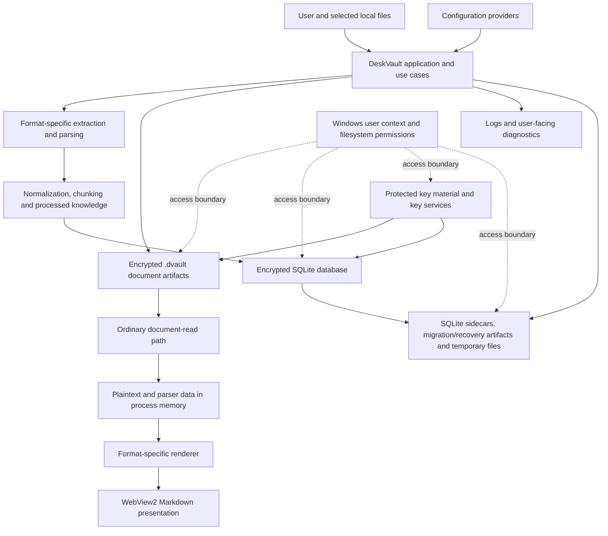

# DeskVault MVP2 Security Threat Model

## 1. Document Control

| Property | Value |
|---|---|
| Document | MVP2 Security Threat Model and Control Baseline |
| Status | Initial engineering baseline; validation pending |
| Technical Task | #230 — Establish MVP2 threat model and security control baseline |
| Parent PBI | #221 — Strengthen DeskVault Security Against Common Threats |
| Reviewed source baseline | `49d3e3f29cab423383d2feb0b07b8c58b44f6e10` |
| Baseline date | 2026-10-26 |
| Primary implementation platform | Windows desktop, .NET |
| Architecture goal | Offline-first document and knowledge platform |
| Integrated verification owner | #235 |
| Intended audience | Product engineering, architecture, security review, and portfolio reviewers |

This document is the authoritative MVP2 threat model and cross-cutting security control baseline for DeskVault.

It documents the supported security model, sensitive assets, trust boundaries, attacker assumptions, threat scenarios, risk-prioritization decisions, existing protections, control gaps, implementation ownership, and verification requirements.

It is an engineering threat model, not a penetration-test report, certification, or claim that the application has passed a comprehensive security assessment.

**Baseline limitation:** This document records source-level observations associated with the stated commit. A source observation is not equivalent to a reproduced exploit, an executed test, a verified Windows access-control result, or proof that the corresponding threat is fully mitigated.

---

## 2. Executive Security Assessment

DeskVault is intended to be a local-first knowledge platform that allows users to store, process, search, and view sensitive documents while retaining control over their local data.

The current MVP2 architecture includes encrypted document artifacts, an encrypted SQLite persistence boundary, protected key material, document processing and extraction, application diagnostics, artifact reconciliation, and in-app document rendering.

The principal cross-cutting security concern is that **encryption at rest does not protect every other representation or operation involving the same data**. Sensitive information can also appear in process memory, parser intermediates, derived document chunks, diagnostic output, filesystem metadata, runtime database files, or migration and recovery artifacts.

The current source review identifies the following areas requiring explicit verification or hardening:

1. Effective configuration precedence and the handling of future secret-bearing settings.
2. Sensitive-data disclosure through logging, exception handling, and diagnostics.
3. Source-input, structural-complexity, parser-intermediate, and processed-output resource boundaries.
4. Resource limits for ordinary document opening and artifact reconciliation.
5. Complete URI-scheme, navigation, and resource-loading restrictions for untrusted Markdown.
6. Effective filesystem access protection for application-managed and SQLite auxiliary artifacts.
7. Safe outcomes for resource-limit failures, incomplete validation, interrupted migration, and other security-sensitive failures.
8. The precise protection boundary when an encrypted vault is copied to another Windows profile or device.

These findings are **areas for assessment and control verification**, not declarations that every area is exploitable. The remaining #221 Technical Tasks own their respective implementation. #235 owns integrated verification against this threat model.

### 2.1 Product-level security objectives

The MVP2 security work should preserve five product outcomes:

- **Confidentiality:** Sensitive document contents, derived knowledge, protected keys, and diagnostic data should not be exposed through avoidable storage or application behavior.
- **Integrity:** Encrypted documents, persisted knowledge, key identity, and artifact ownership must retain their established correctness guarantees.
- **Availability:** Malformed or oversized documents and unexpectedly large artifact inventories must not cause uncontrolled resource consumption within supported application workflows.
- **Correctness:** An incomplete or indeterminate operation must not be reported as successful, complete, matched, or healthy.
- **Trustworthiness:** Every material security claim must be traceable to implementation evidence and an executed validation result or explicitly remain unverified.

The implementation must preserve DeskVault's existing local-first architecture. Security hardening must not silently replace the established encryption, key lifecycle, document viewing, recovery, or persistence designs.

---

## 3. Scope and Methodology

### 3.1 In scope

This threat model covers the MVP2 application and data-processing boundaries relevant to PBI #221:

- Configuration loading, supported overrides, and secret-handling policy.
- Logging, exception handling, and sensitive-data-safe diagnostics.
- Document input, extraction, parsing, intermediate materialization, and processing output.
- Ordinary document reads and plaintext materialization.
- Untrusted Markdown rendering, navigation, and resource loading.
- Document artifact enumeration and reconciliation resource boundaries.
- Filesystem artifact protection and SQLite auxiliary artifacts.
- Database migration/recovery artifacts and interactions with existing key protection.
- Fail-closed behavior and integrated security verification.
- Copied-vault protection assumptions and explicitly unsupported attacker capabilities.

### 3.2 Out of scope

The following remain under their existing product or Technical Task ownership:

| Item | Existing owner |
|---|---|
| Application access and active-session locking | #185 |
| Document-viewing authorization and temporary plaintext lifecycle | #193 |
| Vault backup and restore | #202 |
| Vault-health detection and health-result semantics | #208 |
| Active-vault concurrency | #214 |
| Cryptographic key lifecycle and existing encryption architecture | #220 |
| Document-import reliability and compensation | #100 |
| Processing lifecycle, generations, cancellation, and recovery semantics | #101 |
| Artifact lifecycle consistency and reconciliation semantics | #102 |
| User-understandable processing outcomes | #223 |

Future AI-specific prompt injection, retrieval authorization, embedding protection, model-selection security, and AI credential policy are outside MVP2 scope. They require threat modeling when the relevant AI capabilities and trust boundaries are introduced.

### 3.3 Method

The assessment uses the following sequence:

1. **Decompose:** Identify assets, components, data flows, entry points, and trust boundaries.
2. **Identify:** Develop concrete attack scenarios using STRIDE as a review aid, supplemented by misuse and resource-exhaustion scenarios.
3. **Prioritize:** Assign provisional likelihood and impact ratings based on the current source review and explicit attacker assumptions.
4. **Respond:** Define a required response, the responsible Technical Task, and verifiable control expectations for each in-scope threat.
5. **Validate:** Confirm the model against the implementation, execute the required tests, and record evidence and unresolved risks.

External methodological references:

- [OWASP Threat Modeling Cheat Sheet](https://cheatsheetseries.owasp.org/cheatsheets/Threat_Modeling_Cheat_Sheet.html)
- [Microsoft Security Development Lifecycle — Threat Modeling](https://www.microsoft.com/en-us/securityengineering/sdl/threatmodeling)

This is an iterative baseline. Threat IDs and control IDs are stable references; implementation status and evidence must be updated as the code changes.

---

## 4. System Context and Data Flow

### 4.1 Logical architecture

The following diagram is a security-oriented view of the system, not a substitute for the complete application architecture.

### 4.2 Component and data-flow descriptions

| Component | Security relevance |
|---|---|
| Configuration providers | Supply processing, rendering, storage, endpoint, and logging settings that influence runtime behavior. |
| Application use cases | Orchestrate document import, processing, reading, search, removal, and other workflows. |
| Parsers and extractors | Consume externally supplied document structures and can allocate intermediate objects before producing bounded output. |
| Processed knowledge | Derived text, chunks, metadata, and provenance remain potentially sensitive even after extraction. |
| Encrypted artifact storage | Stores document contents outside the SQLite metadata boundary. |
| Encrypted SQLite persistence | Stores document metadata, lifecycle information, processing state, and derived knowledge. |
| Key services | Provide protected key creation and retrieval under the existing encryption architecture. |
| Ordinary read path | Decrypts a stored document for use by the application; must have an explicit resource boundary. |
| Renderers and WebView2 | Present untrusted document content under a restricted, format-specific policy. |
| Logs and diagnostics | Can expose sensitive values even when stored artifacts are encrypted. |
| Auxiliary artifacts | May contain database data, temporary state, locks, or recovery information; their protection depends on actual contents and lifecycle. |
| Windows security context | Governs access to application files and DPAPI-protected key material; it is not an isolation boundary against arbitrary code executing with the same user's effective privileges. |

### 4.3 Trust boundaries

| ID | Boundary | Security requirement |
|---|---|---|
| TB-01 | Configuration provider → application | Validate supported values and verify precedence; security-sensitive configuration must not be silently weakened. |
| TB-02 | External document → parser | Treat document bytes and structures as untrusted; enforce input and structural resource limits. |
| TB-03 | Parser → canonical processed representation | Preserve complete/partial semantics and avoid publishing incomplete output as successful complete knowledge. |
| TB-04 | Application → persistent storage | Preserve encryption, key authority, canonical artifact ownership, and appropriate access protection for every artifact class. |
| TB-05 | Stored document → process memory | Apply read limits and minimize unnecessary plaintext materialization and lifetime. |
| TB-06 | Markdown-derived HTML → WebView2 | Enforce a complete markup, navigation, URI-scheme, and resource-loading policy. |
| TB-07 | Runtime failure → logs and user-visible diagnostics | Keep useful operational information while preventing disclosure of protected content and metadata. |
| TB-08 | SQLite and filesystem lifecycle → auxiliary files | Classify artifacts by actual contents and protect them without destroying required recovery state. |
| TB-09 | Initialization and recovery across processes | Preserve authoritative key/database state during concurrency, cancellation, interruption, and recovery. |

---

## 5. Assets and Security Goals

### 5.1 Asset register

| ID | Asset | Security impact if compromised |
|---|---|---|
| A-01 | Original document contents | Disclosure or alteration of sensitive source material. |
| A-02 | Decrypted document content and parser intermediates | Exposure of plaintext or excessive memory/resource consumption. |
| A-03 | Encrypted `.dvault` artifacts | Unauthorized file access, tampering, deletion, or incorrect artifact ownership. |
| A-04 | SQLite database | Exposure or alteration of document metadata, processing state, and derived knowledge. |
| A-05 | Master key, database key, and protected key payloads | Loss of confidentiality or access to encrypted data; loss of access to existing data if authoritative key state is mishandled. |
| A-06 | Processed text, chunks, and provenance | Disclosure of source-derived content or incorrect canonical knowledge. |
| A-07 | Configuration and runtime options | Weakened security settings, unsafe resource limits, or unintended storage/logging behavior. |
| A-08 | Logs and diagnostic output | Disclosure of document contents, credentials, paths, filenames, queries, or exception-carried sensitive values. |
| A-09 | SQLite sidecars, migration backups, recovery files, and temporaries | Exposure of database contents or unsafe loss of recovery state. |
| A-10 | Filesystem paths, filenames, metadata, and hashes | Disclosure of document identity or user activity; path confusion and access-control errors. |
| A-11 | Temporary plaintext viewing artifacts | Exposure outside the intended viewing lifecycle. |
| A-12 | Artifact inventory and validation results | False claims of artifact consistency, integrity, completeness, or health. |

### 5.2 Security goals

| Goal | Required property |
|---|---|
| SG-01 — Confidentiality | Stored document contents and database content receive the protection established by the existing encryption architecture. |
| SG-02 — Key authority | Failed key retrieval must not silently create or replace authoritative key material. |
| SG-03 — Bounded processing | Source input, relevant intermediate materialization, structural complexity, processing output, ordinary reads, and reconciliation work have explicit limits appropriate to their operations. |
| SG-04 — Safe presentation | Untrusted Markdown cannot bypass the intended markup, navigation, or resource policy. |
| SG-05 — Diagnostic safety | Protected values are not disclosed through logs or security-sensitive user-facing diagnostics. |
| SG-06 — Correctness | Resource-limit failures, incomplete reads, and indeterminate artifact validation cannot be reported as complete success. |
| SG-07 — Lifecycle integrity | Existing import, processing, viewing, concurrency, removal, and recovery invariants remain intact. |
| SG-08 — Traceability | Each threat maps to controls, implementation ownership, and expected verification evidence. |
| SG-09 — Evidence-based claims | Control completion and risk disposition are based on reviewed source and actual validation results, not assumptions. |

---

## 6. Attacker Model and Assumptions

### 6.1 Attacker profiles

| ID | Actor or condition | Capability considered |
|---|---|---|
| AT-01 | Malicious document author | Supplies malformed or adversarial content in a supported document format. |
| AT-02 | Local user opening an untrusted file | Imports or views a document that attempts to exhaust resources or use unsafe rendering features. |
| AT-03 | Unauthorized local process | Attempts to access application files without the necessary effective permissions or usable keys. |
| AT-04 | Fault or interruption | Causes cancellation, I/O errors, partial writes, process interruption, or interrupted migration/recovery. |
| AT-05 | Configuration maintainer or environment | Supplies unexpected overrides or accidentally introduces a secret or unsafe setting. |
| AT-06 | Local diagnostic reader | Can read accessible logs and uses any disclosed sensitive information. |
| AT-07 | Copied-vault recipient | Obtains vault files in a different profile or device context and attempts to open them. |

These are modeling assumptions. The document does not claim that an attacker can cross every boundary merely because the boundary is in scope.

### 6.2 Out-of-scope capabilities and limitations

The current MVP2 security model does not establish protection against:

- arbitrary code execution with the same Windows user's effective privileges;
- compromise of the operating system or administrator-level compromise;
- malware that can inspect DeskVault's plaintext process memory or use resources already authorized to the same user;
- physical destruction of storage or denial of service caused by a compromised host environment;
- universal device binding based solely on DPAPI `CurrentUser`;
- future AI-specific threats that have not yet been designed into MVP2.

Encryption at rest, a restricted renderer, file permissions, and application-level checks must not be described as protections against these capabilities without additional architecture and evidence.

---

## 7. Risk Assessment Method

### 7.1 Likelihood and impact

Use a provisional 1–5 scale for both likelihood and impact.

**Likelihood**

| Score | Definition |
|---|---|
| 1 | Rare under supported use and the stated attacker model. |
| 2 | Unlikely and dependent on additional conditions. |
| 3 | Plausible under realistic user, input, or failure conditions. |
| 4 | Likely or readily reproducible when the required preconditions exist. |
| 5 | Easily and repeatedly triggered during ordinary supported use. |

**Impact**

| Score | Definition |
|---|---|
| 1 | Negligible consequence. |
| 2 | Limited and readily recoverable consequence. |
| 3 | Material effect on an individual workflow or limited sensitive information. |
| 4 | Severe confidentiality, integrity, or availability effect on valuable data or core operations. |
| 5 | Very severe exposure, broad loss of confidentiality or integrity, or substantial loss of access to valuable vault contents. |

Calculate the initial triage score as:

`Risk score = Likelihood × Impact`

| Score | Triage band |
|---|---|
| 1–4 | Low |
| 5–9 | Moderate |
| 10–16 | High |
| 17–25 | Critical |

### 7.2 Scoring rules

- Scores in this document are provisional engineering assessments, not measured exploitability or formal business-risk calculations.
- Where exploitability depends on unverified runtime behavior, the uncertainty must be recorded; the score must not imply that the condition has been reproduced.
- A control that exists in source can reduce concern only to the extent that its effective behavior and relevant failure cases are demonstrated.
- The risk score does not automatically determine business acceptance. Any residual-risk acceptance requires an explicit decision by the authorized product/security decision-maker.
- Threats outside the supported attacker model are recorded as limitations rather than scored as mitigated.

---

## 8. Source-Evidence Register

All GitHub references in this section are pinned to the reviewed baseline commit:

`49d3e3f29cab423383d2feb0b07b8c58b44f6e10`

### E-01 — Host configuration

[`HostConfigurator.cs`](https://github.com/anirbanB94/DeskVault/blob/49d3e3f29cab423383d2feb0b07b8c58b44f6e10/src/DeskVault.UI/Hosting/HostConfigurator.cs)

Source observation: `HostConfigurator` creates a `HostApplicationBuilder`, sets the base path, then explicitly adds `appsettings.json` before binding application options. Because that provider is added after builder creation, its effective precedence relative to the builder defaults is material and must be verified against the intended override contract; do not assume conventional environment-variable or command-line precedence without a test.

### E-02 — Shipped configuration

[`appsettings.json`](https://github.com/anirbanB94/DeskVault/blob/49d3e3f29cab423383d2feb0b07b8c58b44f6e10/src/DeskVault.UI/appsettings.json)

Source observation: the reviewed file contains application, endpoint, database, storage, processing, CSV parsing, search, rendering, and logging settings. No literal credential was identified in this file during the source review. This does not establish that all deployment artifacts and runtime overrides are secret-free.

### E-03 — Markdown policy construction

[`MarkdownDocumentContentRenderer.cs`](https://github.com/anirbanB94/DeskVault/blob/49d3e3f29cab423383d2feb0b07b8c58b44f6e10/src/DeskVault.UI/Rendering/MarkdownDocumentRendering/MarkdownDocumentContentRenderer.cs)

Source observation: raw HTML can be disabled when `AllowRawHtml` is false. The renderer explicitly disables WebView2 JavaScript and handles resource requests and navigation, including HTTP/HTTPS filtering when the corresponding options are false.

### E-04 — CSV extraction and parsing

[`CsvDocumentTextExtractor.cs`](https://github.com/anirbanB94/DeskVault/blob/49d3e3f29cab423383d2feb0b07b8c58b44f6e10/src/DeskVault.Application/Documents/Extraction/CSVDocument/CsvDocumentTextExtractor.cs) and [`CsvDocumentParser.cs`](https://github.com/anirbanB94/DeskVault/blob/49d3e3f29cab423383d2feb0b07b8c58b44f6e10/src/DeskVault.Application/Documents/Parsing/Csv/CsvDocumentParser.cs)

Source observation: the extractor constructs a parser with `MaxRows = null` and materializes a parsed document before creating its bounded output. The CSV row limit configured for other parsing paths must not be assumed to bound this extractor.

### E-05 — JSON and XML extraction

[`JsonDocumentTextExtractor.cs`](https://github.com/anirbanB94/DeskVault/blob/49d3e3f29cab423383d2feb0b07b8c58b44f6e10/src/DeskVault.Application/Documents/Extraction/JsonDocument/JsonDocumentTextExtractor.cs) and [`XmlDocumentTextExtractor.cs`](https://github.com/anirbanB94/DeskVault/blob/49d3e3f29cab423383d2feb0b07b8c58b44f6e10/src/DeskVault.Application/Documents/Extraction/XmlDocument/XmlDocumentTextExtractor.cs)

Source observation: JSON and XML extraction create structured in-memory representations before output construction. The output limit alone does not establish a bound on every intermediate allocation or structural traversal.

### E-06 — YAML and INI extraction

[`YamlDocumentTextExtractor.cs`](https://github.com/anirbanB94/DeskVault/blob/49d3e3f29cab423383d2feb0b07b8c58b44f6e10/src/DeskVault.Application/Documents/Extraction/YamlDocument/YamlDocumentTextExtractor.cs) and [`IniDocumentTextExtractor.cs`](https://github.com/anirbanB94/DeskVault/blob/49d3e3f29cab423383d2feb0b07b8c58b44f6e10/src/DeskVault.Application/Documents/Extraction/IniDocument/IniDocumentTextExtractor.cs)

Source observation: these formats also have intermediate parsing/materialization behavior that must be included in the resource-boundary review.

### E-07 — Encrypted document reader

[`EncryptedDocumentReader.cs`](https://github.com/anirbanB94/DeskVault/blob/49d3e3f29cab423383d2feb0b07b8c58b44f6e10/src/DeskVault.Infrastructure/Services/EncryptedDocumentReader.cs)

Source observation: the reader exposes an optional `maximumPlaintextBytes` parameter. E-17 records that both `OpenDocumentHandler` and `ReconcileDocumentArtifactsHandler` call `OpenReadAsync` without supplying that optional argument; those caller paths therefore do not request the explicit reader limit.

### E-08 — Artifact enumeration

[`DocumentArtifactEnumerator.cs`](https://github.com/anirbanB94/DeskVault/blob/49d3e3f29cab423383d2feb0b07b8c58b44f6e10/src/DeskVault.Infrastructure/Services/DocumentArtifactEnumerator.cs)

Source observation: the top-level artifact inventory uses `Directory.GetFiles`, which materializes the matching paths. This alone does not prove exploitability but requires the inventory and aggregate validation work to have explicit limits.

### E-09 — Migration and recovery artifacts

[`DatabaseInitializer.cs`](https://github.com/anirbanB94/DeskVault/blob/49d3e3f29cab423383d2feb0b07b8c58b44f6e10/src/DeskVault.Infrastructure/Persistence/DatabaseInitializer.cs)

Source observation: migration and backup files are created and managed during plaintext database migration and promotion. Their sensitivity depends on actual contents and migration state; recovery behavior must be preserved.

### E-10 — Application-managed storage paths

[`DeskVaultDataPaths.cs`](https://github.com/anirbanB94/DeskVault/blob/49d3e3f29cab423383d2feb0b07b8c58b44f6e10/src/DeskVault.Infrastructure/Services/DeskVaultDataPaths.cs)

Source observation: application-managed data, document, and security paths are defined here. Path definitions alone do not prove effective Windows filesystem access protection.

### E-11 — Document encryption and key authority

[ADR-0004 — Document Encryption at Rest](https://github.com/anirbanB94/DeskVault/blob/49d3e3f29cab423383d2feb0b07b8c58b44f6e10/docs/adr/0004-document-encryption-at-rest.md)

Architecture evidence: authenticated document encryption, DPAPI `CurrentUser` protection, atomic key publication, and strict existing-key retrieval are established parts of the documented design.

### E-12 — Persistence and database encryption

[ADR-0005 — Document Metadata Persistence](https://github.com/anirbanB94/DeskVault/blob/49d3e3f29cab423383d2feb0b07b8c58b44f6e10/docs/adr/0005-document-metadata-persistence.md) and [ADR-0009 — Encrypted SQLite Database Provider](https://github.com/anirbanB94/DeskVault/blob/49d3e3f29cab423383d2feb0b07b8c58b44f6e10/docs/adr/0009-encrypted-sqlite-database-provider.md)

Architecture evidence: database metadata and derived knowledge have a distinct encrypted persistence boundary and separate database-key handling.

### E-13 — Import, processing, and removal lifecycle

[ADR-0003 — Document Import Workflow](https://github.com/anirbanB94/DeskVault/blob/49d3e3f29cab423383d2feb0b07b8c58b44f6e10/docs/adr/0003-document-import-workflow.md), [ADR-0010 — Reliable Document Processing Lifecycle](https://github.com/anirbanB94/DeskVault/blob/49d3e3f29cab423383d2feb0b07b8c58b44f6e10/docs/adr/0010-reliable-document-processing-lifecycle.md), and [ADR-0013 — Reliable Document Removal Lifecycle](https://github.com/anirbanB94/DeskVault/blob/49d3e3f29cab423383d2feb0b07b8c58b44f6e10/docs/adr/0013-reliable-document-removal-lifecycle.md)

Architecture evidence: import, processing, and removal are distinct lifecycle boundaries with established failure and consistency responsibilities.

### E-14 — Rendering semantics and derived knowledge

[ADR-0008 — Document Semantic Preservation](https://github.com/anirbanB94/DeskVault/blob/49d3e3f29cab423383d2feb0b07b8c58b44f6e10/docs/adr/0008-document-semantic-preservation-through-rendering-pipeline.md), [ADR-0011 — Stable Chunk Identity and Provenance](https://github.com/anirbanB94/DeskVault/blob/49d3e3f29cab423383d2feb0b07b8c58b44f6e10/docs/adr/0011-stable-document-chunk-identity-and-provenance.md), and [ADR-0012 — Search Result and Relevance Boundary](https://github.com/anirbanB94/DeskVault/blob/49d3e3f29cab423383d2feb0b07b8c58b44f6e10/docs/adr/0012-search-result-and-relevance-boundary.md)

Architecture evidence: canonical processed representations, provenance, search results, and rendering semantics are separate concerns. Security hardening must preserve these contracts.

### E-15 - Project vision and offline-first goal

[ADR-0001 - Project Vision](https://github.com/anirbanB94/DeskVault/blob/49d3e3f29cab423383d2feb0b07b8c58b44f6e10/docs/adr/0001-project-vision.md)

Architecture evidence: DeskVault's accepted product vision establishes an offline-first enterprise knowledge platform, local data storage, privacy-sensitive deployment goals, and local AI as a future capability rather than implemented MVP2 functionality.

### E-16 - Vertical-slice architecture and dependency boundaries

[ADR-0002 - Vertical Slice Architecture](https://github.com/anirbanB94/DeskVault/blob/49d3e3f29cab423383d2feb0b07b8c58b44f6e10/docs/adr/0002-vertical-slice-architecture.md)

Architecture evidence: the project preserves Domain, Application, Infrastructure, UI, and composition-root responsibilities. Cross-cutting hardening must respect those boundaries and the assigned technical-task ownership.

### E-17 - Ordinary document-read and reconciliation caller paths

[OpenDocumentHandler.cs](https://github.com/anirbanB94/DeskVault/blob/49d3e3f29cab423383d2feb0b07b8c58b44f6e10/src/DeskVault.Application/Documents/Queries/OpenDocument/OpenDocumentHandler.cs) and [ReconcileDocumentArtifactsHandler.cs](https://github.com/anirbanB94/DeskVault/blob/49d3e3f29cab423383d2feb0b07b8c58b44f6e10/src/DeskVault.Application/Documents/Queries/ReconcileDocumentArtifacts/ReconcileDocumentArtifactsHandler.cs)

Source observation: both callers invoke `OpenReadAsync` with document identity/hash and a cancellation token but omit the optional `maximumPlaintextBytes` argument. The reader's default for that optional parameter is `null`, so these call sites do not request the explicit plaintext-size limit. This is a source-observed caller-boundary gap, not a reproduced exploit.

### E-18 - Relevant existing test files

The following test files exist at the reviewed baseline and are relevant starting points for regression coverage. Their presence does not establish that they were executed for #230 or that all associated security properties pass.

- CSV extractor behavior: [`tests/DeskVault.Application.Tests/CsvDocumentTextExtractorTests.cs`](https://github.com/anirbanB94/DeskVault/blob/49d3e3f29cab423383d2feb0b07b8c58b44f6e10/tests/DeskVault.Application.Tests/CsvDocumentTextExtractorTests.cs)
- CSV structured-content behavior: [`tests/DeskVault.Application.Tests/CsvDocumentTextExtractorStructuredContentTests.cs`](https://github.com/anirbanB94/DeskVault/blob/49d3e3f29cab423383d2feb0b07b8c58b44f6e10/tests/DeskVault.Application.Tests/CsvDocumentTextExtractorStructuredContentTests.cs)
- CSV parser limits: [`tests/DeskVault.Application.Tests/CsvParserLimitsTests.cs`](https://github.com/anirbanB94/DeskVault/blob/49d3e3f29cab423383d2feb0b07b8c58b44f6e10/tests/DeskVault.Application.Tests/CsvParserLimitsTests.cs)
- Processing output buffer: [`tests/DeskVault.Application.Tests/DocumentProcessingTextBufferTests.cs`](https://github.com/anirbanB94/DeskVault/blob/49d3e3f29cab423383d2feb0b07b8c58b44f6e10/tests/DeskVault.Application.Tests/DocumentProcessingTextBufferTests.cs)
- JSON extractor behavior: [`tests/DeskVault.Application.Tests/JsonDocumentTextExtractorTests.cs`](https://github.com/anirbanB94/DeskVault/blob/49d3e3f29cab423383d2feb0b07b8c58b44f6e10/tests/DeskVault.Application.Tests/JsonDocumentTextExtractorTests.cs)
- XML extractor behavior: [`tests/DeskVault.Application.Tests/XmlDocumentTextExtractorTests.cs`](https://github.com/anirbanB94/DeskVault/blob/49d3e3f29cab423383d2feb0b07b8c58b44f6e10/tests/DeskVault.Application.Tests/XmlDocumentTextExtractorTests.cs)
- YAML extractor behavior: [`tests/DeskVault.Application.Tests/YamlDocumentTextExtractorTests.cs`](https://github.com/anirbanB94/DeskVault/blob/49d3e3f29cab423383d2feb0b07b8c58b44f6e10/tests/DeskVault.Application.Tests/YamlDocumentTextExtractorTests.cs)
- INI extractor behavior: [`tests/DeskVault.Application.Tests/IniDocumentTextExtractorTests.cs`](https://github.com/anirbanB94/DeskVault/blob/49d3e3f29cab423383d2feb0b07b8c58b44f6e10/tests/DeskVault.Application.Tests/IniDocumentTextExtractorTests.cs)
- Encrypted reader behavior: [`tests/DeskVault.Infrastructure.Tests/EncryptedDocumentReaderTests.cs`](https://github.com/anirbanB94/DeskVault/blob/49d3e3f29cab423383d2feb0b07b8c58b44f6e10/tests/DeskVault.Infrastructure.Tests/EncryptedDocumentReaderTests.cs)
- Artifact enumeration behavior: [`tests/DeskVault.Infrastructure.Tests/DocumentArtifactEnumeratorTests.cs`](https://github.com/anirbanB94/DeskVault/blob/49d3e3f29cab423383d2feb0b07b8c58b44f6e10/tests/DeskVault.Infrastructure.Tests/DocumentArtifactEnumeratorTests.cs)
- Reconciliation handler behavior: [`tests/DeskVault.Application.Tests/ReconcileDocumentArtifactsHandlerTests.cs`](https://github.com/anirbanB94/DeskVault/blob/49d3e3f29cab423383d2feb0b07b8c58b44f6e10/tests/DeskVault.Application.Tests/ReconcileDocumentArtifactsHandlerTests.cs)
- Plaintext database migration/recovery integration: [`tests/DeskVault.Infrastructure.Tests/PlaintextDatabaseMigrationIntegrationTests.cs`](https://github.com/anirbanB94/DeskVault/blob/49d3e3f29cab423383d2feb0b07b8c58b44f6e10/tests/DeskVault.Infrastructure.Tests/PlaintextDatabaseMigrationIntegrationTests.cs)
- Renderer resolver selection (not a scheme-policy test): [`tests/DeskVault.UI.Tests/DocumentContentRendererResolverTests.cs`](https://github.com/anirbanB94/DeskVault/blob/49d3e3f29cab423383d2feb0b07b8c58b44f6e10/tests/DeskVault.UI.Tests/DocumentContentRendererResolverTests.cs)

The renderer-resolver test establishes renderer selection coverage, not the complete Markdown security policy. The initial review did not establish a dedicated suite covering all raw-HTML, URI-scheme, local-file, navigation, and external-resource cases; #319 must provide focused security tests for its assigned policy.

### E-19 - Diagnostic and exception-bearing output paths

- [`ImportDocumentHandler.cs`](https://github.com/anirbanB94/DeskVault/blob/49d3e3f29cab423383d2feb0b07b8c58b44f6e10/src/DeskVault.Application/Documents/Commands/ImportDocument/ImportDocumentHandler.cs#L129-L149)
- [`RemoveDocumentHandler.cs`](https://github.com/anirbanB94/DeskVault/blob/49d3e3f29cab423383d2feb0b07b8c58b44f6e10/src/DeskVault.Application/Documents/Commands/RemoveDocument/RemoveDocumentHandler.cs#L53-L71)
- [`MainFormPresenter.cs`](https://github.com/anirbanB94/DeskVault/blob/49d3e3f29cab423383d2feb0b07b8c58b44f6e10/src/DeskVault.UI/Presenters/MainFormPresenter.cs#L1157-L1166)
- [`MainFormPresenterTests.cs`](https://github.com/anirbanB94/DeskVault/blob/49d3e3f29cab423383d2feb0b07b8c58b44f6e10/tests/DeskVault.UI.Tests/MainFormPresenterTests.cs#L303-L372)
- [`EncryptedDocumentReaderTests.cs`](https://github.com/anirbanB94/DeskVault/blob/49d3e3f29cab423383d2feb0b07b8c58b44f6e10/tests/DeskVault.Infrastructure.Tests/EncryptedDocumentReaderTests.cs#L484-L555)

Source/test observation: import and removal handlers log caught exception objects and return `ex.Message` for I/O and authorization failures. The search-failure path in `MainFormPresenter` places `ex.Message` in status text and passes `ex.ToString()` to the user-facing error view; related workspace-operation paths also use exception detail in the error UI. `MainFormPresenterTests.SearchRequested_SearchStoreFails_ShowsErrorAndFailureStatus` explicitly asserts that the exception message is surfaced in the status and error dialog. `EncryptedDocumentReaderTests.OpenReadAsync_WhenContentIntegrityFails_DoesNotLogPlaintextHashOrCryptographicMaterial` is a narrow reader-specific non-disclosure test; it does not establish cross-cutting diagnostic safety.

These are source/test-observed potential disclosure paths, not proof that a particular secret has already leaked. #232 owns the systematic review, remediation, and synthetic-sensitive-value regression tests.

**Evidence note:** This register is a reference index, not an execution report. The final task evidence must identify actual tests or inspections executed and record their results.

---

## 9. Threat Register

### DV-T-001 — Configuration overrides weaken security-sensitive behavior

- **STRIDE:** Tampering, Elevation of Privilege where applicable.
- **Affected assets:** A-07, A-08, A-09.
- **Trust boundary:** TB-01.
- **Attack scenario:** A supported or unexpected configuration source changes a security-sensitive option, resource limit, storage destination, endpoint, or logging setting. The effective value differs from the intended policy, or a future credential is accidentally shipped in configuration.
- **Preconditions:** The relevant configuration source or override is available, or the shipped configuration changes.
- **Entry point:** `HostConfigurator.ConfigureConfiguration`, options binding, the shipped `appsettings.json`, and supported configuration override sources.
- **Plausible attack path:** A provider is applied in an unexpected order or an invalid override is accepted; the runtime then uses a security-sensitive endpoint, storage/logging option, renderer setting, or resource limit different from the intended policy. A future secret may also be accidentally included in shipped configuration.
- **Potential impact:** Weakened restrictions, unintended data destinations or external behavior, resource exhaustion, or credential disclosure if a real secret is introduced.
- **Current protection:** E-01 and E-02 show explicit configuration setup, option binding, restrictive default Markdown options, and no literal credential identified in the reviewed JSON.
- **Gap:** `HostConfigurator` adds `appsettings.json` after builder creation, so effective precedence relative to builder defaults is material and must be tested against the intended override contract. Security-sensitive value validation and deployment-wide secret coverage also require explicit verification.
- **Initial rating:** Likelihood 3 × Impact 4 = **12, High**.
- **Treatment:** Mitigate.
- **Owner:** #231.
- **Verification:** Test effective resolved options across supported providers and override sources. Check shipped configuration and build artifacts for actual secret values. Test invalid or unsupported values according to the documented policy.
- **Residual-risk rule:** Do not claim that secrets are comprehensively absent or that precedence is correct until the relevant checks pass.

### DV-T-002 — Logs or diagnostics disclose sensitive information

- **STRIDE:** Information Disclosure.
- **Affected assets:** A-01, A-04 through A-10.
- **Trust boundary:** TB-07.
- **Attack scenario:** A failure emits raw exception details or contextual values that contain document text, keys, secrets, paths, filenames, queries, or metadata. Someone who can access logs or diagnostic output recovers information that should remain protected.
- **Preconditions:** A relevant failure or logging path receives sensitive values.
- **Entry point:** Exception catches and logger calls in import/removal handlers; search failure status/error UI; workspace-operation error presentations.
- **Plausible attack path:** A malformed input, path, storage condition, or backend failure causes an exception carrying sensitive details; code logs the exception or forwards its message/`ToString()` into user-visible diagnostics.
- **Potential impact:** Disclosure of sensitive paths, filenames, document-derived values, query data, or other exception-carried information to log readers or users who should not receive it.
- **Current protection:** E-19 records a narrow reader-specific diagnostic-safety test. However, import/removal handlers log exception objects and return `ex.Message`, while search failure handling exposes `ex.Message` in status text and `ex.ToString()` through the error UI. The existing controls do not establish complete redaction.
- **Gap:** These exception-bearing paths are concrete review/remediation targets. A systematic sink/source audit and synthetic-sensitive-value tests are required to establish which values can escape and to prevent sensitive paths, filenames, document-derived data, or other exception-carried values from reaching logs or user-facing diagnostics.
- **Initial rating:** Likelihood 3 × Impact 4 = **12, High**.
- **Treatment:** Mitigate.
- **Owner:** #232.
- **Verification:** Produce logs and user-facing results using synthetic secrets, keys, document data, paths, filenames, queries, and metadata. Assert that prohibited values do not appear and that useful operational context remains.
- **Residual-risk rule:** A test of one handler does not establish that all cross-cutting diagnostic paths are safe.

### DV-T-003 — Untrusted document input causes excessive parser resource use

- **STRIDE:** Denial of Service.
- **Affected assets:** A-01, A-02, A-06; application availability.
- **Trust boundary:** TB-02 and TB-03.
- **Attack scenario:** A document uses excessive size, nesting, row/field counts, nodes, aliases, or structural expansion. Parsing or constructing intermediate structures consumes excessive memory or CPU before the processed-output boundary is reached.
- **Preconditions:** The file reaches an extractor or parser without an effective limit for the relevant resource dimension.
- **Entry point:** Supported document-processing entry points and format-specific extractors/parsers for CSV, JSON, XML, YAML, and INI content.
- **Plausible attack path:** A crafted or unusually large document reaches a parser that constructs a full intermediate representation before output limits apply; high row/field/node counts, nesting, aliases, or fan-out cause excessive allocation or traversal.
- **Potential impact:** Excessive memory/CPU consumption, application unresponsiveness or failure, and possible incomplete processed knowledge if resource-limit outcomes are mishandled.
- **Current protection:** Processing options declare a 32 MiB default for decrypted document bytes and processed text bytes. Format-specific parsers and output buffers exist.
- **Gap:** Output-size limits do not establish limits on all intermediate allocations, structural complexity, CPU, or parser work. E-04 through E-06 identify structured parsing/materialization boundaries that require explicit treatment.
- **Initial rating:** Likelihood 4 × Impact 4 = **16, High**.
- **Treatment:** Mitigate.
- **Owner:** #233. Preserve processing lifecycle semantics owned by #101.
- **Verification:** Define per-format input, structure, intermediate, and output boundaries. Test below, at, and above each boundary, including cancellation and malformed input. Demonstrate that each limit is applied before the excessive work it is intended to prevent.
- **Residual-risk rule:** A bounded final text buffer must not be cited as proof that parser memory is bounded.

### DV-T-004 — Ordinary document opening materializes excessive plaintext

- **STRIDE:** Denial of Service; Information Disclosure where excess plaintext handling increases exposure.
- **Affected assets:** A-01, A-02, A-05.
- **Trust boundary:** TB-05.
- **Attack scenario:** Opening a sufficiently large document causes the application to materialize excessive decrypted content or to hold unnecessary plaintext copies.
- **Preconditions:** A large stored document reaches the ordinary open path.
- **Entry point:** The ordinary open use case (`OpenDocumentHandler`) calling `IDocumentReader.OpenReadAsync`, with plaintext staged by `EncryptedDocumentReader`.
- **Plausible attack path:** A large stored artifact reaches the ordinary-open caller, which omits `maximumPlaintextBytes`; the reader can stage the complete decrypted content without that explicit caller-supplied bound.
- **Potential impact:** Uncontrolled memory consumption, degraded availability, or a larger/longer-lived plaintext representation than intended. The precise exploitability remains unverified.
- **Current protection:** E-07 shows that the encrypted reader supports an optional plaintext-size limit.
- **Gap:** E-17 verifies that the ordinary-open caller omits `maximumPlaintextBytes`, so the call does not request the reader's explicit optional limit. #272 must supply a finite bound or implement an appropriate bounded complete strategy. This is source evidence of a gap, not proof of a reproduced exploit.
- **Initial rating:** Likelihood 3 × Impact 4 = **12, High**.
- **Treatment:** Mitigate.
- **Owner:** #272. Temporary plaintext viewing lifecycle remains under #193.
- **Verification:** Test the actual ordinary open entry point at supported sizes, the maximum, and maximum plus one byte. Include cancellation, integrity failures, and read failures. Confirm explicit failure or a bounded complete strategy; silent truncation is unacceptable.

### DV-T-005 — Untrusted Markdown bypasses the intended rendering policy

- **STRIDE:** Elevation of Privilege, Information Disclosure, and Spoofing where applicable.
- **Affected assets:** A-01, A-02, A-10.
- **Trust boundary:** TB-06.
- **Attack scenario:** Markdown content causes unsafe markup processing, unsupported-scheme navigation, local-file access, or unapproved resource loading outside the intended preview policy.
- **Preconditions:** An attacker-supplied Markdown file is previewed.
- **Entry point:** Markdown preview in `MarkdownDocumentContentRenderer`, including the WebView2 navigation and web-resource-request handlers.
- **Plausible attack path:** Crafted Markdown produces links, embedded resources, or markup that reaches a WebView2 navigation/resource path; if only HTTP/HTTPS are explicitly handled, a local-file or other unsupported scheme may not be rejected by an explicit allow-list.
- **Potential impact:** Unintended navigation or resource access, disclosure of locally accessible information, or misleading/spoofed presentation. No specific exploit is claimed reproduced.
- **Current protection:** E-03 shows raw HTML disabling when configured, WebView2 JavaScript disabling, and explicit HTTP/HTTPS filtering for resource requests/navigation when external access is disabled.
- **Gap:** The reviewed implementation does not establish a comprehensive allow-list covering every unsupported scheme or local-file/custom-scheme reference. Effective configuration must also be tested.
- **Initial rating:** Likelihood 3 × Impact 4 = **12, High**.
- **Treatment:** Mitigate.
- **Owner:** #319.
- **Verification:** Establish explicit markup, navigation, and resource policies. Test HTTP/HTTPS, file/local references, unsupported custom schemes, malformed URIs, scripts, raw HTML, and legitimate supported previews.

### DV-T-006 — Artifact inventory or validation consumes excessive resources

- **STRIDE:** Denial of Service.
- **Affected assets:** A-03, A-04, A-12.
- **Trust boundary:** TB-08.
- **Attack scenario:** A very large artifact directory, oversized files, or a changing filesystem state causes unbounded inventory allocation or excessive validation work.
- **Preconditions:** The vault contains enough artifacts or data to stress current enumeration and validation behavior.
- **Entry point:** `DocumentArtifactEnumerator.EnumerateAsync` and the artifact inventory/content-validation loop in `ReconcileDocumentArtifactsHandler`.
- **Plausible attack path:** A vault or filesystem state with a very large number of artifacts causes `Directory.GetFiles` to materialize the full inventory, after which reconciliation performs repeated artifact read/decryption/hash work without sufficient per-file and aggregate limits.
- **Potential impact:** Excessive memory/CPU/IO use and degraded availability during reconciliation; an interrupted pass may also leave validation incomplete.
- **Current protection:** E-08 establishes an artifact enumerator and current top-level inventory behavior.
- **Gap:** `Directory.GetFiles` materializes the matching paths, and E-17 shows the reconciliation caller omits the reader's optional plaintext-size maximum when validating content. These are source-observed gaps in inventory/read-bound coverage, not proof of an exploit. #272 must bound inventory, per-artifact validation, and aggregate work.
- **Initial rating:** Likelihood 4 × Impact 3 = **12, High**.
- **Treatment:** Mitigate.
- **Owner:** #272. Reconciliation semantics remain under #102.
- **Verification:** Test artifact count limits, per-artifact content limits, aggregate-work limits, cancellation, unreadable artifacts, and concurrent filesystem changes. Preserve findings when safe continuation remains possible.

### DV-T-007 — Incomplete artifact validation is reported as successful

- **STRIDE:** Tampering, Repudiation, and Information Disclosure where downstream consumers rely on an incorrect trust result.
- **Affected assets:** A-03, A-04, A-12.
- **Trust boundaries:** TB-04 and TB-08.
- **Attack scenario:** An I/O failure, cancellation, resource limit, or incomplete hash/content check is handled in a way that produces a successful `Matched` result or hides relevant findings.
- **Preconditions:** Artifact validation is incomplete or indeterminate.
- **Entry point:** Reconciliation content-read and result-classification logic that decides whether an artifact is `Matched`, unreadable, mismatched, or otherwise indeterminate.
- **Plausible attack path:** A read, hash, I/O, cancellation, or resource-limit failure prevents all required checks from completing, but a failure path or coarse result mapping still reports success or suppresses other safe-to-collect findings.
- **Potential impact:** False assurance of artifact integrity/consistency, missed findings, or incorrect decisions by users and downstream health/recovery workflows.
- **Current protection:** Existing artifact consistency and reconciliation responsibilities exist under #102.
- **Gap:** E-17 shows the reconciliation reader call omits the optional plaintext-size maximum. Resource-limit and indeterminate-result cases must be specifically demonstrated; ordinary missing/orphan/mismatch tests alone do not prove all failure paths.
- **Initial rating:** Likelihood 3 × Impact 4 = **12, High**.
- **Treatment:** Mitigate.
- **Owner:** #272 for resource bounds and validation certainty; #102 for artifact lifecycle semantics.
- **Verification:** Prove that `Matched` requires all mandatory checks to complete. Test incomplete reads and failures and verify that unrelated findings are not suppressed where safe continuation is possible.

### DV-T-008 — Sensitive filesystem artifacts lack effective access protection

- **STRIDE:** Information Disclosure, Tampering.
- **Affected assets:** A-03, A-04, A-05, A-09, A-10.
- **Trust boundary:** TB-04 and TB-08.
- **Attack scenario:** A sensitive artifact is created outside its intended storage boundary, inherits ineffective permissions, or remains accessible through an unexpected auxiliary path.
- **Preconditions:** An actor can access a location whose effective permissions permit access to the artifact.
- **Entry point:** Creation and access of files under application-managed data, Documents, Security, database, logging, and temporary paths, including files created by dependent runtime libraries.
- **Plausible attack path:** A sensitive file is created in an unexpected location or inherits effective Windows access permissions broader than intended; a local actor who has access to that path reads or alters it.
- **Potential impact:** Disclosure or tampering with encrypted artifacts, database/key-related files, logs, or sensitive auxiliary data, depending on the actual contents and permissions.
- **Current protection:** E-10 establishes application-managed path definitions; document encryption and key protection are existing controls.
- **Gap:** Path definitions and directory creation do not establish effective Windows ACLs or protection for every actual file and auxiliary-artifact class.
- **Initial rating:** Likelihood 3 × Impact 5 = **15, High**.
- **Treatment:** Mitigate.
- **Owner:** #234 for auxiliary-artifact protection; #220 remains authoritative for key and encryption lifecycle.
- **Verification:** Check effective Windows access protection for relevant directories/files, identify actual artifact locations and content sensitivity, and test failure to establish required protection.

### DV-T-009 — Interrupted database migration leaves exposed plaintext recovery material

- **STRIDE:** Information Disclosure, Tampering, Denial of Service.
- **Affected assets:** A-04, A-05, A-09.
- **Trust boundary:** TB-08 and TB-09.
- **Attack scenario:** Plaintext database migration or promotion is interrupted and a migration/recovery artifact containing sensitive database contents remains accessible.
- **Preconditions:** The migration/recovery path is exercised and the resulting files are accessible to an actor.
- **Entry point:** `DatabaseInitializer` plaintext-to-encrypted migration staging, promotion, backup retention, and recovery/cleanup paths.
- **Plausible attack path:** Migration creates a plaintext recovery backup or staging artifact, then interruption or cleanup failure leaves the artifact behind; an actor with effective filesystem access can read it or it can interfere with later recovery.
- **Potential impact:** Disclosure of database contents, integrity loss, failed startup, or loss of recoverability if cleanup or promotion destroys the authoritative state.
- **Current protection:** E-09 shows migration validation, promotion, and cleanup/recovery behavior.
- **Gap:** The contents and effective access protection of retained migration/backup files and SQLite runtime sidecars require evidence. Blanket deletion would be unsafe if it destroyed required recovery state.
- **Initial rating:** Likelihood 3 × Impact 5 = **15, High**.
- **Treatment:** Mitigate.
- **Owner:** #234 for artifact protection. Preserve the existing migration/recovery lifecycle.
- **Verification:** Fault-inject failure around migration creation, validation, promotion, and cleanup. Inspect artifact contents and access; verify restart/recovery correctness and that required authoritative state remains available.

### DV-T-010 — Copied-vault protection is assumed to exceed the actual guarantee

- **STRIDE:** Information Disclosure, Elevation of Privilege where applicable.
- **Affected assets:** A-01, A-03, A-04, A-05.
- **Trust boundary:** TB-04 and TB-09.
- **Attack scenario:** A user assumes a copied encrypted vault is universally device-bound or permanently inaccessible, or assumes copied files are safe without considering whether usable protected key material and the original user context remain available.
- **Preconditions:** Vault files or protected key material are copied to another profile/device or remain accessible under the original user context.
- **Entry point:** Copying the encrypted document artifacts, encrypted database, and any protected key artifacts across profiles/devices, or reusing a copy in the original user context.
- **Plausible attack path:** A user or attacker copies some or all vault files and assumes DPAPI `CurrentUser` guarantees universal device binding, or fails to account for whether the target context can access usable protected key material.
- **Potential impact:** Incorrect security assumptions or unintended access to copied vault content under contexts where the required key material remains usable. Actual cross-profile/device behavior remains unverified.
- **Current protection:** E-11 documents DPAPI `CurrentUser` key protection and the existing encryption/key lifecycle.
- **Gap:** DPAPI `CurrentUser` is not, by itself, a universal device-binding guarantee. The actual profile/device copy behavior must be tested and documented.
- **Initial rating:** Likelihood 2 × Impact 5 = **10, High**.
- **Treatment:** Mitigate by documenting and verifying the existing boundary; do not invent a stronger guarantee.
- **Owner:** #220 for key/encryption semantics; #235 records integrated evidence.
- **Verification:** Test copies under the original profile, a different Windows profile, and another device where supported. Record actual results and conditions. Do not characterize same-user arbitrary code execution as prevented by these checks.

### DV-T-011 — Interrupted or concurrent initialization establishes incorrect authoritative state

- **STRIDE:** Tampering, Denial of Service.
- **Affected assets:** A-03, A-04, A-05, A-09.
- **Trust boundary:** TB-04 and TB-09.
- **Attack scenario:** Competing initialization attempts or a failure during publication/recovery leaves inconsistent authoritative key/database state, or a failure path replaces protected state instead of reporting failure.
- **Preconditions:** Concurrent startup or interruption during a security-sensitive initialization/migration operation.
- **Entry point:** Cross-process vault initialization, key/database provisioning, schema migration, migration staging/promotion, and recovery coordination.
- **Plausible attack path:** Concurrent instances or interruption during initialization cause overlapping state inspection/publication/cleanup, potentially leaving competing temporary candidates or ambiguous database/key state.
- **Potential impact:** Data becoming unreadable, inconsistent authoritative state, interrupted recovery, or startup failure. The existing mechanisms are not declared defective; required behavior must be verified.
- **Current protection:** E-11 and E-12 document atomic key-publication and strict retrieval architecture for document/database keys.
- **Gap:** The threat model does not declare this existing behavior defective; relevant concurrency and fault-injection evidence must demonstrate that its guarantees hold.
- **Initial rating:** Likelihood 2 × Impact 4 = **8, Moderate**.
- **Treatment:** Verify and mitigate any demonstrated gap.
- **Owner:** #220 for key lifecycle; #214 for active-vault concurrency; #234 for auxiliary-artifact protection as applicable.
- **Verification:** Exercise competing initialization, interrupted publication, existing-key retrieval failure, and recovery scenarios. Missing or unusable key material must not silently authorize replacement.

### DV-T-012 — Arbitrary same-user code execution exceeds the supported model

- **STRIDE:** Elevation of Privilege and Information Disclosure.
- **Affected assets:** Potentially all assets available to the compromised user's effective security context.
- **Trust boundaries:** Windows user context, key protection, and process memory.
- **Attack scenario:** Code already executing with the same user's effective privileges inspects plaintext memory, accesses files available to that user, or invokes authorized application operations.
- **Preconditions:** The Windows user context or host is compromised sufficiently for the code to act with those privileges.
- **Entry point:** The Windows user security context, process memory containing plaintext, and filesystem/API operations already authorized to the compromised user.
- **Plausible attack path:** Arbitrary code executes with the same user’s effective privileges and reads accessible vault files, inspects authorized process memory, or invokes operations available to that user.
- **Potential impact:** Potential confidentiality/integrity/availability loss for assets accessible to that user. This capability is explicitly outside MVP2’s supported attacker model, not claimed as mitigated.
- **Current protection:** Encryption at rest and DPAPI provide protection under their respective boundaries; they do not establish isolation from arbitrary same-user code.
- **Gap:** This is an explicit limitation of the supported attacker model, not a threat claimed to be mitigated by MVP2.
- **Initial rating:** Not scored; out of the supported attacker model.
- **Treatment:** Document the limitation and avoid unsupported claims.
- **Owner:** Product/security architecture. Any broader protection requirement needs separate scope and an explicit architectural review.
- **Verification:** Review security claims to ensure file-encryption and copied-vault tests are not misrepresented as protection against same-user code execution.

---

## 10. Threat-to-Control Traceability Matrix

This matrix records the threat, affected assets, source-observed protection, current gap/status, accountable owner, and expected verification evidence for every cross-cutting control. The detailed control register in Section 11 provides the fuller implementation expectations.

| Control | Threat(s) | Affected assets | Current protection / source evidence | Gap or status | Owner | Expected validation evidence |
|---|---|---|---|---|---|---|
| DV-SEC-001 - Configuration classification and secret handling | DV-T-001 | A-07, A-08, A-09 | E-01 and E-02; no literal credential identified in the reviewed shipped JSON | Deployment/build-output coverage and future secret policy remain unverified | #231 | Secret scans of shipped configuration/build artifacts; policy review; tests for required and invalid sensitive settings |
| DV-SEC-002 - Configuration-provider precedence | DV-T-001 | A-07 | E-01 shows an explicit JSON provider is added after builder creation | Effective precedence is material but not yet runtime-tested against the intended override contract | #231 | Tests of resolved options across supported providers and overrides, including security-sensitive settings |
| DV-SEC-003 - Sensitive-data-safe diagnostics | DV-T-002 | A-01, A-04 to A-10 | E-19: reader-specific redaction test exists, but multiple handler/presenter paths log or surface exception-bearing values | Cross-cutting safety is not established; exception text and `ex.ToString()` paths require systematic review and safe output behavior | #232 | Captured success/failure logs and user-facing diagnostics using synthetic sensitive values; assert prohibited values are absent while safe operational context remains |
| DV-SEC-004 - Source-input and structural resource boundaries | DV-T-003 | A-01, A-02, A-06 | E-04 to E-06 show format-specific parsers and output limits | Input-size, structural, cancellation and total-work boundaries require per-format verification | #233 | Tests below, at, and above each defined boundary, including malformed input and cancellation |
| DV-SEC-005 - Parser intermediate-materialization bounds | DV-T-003 | A-02; application availability | E-04 to E-06 show parsers creating intermediate representations | Final output limits do not establish bounded intermediate memory or structural expansion | #233 | Parser-specific tests for large inputs, nesting, fan-out, rows/nodes/fields and early enforcement |
| DV-SEC-006 - Processed-output limits and completeness | DV-T-003 | A-01, A-02, A-06; persisted processing state | Existing output-buffer limits and processing lifecycle contracts | Complete-result semantics under parser failures, limits and cancellation require evidence | #233; #101 owns lifecycle semantics | Assert result and persisted state after output limits, parser failures and cancellation; no silent truncation as complete output |
| DV-SEC-007 - Markdown markup and script policy | DV-T-005 | A-01, A-02, A-10 | E-03 shows configurable raw-HTML disabling and WebView2 JavaScript disabled | Effective policy and supported configuration combinations require regression evidence | #319 | Renderer/WebView2 tests for script/raw HTML restrictions and supported preview usability |
| DV-SEC-008 - Markdown navigation scheme policy | DV-T-005 | A-01, A-02, A-10 | E-03 shows invalid navigation URIs are cancelled and HTTP/HTTPS are handled explicitly | Complete allow/deny policy for other schemes and local-file navigation is not established | #319 | Tests for HTTP/HTTPS, local-file candidates, custom schemes, malformed URIs and legitimate navigation |
| DV-SEC-009 - Markdown resource scheme policy | DV-T-005 | A-01, A-02, A-10 | E-03 shows HTTP/HTTPS resource requests are blocked when external resources are disabled | Handling of local-file and unsupported/custom resource schemes requires explicit policy and testing | #319 | Resource-request tests for external, local-file, custom, malformed and supported preview resources |
| DV-SEC-010 - Ordinary document-read boundary | DV-T-004 | A-01, A-02, A-05 | E-07 provides an optional reader limit; E-17 shows the ordinary-open caller omits it | Source-observed missing caller-supplied maximum; mitigation pending | #272 | End-to-end ordinary-open tests at supported sizes, maximum plus one byte, cancellation and integrity failures |
| DV-SEC-011 - Bounded reconciliation and validation certainty | DV-T-006, DV-T-007 | A-03, A-04, A-12 | E-08 shows array-based inventory enumeration; E-17 shows the reconciliation read call omits the optional reader maximum | Inventory and caller-level content bounds require implementation; incomplete validation must not become `Matched` | #272; #102 owns lifecycle semantics | Bounded-inventory/content tests, incomplete-validation tests, and regression for all established consistency outcomes |
| DV-SEC-012 - Filesystem artifact boundary | DV-T-008 | A-03, A-04, A-05, A-09, A-10 | E-10 defines managed paths; encryption/key architecture exists | Effective Windows ACLs and actual artifact locations are not established by paths alone | #234 for auxiliary artifacts; existing owners retain artifact/key lifecycle | Windows permission checks, path-boundary tests, unexpected-access tests, and protection-failure behavior |
| DV-SEC-013 - SQLite and migration/recovery auxiliary-artifact protection | DV-T-008, DV-T-009, DV-T-011 | A-04, A-05, A-09 | E-09 documents migration and recovery behavior; E-12 documents encrypted DB/key separation | Actual sidecars, retained migration artifacts, access protection and crash-state behavior require validation | #234 for auxiliary-artifact protection | Runtime artifact inspection, effective-access checks, fault injection and restart/recovery tests |
| DV-SEC-014 - Fail-closed behavior for security-sensitive uncertainty | DV-T-001 to DV-T-011 where applicable | Assets affected by each operation | Existing feature-specific failure/lifecycle mechanisms exist | No blanket cross-cutting pass is claimed; behavior/evidence is task-specific | Owner of affected operation; #235 integrates | Failure, cancellation, limit, invalid-input, key, reconciliation, rendering and filesystem-protection tests asserting visible/persisted outcomes |
| DV-SEC-015 - Integrated verification and evidence completeness | All in-scope threats | All | This document defines the expected evidence contract | Integrated results have not been recorded by this document | #235 | Completed control-to-evidence matrix with execution details, actual results, status, remaining gaps and disposition |
| DV-SEC-016 - Copied-vault boundary and attacker-model limitation | DV-T-010, DV-T-012 | A-01, A-03, A-04, A-05; all assets accessible within the same-user security context | E-11 records DPAPI `CurrentUser` key protection and the existing encryption/key lifecycle | Copy behavior is unverified; arbitrary same-user code execution is outside the supported attacker model and is not claimed to be mitigated | #220 for key/encryption semantics; #235 for integrated evidence; Product/security architecture for any stronger guarantee | Test copies under the original profile, a different profile, and another device where supported; record conditions, actual outcomes and residual risks; review claims for unsupported device-binding or same-user isolation guarantees |

---

## 11. Security Control Register

The `DV-SEC-*` IDs are stable references used by the threat register and the integrated validation. An ID denotes a required security property; it does not mean that the control has been implemented or passed.

### DV-SEC-001 — Configuration classification and secret handling

- **Threat:** DV-T-001.
- **Assets:** A-07, A-08, A-09.
- **Owner:** #231.
- **Current evidence:** E-01, E-02.
- **Status:** Partial source evidence; deployment coverage unverified.
- **Required behavior:** Classify settings; keep actual secrets out of shipped configuration; define sourcing/protection policy before an in-scope capability genuinely requires a secret. Do not invent a secret-management subsystem without a current requirement.
- **Verification:** Shipped configuration and build-artifact scans; secret-handling policy review; tests for required/invalid sensitive configuration values.

### DV-SEC-002 — Configuration-provider precedence

- **Threat:** DV-T-001.
- **Assets:** A-07.
- **Owner:** #231.
- **Current evidence:** E-01.
- **Status:** Provider-addition order is source-observed; its effective precedence against the intended override contract is not yet runtime-verified.
- **Required behavior:** Define and test precedence for each supported configuration source. Confirm that security-sensitive settings resolve to intended values.
- **Verification:** Runtime options assertions under each supported source and override combination, including restrictive rendering options and resource-limit settings.

### DV-SEC-003 — Sensitive-data-safe diagnostics

- **Threat:** DV-T-002.
- **Assets:** A-01, A-04 through A-10.
- **Owner:** #232.
- **Current evidence:** E-19 identifies exception-bearing output paths in import/removal handlers and `MainFormPresenter`, a test assertion that a search exception message reaches the UI, and a narrow reader-specific non-disclosure test.
- **Status:** Known disclosure paths require systematic review/remediation; no comprehensive cross-cutting safety guarantee is established.
- **Required behavior:** Prevent disclosure of document content, keys, secrets, sensitive paths/filenames, query values, metadata, and sensitive exception values while retaining useful non-sensitive operational context.
- **Verification:** Captured output from representative failure paths using synthetic sensitive values. Assert prohibited values are absent from logs and user-facing diagnostics.

### DV-SEC-004 — Source-input and structural resource boundaries

- **Threat:** DV-T-003.
- **Assets:** A-01, A-02, A-06.
- **Owner:** #233.
- **Current evidence:** E-04, E-05, E-06.
- **Status:** Partial protection.
- **Required behavior:** Define and enforce source-input, structural-complexity, cancellation, and total-work boundaries where appropriate for each supported format.
- **Verification:** Format-specific tests at/below/above each boundary, including malformed content and cancellation.

### DV-SEC-005 — Parser intermediate-materialization bounds

- **Threat:** DV-T-003.
- **Assets:** A-02 and application availability.
- **Owner:** #233.
- **Current evidence:** E-04, E-05, E-06.
- **Status:** Known gap requiring implementation/evidence.
- **Required behavior:** Bound or avoid excessive intermediate memory and structural expansion, not just final output.
- **Verification:** Parser-specific tests for large structured inputs, nesting, fan-out, rows/nodes/fields, and early enforcement of limits.

### DV-SEC-006 — Processed-output limits and completeness

- **Threat:** DV-T-003.
- **Assets:** A-01, A-02, A-06 and persisted processing state.
- **Owner:** #233 for extraction/resource behavior; #101 for processing lifecycle semantics.
- **Current evidence:** E-04 through E-06.
- **Status:** Partial protection.
- **Required behavior:** Preserve output byte limits without letting partial, malformed, cancelled, or resource-limited content be published as successful complete processing.
- **Verification:** Assert both the returned outcome and persistence state for output-limit breaches, extraction errors, and cancellation. No silent truncation as complete output.

### DV-SEC-007 — Markdown markup and script policy

- **Threat:** DV-T-005.
- **Assets:** A-01, A-02, A-10.
- **Owner:** #319.
- **Current evidence:** E-03.
- **Status:** Partial protection.
- **Required behavior:** Enforce the intended raw-HTML and script restrictions under supported settings.
- **Verification:** Renderer/WebView2 tests for blocked markup/script behavior and supported Markdown usability.

### DV-SEC-008 — Markdown navigation scheme policy

- **Threat:** DV-T-005.
- **Assets:** A-01, A-02, A-10.
- **Owner:** #319.
- **Current evidence:** E-03.
- **Status:** Complete scheme policy unverified.
- **Required behavior:** Explicitly allow supported navigation and reject unsupported schemes, local-file navigation, and unapproved custom navigation. Filtering only HTTP/HTTPS must not be treated as equivalent to rejecting all unsupported schemes.
- **Verification:** Tests for supported links, HTTP/HTTPS, local-file candidates, custom schemes, malformed references, and invalid navigation.

### DV-SEC-009 — Markdown resource scheme policy

- **Threat:** DV-T-005.
- **Assets:** A-01, A-02, A-10.
- **Owner:** #319.
- **Current evidence:** E-03.
- **Status:** Partial protection.
- **Required behavior:** Explicitly define allowed resource schemes and resource-loading behavior; reject local-file and unsupported references not part of the supported preview.
- **Verification:** Tests for external resources, local-file candidates, custom schemes, malformed URIs, blocked resources, and legitimate preview content.

### DV-SEC-010 — Ordinary document-read boundary

- **Threat:** DV-T-004.
- **Assets:** A-01, A-02, A-05.
- **Owner:** #272.
- **Current evidence:** E-07 and E-17.
- **Status:** Source-observed gap: the ordinary-open caller omits the optional maximum; mitigation and tests remain pending.
- **Required behavior:** Apply an explicit finite read boundary or appropriate bounded strategy to ordinary open flows, preserving complete-document semantics.
- **Verification:** Tests through the actual ordinary-open entry point for supported sizes, the maximum, maximum plus one byte, cancellation, integrity failures, and explicit error outcomes.

### DV-SEC-011 — Bounded reconciliation and validation certainty

- **Threats:** DV-T-006, DV-T-007.
- **Assets:** A-03, A-04, A-12.
- **Owner:** #272; #102 owns lifecycle/reconciliation semantics.
- **Current evidence:** E-08 and E-17.
- **Status:** Inventory materialization and missing caller-supplied read limits are source-observed gaps; mitigation and integrated evidence remain pending.
- **Required behavior:** Bound inventory and artifact-content validation; do not report `Matched` unless all mandatory checks complete; preserve unrelated findings where safe continuation is possible.
- **Verification:** Tests for large inventories, content limits, incomplete validation, unreadable files, cancellation, and all established consistency outcomes.

### DV-SEC-012 — Filesystem artifact boundary

- **Threat:** DV-T-008.
- **Assets:** A-03, A-04, A-05, A-09, A-10.
- **Owner:** #234 for auxiliary artifacts; existing artifact/key lifecycle owners remain unchanged.
- **Current evidence:** E-10 and existing encryption/key architecture.
- **Status:** Effective filesystem access protection not established by path definitions alone.
- **Required behavior:** Verify intended locations and effective Windows access protections for the actual sensitive artifact classes. Preserve canonical ownership and recovery behavior.
- **Verification:** Windows permission checks, path-boundary tests, unexpected-access tests, and failure behavior when required protection cannot be established.

### DV-SEC-013 — SQLite and migration/recovery auxiliary-artifact protection

- **Threats:** DV-T-008, DV-T-009, DV-T-011.
- **Assets:** A-04, A-05, A-09.
- **Owner:** #234 for auxiliary-artifact protection.
- **Current evidence:** E-09, E-12.
- **Status:** Partial evidence; runtime artifact behavior needs validation.
- **Required behavior:** Classify and protect SQLite sidecars/journals, migration/recovery files, locks, and temporary artifacts according to their actual contents and lifecycle. Do not remove required recovery state solely to make the filesystem look clean.
- **Verification:** Runtime artifact inspection, effective-access checks, fault-injection tests, restart/recovery tests, and validation of safe cleanup.

### DV-SEC-014 — Fail-closed behavior for security-sensitive uncertainty

- **Threats:** DV-T-001 through DV-T-011 where applicable.
- **Assets:** Assets affected by the relevant operation.
- **Owner:** The Technical Task owning the affected operation; #235 validates integrated behavior.
- **Current evidence:** Existing feature-specific failure/lifecycle mechanisms are documented, but no blanket pass is claimed.
- **Status:** Required invariant; evidence is task-specific.
- **Required behavior:** Invalid security-sensitive configuration, failed key retrieval, exceeded mandatory resource limits, incomplete validation, or failure to establish required protection must not silently become success, complete, `Matched`, or healthy. Preserve required recovery state and avoid unsafe fallback.
- **Verification:** Failure, cancellation, limit, invalid-input, key, reconciliation, rendering, and filesystem-protection tests assert externally visible and persisted outcomes.

### DV-SEC-015 — Integrated verification and evidence completeness

- **Threats:** All in-scope threats.
- **Assets:** All.
- **Owner:** #235.
- **Current evidence:** This threat model defines the required evidence; it is not the integrated test result.
- **Status:** Pending.
- **Required behavior:** Verify every in-scope control; record failures, unexecuted checks, insufficient evidence, and residual risks separately.
- **Verification:** A completed evidence matrix with test identifiers, commands/scenarios, actual results, relevant output, control status, and remaining owner/disposition.

### DV-SEC-016 — Copied-vault boundary and attacker-model limitation

- **Threats:** DV-T-010 and DV-T-012.
- **Assets:** Encrypted document artifacts, encrypted database and protected key material, plus any assets accessible within the same-user security context.
- **Owner:** #220 for existing key/encryption semantics; #235 for integrated evidence. Product/security architecture owns any decision to require stronger protection.
- **Current evidence:** E-11 documents the existing DPAPI `CurrentUser` key-protection mechanism. That mechanism does not, by itself, establish universal device binding or isolation from arbitrary code running with the same user's effective privileges.
- **Status:** Copy behavior remains unverified; arbitrary same-user code execution is explicitly outside the supported attacker model.
- **Required behavior:** Describe the existing guarantee no more strongly than the evidence supports. Do not imply that copying a vault always makes it inaccessible, that DPAPI `CurrentUser` alone provides universal device binding, or that MVP2 prevents arbitrary same-user code from accessing data already available to that user. Do not change key semantics within #230.
- **Verification:** Test copies under the original profile, a different Windows profile, and another device where supported. Record exact conditions and outcomes. Review all relevant security claims. Any requirement stronger than the demonstrated existing boundary requires separately scoped architectural review and explicit residual-risk disposition.

---

## 12. Fail-Closed and Lifecycle Invariants

The following invariants must be preserved by applicable implementations. They complement, and do not replace, the detailed contracts owned by the existing PBIs and ADRs.

1. **Configuration:** A security-sensitive value that fails validation must not silently weaken the intended policy.
2. **Key authority:** A failed retrieval or unprotection of an existing authoritative key must not implicitly authorize a replacement key.
3. **Processing:** A parser failure, cancellation, or mandatory resource-limit breach must not publish incomplete output as a successful complete processed representation.
4. **Ordinary reads:** Exceeding the supported read boundary must result in explicit failure or a suitable bounded complete strategy. Silent truncation is unacceptable.
5. **Rendering:** Invalid or unsupported URIs must be handled by an explicit safe policy. Failure to validate a URI must not create implicit permission to navigate or load it.
6. **Reconciliation:** An artifact that could not be completely validated must not be marked `Matched`.
7. **Partial continuation:** A failure affecting one artifact must not hide unrelated findings when safe continuation remains possible.
8. **Filesystem protection:** Failure to establish required access protection must be surfaced rather than treated as proof that the artifact is protected.
9. **Migration and recovery:** Cleanup must not destroy required authoritative state or prevent recovery. A migration artifact's filename alone must not be used as proof that its contents are safe.
10. **Diagnostics:** Failure output must be useful without disclosing protected content, credentials, protected key material, or sensitive metadata.
11. **Integrated verification:** Unexecuted, failed, and insufficiently evidenced checks must not be reported as passed.
12. **Scope discipline:** Security hardening must preserve existing ownership and architecture unless a verified gap is raised for explicit architectural review.

---

## 13. Existing Feature Responsibilities and Control Ownership

### 13.1 Existing feature/lifecycle responsibilities

| Work item | Responsibility preserved by this threat model |
|---|---|
| #185 | Application access and session locking; this document does not redesign locking. |
| #193 | Document viewing and temporary plaintext lifecycle; ordinary-read limits do not transfer viewing authorization or cleanup ownership. |
| #202 | Backup and restore; auxiliary-artifact hardening must preserve required recovery behavior. |
| #208 | Vault health and diagnostic-result semantics; this document does not redefine health results. |
| #214 | Active-vault concurrency; initialization checks do not replace concurrency ownership. |
| #220 | Key lifecycle and encryption architecture; this document does not prescribe a replacement cryptographic design. |
| #100 | Import reliability and compensation; parser hardening must preserve import semantics. |
| #101 | Processing lifecycle, generations, cancellation, retry and failure recovery; #233 must preserve these invariants. |
| #102 | Artifact lifecycle consistency and reconciliation semantics; #272 adds bounds and validation certainty without replacing these semantics. |
| #223 | User-understandable processing outcomes; resource-limit failures must remain consistent with the outcome contract. |

### 13.2 Remaining #221 tasks

| Technical Task | Non-overlapping implementation scope |
|---|---|
| #231 | Configuration classification, secret policy, supported override behavior, and effective configuration validation. |
| #232 | Logging, exception-handling, and diagnostic safety. |
| #233 | Input, parser/intermediate, structural-complexity, and processing-output resource boundaries. |
| #272 | Ordinary document-read bounds and artifact-reconciliation resource bounds and validation certainty. |
| #234 | Filesystem and SQLite auxiliary-artifact protection, not artifact lifecycle orchestration. |
| #319 | Untrusted Markdown rendering, raw HTML, URI-scheme, navigation, and resource-loading policy. |
| #235 | Integrated verification, evidence completeness, and recorded remaining risks. |

One threat may involve multiple system boundaries, but each task must implement only the responsibilities established in its scope. Shared validation does not transfer feature ownership.

---

## 14. Copied-Vault Protection Boundary

The existing encryption design provides at-rest protections with a documented key lifecycle. It must not be described as offering universal device binding or protection against a process with the same user's effective privileges.

ADR-0004 documents DPAPI `CurrentUser` protection for key material. Whether a copied vault can be opened depends on the files copied, the availability and usability of protected key material, and the target Windows security context.

| Scenario | Required interpretation |
|---|---|
| Only encrypted document/database artifacts are copied and required keys are unavailable | The encrypted contents should remain inaccessible; verify the actual failure behavior. |
| Vault and protected key artifacts are copied to another Windows profile | Expected access depends on whether that profile can unprotect the required key material; test and record the outcome. |
| Vault and protected key artifacts are copied to another device | Do not claim device-bound protection solely from DPAPI `CurrentUser`; document the tested conditions. |
| A copy is made and used under the original user context with usable protected key material | Do not assume the copied vault is inaccessible just because it is a copy. |
| Arbitrary code runs with the same user's effective privileges | Outside the supported attacker model; no preventive claim is made. |

**Owner:** #220 owns the existing key/encryption semantics. #235 owns recording the integrated evidence and any residual issue. Any requirement stronger than the demonstrated protection boundary needs a separately scoped architecture decision.

---

## 15. ADR Impact Assessment

This is the initial impact assessment for the reviewed baseline. It is not authorization to rewrite existing decisions or evidence that every architectural implication has been exhaustively validated.

| ADR | Relevant boundary | Impact decision |
|---|---|---|
| [ADR-0001 - Project Vision](../adr/0001-project-vision.md) | Offline-first operation, local data ownership, privacy-sensitive deployment goals, and future local AI | The baseline aligns with local-first operation. Future local AI is not treated as implemented MVP2 functionality. No architecture change proposed. |
| [ADR-0002 - Vertical Slice Architecture](../adr/0002-vertical-slice-architecture.md) | Domain/Application/Infrastructure/UI boundaries and the composition root | No architecture redesign proposed. The threat model spans existing application slices and Infrastructure/UI trust boundaries. Preserve dependency direction and keep controls within assigned responsibilities. |
| [ADR-0003 - Document Import Workflow](../adr/0003-document-import-workflow.md) | Import validation, storage, compensation and separation from processing | No redesign proposed. #233 hardens the parser/processing boundary while #100 remains authoritative for import reliability. |
| [ADR-0004 - Document Encryption at Rest](../adr/0004-document-encryption-at-rest.md) | Document encryption, key protection, atomic publication and strict retrieval | Preserve the existing encryption and key lifecycle. Clarify copied-vault and same-user limitations; do not claim universal device binding. Any key-semantics change requires separate justification. |
| [ADR-0005 - Document Metadata Persistence](../adr/0005-document-metadata-persistence.md) | Metadata and derived-knowledge persistence | No persistence-contract redesign proposed. Treat metadata, processing state, chunks and provenance as potentially sensitive assets. |
| [ADR-0006 - In-App Document Workspace](../adr/0006-in-app-document-workspace.md) | In-app document viewing | No change proposed. Viewing authorization and temporary plaintext lifecycle remain with #193. |
| [ADR-0007 - Document Workspace UI and Interaction Model](../adr/0007-document-workspace-ui-and-interaction-model.md) | Workspace and renderer integration | No change proposed by #230. Markdown presentation security belongs to #319; viewing lifecycle remains with #193. |
| [ADR-0008 - Document Semantic Preservation](../adr/0008-document-semantic-preservation-through-rendering-pipeline.md) | Extraction, structured representation and rendering semantics | Reinforces the requirement not to present partial output as complete. Resource enforcement belongs to #233; user-facing processing outcomes remain under #223. |
| [ADR-0009 - Encrypted SQLite Database Provider](../adr/0009-encrypted-sqlite-database-provider.md) | Encrypted database and separate key handling | No provider redesign proposed. Key lifecycle remains under #220. Migration/recovery and runtime auxiliary-artifact protection require evidence under #234. |
| [ADR-0010 - Reliable Document Processing Lifecycle](../adr/0010-reliable-document-processing-lifecycle.md) | Processing generations, cancellation, failure, retry and publication | Preserve lifecycle guarantees under #101. #233 must ensure resource limits do not permit incomplete or obsolete results to be published as successful. |
| [ADR-0011 - Stable Document Chunk Identity and Provenance](../adr/0011-stable-document-chunk-identity-and-provenance.md) | Canonical chunks, identity and provenance | No identity redesign proposed. Recognize derived chunk contents and provenance as potentially sensitive. |
| [ADR-0012 - Search Result and Relevance Boundary](../adr/0012-search-result-and-relevance-boundary.md) | Document-oriented search and pagination | No search-contract redesign proposed. Diagnostic query/result disclosure belongs to #232; bounded processing and reads must not redefine search semantics. |
| [ADR-0013 - Reliable Document Removal Lifecycle](../adr/0013-reliable-document-removal-lifecycle.md) | Retry-convergent artifact/workspace/metadata cleanup | No removal-lifecycle redesign proposed. #234 protects auxiliary artifacts without assuming cleanup-ordering ownership; #102 retains artifact lifecycle consistency. |

### 15.1 ADR decision rule

No replacement encryption, key-management, database, viewing, recovery, or processing architecture is proposed by this baseline. The identified gaps can be assessed within the established #221 task ownership unless implementation evidence demonstrates otherwise.

If an implementation task identifies a material contradiction between an existing ADR and a required security property, record the specific evidence and raise an explicit architecture review. Do not silently alter the contract or update unrelated ADRs.

---

## 16. Integrated Verification Plan

Final integrated validation belongs to #235. Each implementation task must provide its focused evidence before the integrated review.

### 16.1 Configuration and diagnostics

- Verify effective configuration precedence for supported sources and security-sensitive settings.
- Verify shipped configuration and relevant build artifacts for actual secrets.
- Test diagnostic output using synthetic sensitive values in success and failure paths.
- Verify that safe operational context remains available.

### 16.2 Parser and processing

- Test every supported format against input, intermediate, structural, and output boundaries.
- Include malformed inputs, oversized fields/rows/nodes, relevant nesting/fan-out, cancellation, and extraction failure.
- Demonstrate that limits are enforced before excessive work occurs.
- Verify that resource-limit failures and partial processing never produce a successful complete representation.
- Verify preservation of processing-generation, cancellation, retry, and recovery semantics.

### 16.3 Ordinary reads and reconciliation

- Test the ordinary open caller path, supported size limits, maximum plus one byte, integrity failures, cancellation and I/O failures.
- Test bounded artifact inventory and content validation.
- Preserve regression coverage for missing, orphaned, unreadable, path-mismatched and content-mismatched artifacts.
- Verify that incomplete validation cannot return `Matched`.
- Verify safe continuation preserves unrelated findings.

### 16.4 Markdown

- Test raw HTML and script restrictions.
- Test HTTP/HTTPS, file/local references, unsupported custom schemes, malformed URIs, navigation and resource-loading paths.
- Verify the explicit secure policy while preserving supported Markdown presentation.

### 16.5 Filesystem, key and SQLite artifacts

- Inspect actual SQLite runtime sidecars, journals, migration/recovery artifacts, locks, temporaries and logs.
- Verify effective Windows access protection for relevant paths and files.
- Fault-inject failures during migration, promotion and cleanup.
- Verify that required authoritative and recovery state remains intact.
- Exercise copied-vault scenarios under the relevant Windows profile/device contexts.
- Confirm that the observed security guarantee is stated no more strongly than the evidence supports.

### 16.6 Evidence record

For every `DV-SEC-*` control, #235 must record:

| Field | Required information |
|---|---|
| Control ID | Stable `DV-SEC-*` identifier |
| Threat mapping | Relevant `DV-T-*` identifiers |
| Implementation owner | Assigned Technical Task |
| Evidence identity | Test name, test ID, inspection, or scenario identifier |
| Execution details | Actual command/scenario and environment where material |
| Result | Actual output, assertion result, or other relevant evidence |
| Status | `Passed`, `Failed`, `Unexecuted`, or `Insufficient evidence` |
| Residual gap | Remaining risk or unverified requirement |
| Disposition | Follow-up owner and explicit risk disposition where applicable |

A test file merely existing in the repository does not make a control passed. A code change without a relevant executed validation result does not justify a `Passed` status. A control with insufficient evidence remains insufficiently evidenced.

### 16.7 Exit criteria

The integrated security review can be considered complete only when:

- every in-scope threat maps to explicit controls and implementation ownership;
- the relevant implementations and regression tests have been completed and their results recorded;
- failures, partial results, and unsupported assumptions have not been silently treated as success;
- effective configuration, diagnostic safety, parser/read/reconciliation limits, renderer policy, and auxiliary-artifact protection have evidence appropriate to their claims;
- the copied-vault boundary is documented without unsupported device-binding claims;
- every unmitigated or insufficiently evidenced risk has a named follow-up owner or an explicit risk disposition.

The goal is not to claim zero risk. The goal is to ensure that the security posture is transparent, technically defensible, testable, and aligned with the actual DeskVault product.

---

## 17. Maintenance

Review this document whenever:

- an in-scope control or trust boundary materially changes;
- test results contradict a documented source observation or assumption;
- an ADR changes an established security guarantee;
- the product adds a new sensitive-data flow, persistence mechanism, parser, renderer, or external integration;
- a new security-related PBI changes task ownership or introduces a previously unsupported attacker capability.

Keep threat identifiers and control identifiers stable. If a threat is retired, merged, or replaced, record its disposition and preserve traceability instead of silently reusing its ID.

After the initial baseline, cite the relevant implementation revision and concrete evidence for changed claims. Maintain a clear distinction between the threat model, implementation status, executed verification results, and accepted residual risk.

The authoritative integrated status and final evidence mapping belong to #235.
